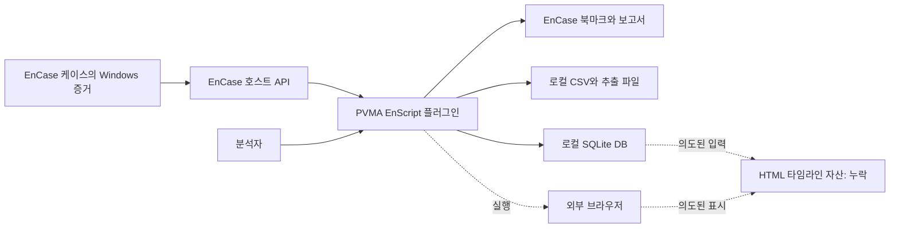
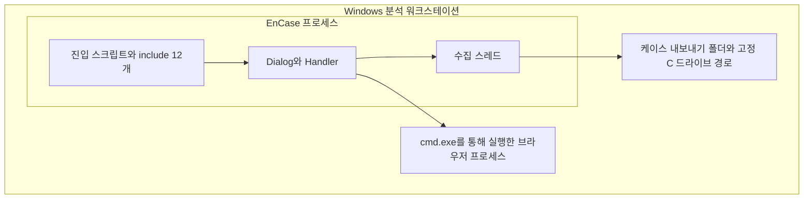

# 시스템 아키텍처

[English](ARCHITECTURE.md) | **한국어**

2026-10-13 보존된 소스를 기준으로 작성한 사후 문서입니다. 2017년 당시의 원본 산출물이 아닙니다.

## 시스템 경계

EnCase 프로세스가 플러그인을 호스팅합니다. 케이스 API로 증거를 읽고 분석자 로컬 파일시스템에 파생 보고서·DB를 씁니다. 브라우저 실행은 별도 프로세스 경계입니다. 네트워크 서비스, REST API, 인증 서버, DB 데몬은 소스에서 확인되지 않습니다.

## 논리 구성요소

| 구성요소 | 책임 | 코드 경계 |
| --- | --- | --- |
| 진입·조립 | Windows 볼륨 탐색, 공통 폴더와 모듈 Dialog 구성 | MainClass / MainDialogClass |
| 표현 | 탭, 컬럼, 메뉴, 검색 필터, 차트 | DialogClass / HandlerClass 파생 클래스 |
| 수집·파싱 | 케이스 순회, 레지스트리·바이너리·이벤트·브라우저 파싱 | ThreadClass 파생 클래스와 보조 메서드 |
| 결과 모델 | 표시 행과 필터용 사본 보관 | NameListClass 파생 클래스 |
| 저장 | 북마크·보고서·CSV·SQLite·로컬 추출 파일 | EnCase / LocalFileClass / SQLiteClass |
| 타임라인 통합 | 여러 아티팩트를 독립 재수집하고 집계 | TimeLineThreadClass |

파일 안의 책임 구분이며 별도 배포 계층이 아닙니다. 하나의 클래스에 파싱·UI 갱신·저장이 섞여 있습니다. 타임라인은 공통 아티팩트 서비스를 호출하지 않고 수집 로직을 중복 구현합니다.

## 배포 구조

include 해석과 호스트 라이선스·설정은 EnCase가 담당합니다. 설치 패키지, 의존성 잠금 파일, 재현 가능한 호스트 이미지는 없습니다. 분산 서비스가 아닌 로컬 플러그인 배포입니다.

## 소스에서 해석한 설계 선택

EnCase API는 별도 증거 리더 구현을 줄이고 북마크·보고서 통합을 제공합니다. 아티팩트별 파일은 기능 파악에 도움이 되지만 여러 책임을 함께 가집니다. SQLite는 파생 기록을 파일로 제공하지만 고정 경로와 스키마 변형이 반복 실행을 복잡하게 합니다. 고정 오프셋 파싱은 가정한 포맷에 단순하게 적용되지만 버전 지원을 제한합니다. 현재의 소스 해석이며 당시 아키텍처 의사결정 기록은 남아 있지 않습니다.

[상세 설계](SYSTEM_DESIGN.ko.md), [코드 구조](CODE_STRUCTURE.ko.md), [데이터 모델](DATA_MODEL.ko.md)을 참조하세요.
