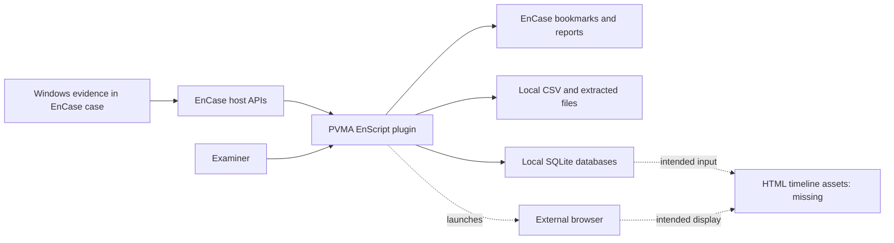
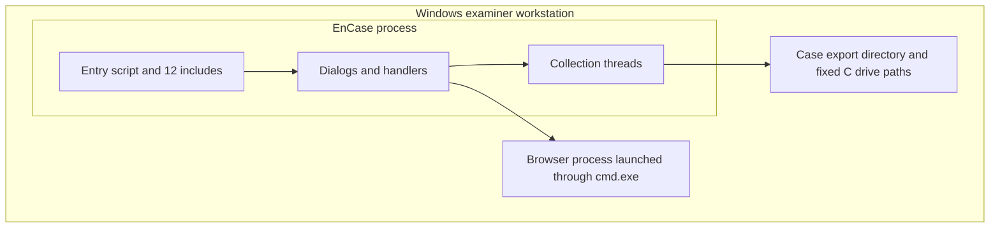

# System Architecture

**English** | [한국어](ARCHITECTURE.ko.md)

Prepared on 2026-10-13 from the archived source. This is retrospective documentation, not an original 2017 deliverable.

## Context and Boundaries

The EnCase process hosts the plugin. Evidence is accessed through case APIs; reports and bookmarks belong to the EnCase host, while extracted files and databases are written to the examiner's local filesystem. Browser launch is a separate process boundary. There is no observed network service, REST API, authentication server, or database daemon in the source.

## Logical Components

| Component | Responsibility | Boundary |
| --- | --- | --- |
| Entry/assembly | Locate Windows volume; construct shared folder and module dialogs | MainClass and MainDialogClass |
| Presentation | Tabbed controls, columns, menus, keyword filters, charts | DialogClass / HandlerClass derivatives |
| Collection/parsing | Iterate case items and parse registry/binary/event/browser records | ThreadClass derivatives and helper methods |
| Result model | Store display rows and copies for filtering | NameListClass derivatives |
| Persistence | Bookmarks, reports, CSV, SQLite and extracted local files | EnCase and LocalFileClass / SQLiteClass |
| Timeline integration | Independently rescan and aggregate several artifact families | TimeLineThreadClass |

These are responsibilities within source files, not separate deployable layers. Parsing, UI updates, and persistence are often mixed in one class. The timeline duplicates collection logic rather than calling a common artifact service.

## Deployment View

Source include resolution and host licensing/configuration belong to EnCase. No installation package, dependency lockfile, or reproducible host image is available. This is one local plugin deployment, not a distributed service.

## Tradeoffs Observed

EnCase APIs reduce the need for a separate evidence reader and provide bookmark/report integration. Per-artifact files keep functionality recognizable, but each combines several roles. SQLite gives portable derived records while hardcoded paths and multiple schema variants complicate repeat runs. Fixed binary offsets make parsing straightforward for the assumed formats but constrain version coverage. These are present-day interpretations of the source; no original architecture decision records survive.

See [detailed design](SYSTEM_DESIGN.md), [code structure](CODE_STRUCTURE.md), and [data model](DATA_MODEL.md).
