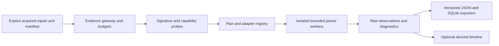

# 멀티 OS 아키텍처·데이터 계약

[English](CROSS_PLATFORM_ARCHITECTURE.md) | **한국어**

2026-10-27 · 향후 확장 설계. 구현·호환 인증 결과가 아닙니다. 현재 패키지 0.15.0 / 보고서 스키마 15는 변경하지 않습니다.

## 계층과 기존 코드 연결

이전 중에는 현재의 평면 Python 패키지를 유지합니다. 회귀 검증 후 공통 서비스를 추출하며 제안 모듈명은 현존 API가 아닙니다. 기존 디코더 의미와 아카이브 바이트를 보존합니다.

evidence.py의 보존·발행 계약, binary.py·registry_hive.py의 제한 읽기, browser.py의 SQLite 의미, model.py·exports.py의 보고서 구조를 재사용합니다. cli.py는 정적으로 등록한 내장 어댑터의 조정 계층으로 확장합니다. 기존 모듈부터 래핑하고 macOS/Linux는 인프라만 공유하며 Windows 해석을 재사용하지 않습니다. 외부 플러그인 자동 탐색이나 임의 import 경로는 추가하지 않습니다.

## 입력·어댑터 계약

입력 매니페스트 필드 제안: 매니페스트 버전, source ID, 획득 세트 ID, 명시적 로컬 파일 경로, 기대 크기·해시, 동반 파일 역할 연결, 출처를 포함한 선언 증거 OS/build, 획득 도구·시각, 선택적 원래 경로 바이트. 사용자 선언은 주장으로 구분합니다. 읽기 전 파일 수·크기를 검사하며 파일명은 힌트만 제공합니다. 나열된 소스만 읽고 증거 내부 경로를 열지 않습니다. 획득 세트도 사용자의 명시적 연결이며 동일 사용자·장치를 입증하지 않습니다.

어댑터 descriptor는 ID/버전, 시그니처, 리비전 조건, 필수 동반 파일 역할, 출력 종류, 의존성과 자원 한도를 선언합니다. probe는 일치·불일치·모호·미지원과 근거를 반환합니다. 모호하면 명시적 선택이 필요하지만 선택으로 검사를 우회하지 못합니다. parse는 읽기 전용 소스 핸들·공유 예산·취소 문맥을 받아 관측과 진단을 생성합니다. probe/parse에는 네트워크·셸·증거 쓰기 기능을 제공하지 않습니다.

지원 기능 조회·매니페스트 검증·실행 전 계획·계획 분석 명령을 제안합니다. 기존 CLI 플래그는 유지합니다. 이 문서로 새 명령이 구현되지는 않습니다.

## 차기 보고서 모델·스키마 이전

스키마 16은 제안 번호로만 예약하며 현재 스키마 15 상수는 변경하지 않습니다. 구현 전 null·바이트·정수 의미가 같은 JSON schema와 SQLite DDL을 확정합니다. 기존 계열 배열·테이블과 의미를 유지하고 macOS/Linux 관측 및 소스 메타데이터를 별도로 추가합니다. Windows 행으로 강제 변환하지 않습니다. 향후 출력 스키마 선택은 15/16을 명시하며 신규 전용 자료가 있을 때 15로 조용히 누락하지 않고 거부합니다.

관측 필드 제안: ID, source ID, adapter ID/버전, 아티팩트 종류, 원시 필드명·값·타입·인코딩, 논리 레코드 위치, 가능한 경우 물리 바이트 범위 매핑, 파싱 상태, 진단 참조. 중복 필드는 dictionary 대신 발생 순번을 가진 자식 행으로 보존합니다. JSON의 임의 바이트는 base64 표식을 사용하고 SQLite는 BLOB을 사용합니다. 큰 원시 카운터·시각은 필요시 십진 문자열로 저장해 JSON/SQLite 손실을 방지합니다. 소스 해시·위치·발생 순번으로 레코드를 식별하며 반복 입력의 source ID는 별개로 유지합니다.

시각은 원시 값·epoch·단위·정밀도·clock domain·시간대 출처를 보존하며 UTC 변환은 null일 수 있습니다. FILETIME 100 ns tick을 정확히 유지합니다. journal 단조 시각은 boot 식별 없이는 전역 정렬하지 않습니다. 연도 없는 syslog 시각은 명시적·감사 가능한 추론 요청 없이는 연도를 부여하지 않습니다. 분석 PC 시간대를 적용하지 않습니다. 타임라인은 원시 관측을 참조하는 파생 결과이며 인과관계 증거가 아닙니다.

## 경로·플랫폼 의미

분석에 사용하는 소스 파일 위치와 아티팩트가 저장한 경로를 분리합니다. 잘못된 UTF-8을 포함한 POSIX 경로 바이트, Windows UTF-16·UNC·device 경로, 정규화에 민감한 macOS 이름을 보존합니다. 표시 문자열을 정규 식별자로 취급하지 않습니다. 대소문자·Unicode 정규화, 환경변수 확장, 바로가기 해석, 드라이브 문자 추정, 소유권 자동 결합을 수행하지 않습니다.

명시적으로 허용된 파일 밖을 탐색하지 않습니다. 향후 디렉터리 매니페스트 도우미는 symlink/reparse point·경로 이탈·순환을 검사하고 깊이·개수를 제한하며 읽기 불가·클라우드 placeholder는 내려받지 않고 진단합니다. 파일시스템 메타데이터는 임시 복사본이나 분석 PC가 아닌 획득 소스에 귀속합니다. 논리 파일만 제공되면 이미지 오프셋은 미상으로 둡니다.

## 파서 경계·결과 발행

기존 포맷별 더 엄격한 제한을 유지합니다. 신규 어댑터 초기 한도 제안: 파일당 256 MiB, 실행당 허용 입력 2 GiB, 레코드 100,000개, 문자열·필드당 1 MiB, 중첩 64단계, 디코딩 출력 합계 256 MiB, worker당 60초. 이는 설정 가능한 시작 예산이며 측정된 처리 용량이나 기존 SQLite/EVTX 한도의 대체가 아닙니다. 대형 자료는 명시 설정·용량 테스트가 필요합니다. 할당 전 검사하고 진단·원시 바이트 출력도 예산에 포함합니다.

위험 디코더는 감독 subprocess에서 wall timeout·취소·자식 프로세스 정리를 적용합니다. 이식 가능한 예산 카운터와 호스트별 메모리 제어를 병행하며 subprocess만으로 sandbox를 주장하지 않습니다. XML 외부 entity·DTD와 plist 객체 역직렬화를 금지합니다. 자료 문자열이나 launch 서비스를 실행하지 않습니다. 향후 외부 변환을 승인하면 고정한 허용 실행 파일과 리터럴 인수를 별도 staging에서 사용하며 도구·버전·옵션·입출력 해시·변환 오프셋을 기록합니다.

안정 snapshot 검사, SQLite DB/WAL 동반 파일 검증, 자동 journal replay 금지를 유지합니다. 완전한 보고서를 staging한 뒤 기존 파일·sidecar를 대체하지 않고 독점 발행합니다. timeout·손상·예산 초과 시 최종 부분 보고서를 발행하지 않습니다. 향후 부분 모드는 별도 명시 계약이 필요합니다. 기존 종료 코드 0 성공, strict 경고 1 및 완전 출력, 치명 오류 2 및 발행 없음 계약을 유지합니다. POSIX hard link를 가정하지 않고 호스트·파일시스템별 발행 의미를 검증합니다.
