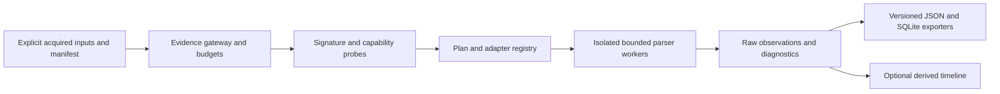

# Cross-platform architecture and data contracts

**English** | [한국어](CROSS_PLATFORM_ARCHITECTURE.ko.md)

2026-10-27 · Proposed extension design, not an implementation or compatibility certification. Current package 0.15.0 / report schema 15 remains unchanged.

## Layers and existing code

Keep the current flat Python package during migration. Extract shared services only after regression coverage; proposed module names are not existing APIs. Preserve existing decoder semantics and all archive bytes.

Reuse evidence.py for preservation/publication contracts, binary.py and registry_hive.py for bounded reads, browser.py for SQLite semantics, and model.py/exports.py for reports. cli.py becomes orchestration over a static built-in adapter registry. Existing artifact modules remain wrapped adapters first. Later macOS/Linux adapters share infrastructure, not Windows-specific interpretation. Do not add automatic third-party plugin discovery or arbitrary import paths.

## Input and adapter contracts

Proposed manifest fields: manifest version, source ID, acquisition-set ID, explicit local file path, expected size/hash, companion-role links, declared evidence OS/build with provenance, acquisition tool/time, and optional source-path bytes. User declarations remain claims. Validate file count/size before reads; filenames are hints. Read only enumerated sources, never paths embedded in evidence. Acquisition-set membership is explicit and does not prove a common user or device.

An adapter descriptor declares ID/version, signatures, revision predicates, required companion roles, output record kinds, dependencies and budgets. Probe returns match, no-match, ambiguous or unsupported plus reasons; ambiguous matches require explicit selection, and selection cannot bypass validation. Parse accepts a read-only source handle, shared budget and cancellation context, and emits observations plus diagnostics. Neither probe nor parse receives network, shell or evidence write capabilities.

Proposed commands are separate from current CLI behavior: inspect capabilities, validate a manifest, display a dry-run plan and analyze that plan. Keep all current flags working. No new command is implemented by this documentation.

## Future report model and schema migration

Reserve schema 16 as a proposal only; do not change the current schema 15 constant. Before implementation, freeze a JSON schema and SQLite DDL with identical null/bytes/integer semantics. Keep existing family arrays/tables and meanings; add source metadata and separate macOS/Linux observations, never coerce them into Windows rows. A future export-schema option must explicitly select 15 or 16. Reject schema 15 export containing new-only records rather than silently dropping them.

Proposed observation fields: ID, source ID, adapter ID/version, artifact kind, raw field name/value/type/encoding, logical record locator, physical byte-range mappings where available, parse status and diagnostic references. Repeated fields use ordered child rows with occurrence indices, not a dictionary. JSON represents arbitrary bytes as labeled base64; SQLite uses BLOB. Wide raw counters/timestamps use decimal text where needed for lossless JSON and SQLite parity. Source digest plus locator and occurrence identifies records; repeated inputs retain distinct source IDs.

Timestamps retain raw value, epoch, unit, precision, clock domain and timezone provenance; normalized UTC is nullable. Keep FILETIME 100 ns ticks exact. Monotonic journal times require boot identity and cannot be globally ordered alone. Yearless syslog dates remain yearless unless an explicit, auditable inference is requested. No examiner-local timezone assignment. Timeline rows are derived references, never replacement observations or proof of causation.

## Paths and platform semantics

Separate source filesystem location from an artifact's stored path. Preserve raw POSIX path bytes (including invalid UTF-8), Windows UTF-16/UNC/device paths and macOS normalization-sensitive names. A display string is not a canonical identity. Do not case-fold, Unicode-normalize, expand environment variables, resolve shortcuts, infer drive letters or join ownership automatically.

No traversal outside explicitly admitted input files. A later directory-manifest helper must detect symlinks/reparse points, reject escape/cycles, impose depth/count limits and report unreadable/cloud-placeholder entries without fetching them. Filesystem metadata belongs to the acquisition source, not the temporary copy or analyst host. Image offsets must remain unknown when only logical files are provided.

## Parser boundaries and publication

Retain existing stricter format-specific limits. Proposed initial ceilings for new adapters: 256 MiB per file, 2 GiB admitted input per run, 100,000 records, 1 MiB per string/field, 64 nesting levels, 256 MiB aggregate decoded output and 60 seconds per worker. These are configurable starting budgets, not measured capacity or a replacement for current SQLite/EVTX limits. Larger cases require explicit settings and capacity tests. Check before allocation; count diagnostic/raw-byte output too.

Each risky decoder runs in a supervised subprocess with wall timeout, cancellation and process-tree cleanup. Portable budget counters complement host-specific memory controls; subprocess isolation alone is not a sandbox. Disable XML external entities/DTD and plist object deserialization. Never invoke strings or launch services from parsed data. External conversion, if approved later, uses a pinned allowlisted executable with literal arguments in a separate staging area; provenance records tool/version/options/input/output hashes and transformed offsets.

Keep stable snapshot validation, SQLite DB/WAL pairing and no automatic journal replay. Stage complete reports; publish exclusively without replacing existing files or sidecars. On timeout/corruption/budget exhaustion fail without final partial reports; any future partial mode needs a new explicit contract. Preserve existing exit codes: 0 success, strict warnings 1 after complete output, fatal 2 without publication. Test publication semantics on each host/filesystem rather than assuming POSIX hard links work everywhere.
