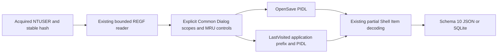

# 공통 파일 대화상자 PIDL MRU Python CLI

[English](DIALOG_MRU_CLI.md) | **한국어**

현재 패키지는 0.12.0이며 모든 출력은 스키마 12입니다. 아래 도입/결과는 당시 기록이며 현재 스키마는 [RunMRU](RUN_MRU_CLI.ko.md)를 참고하세요.

2026-10-16에 2c6a4203770834c6e197e86b9a1888ea5c4c5d68 기반 codex/python-dialog-mru에서 구현하고 자체 리뷰했습니다. 패키지 0.10.0/보고서 스키마 10은 OpenSavePidlMRU와 LastVisitedPidlMRU를 추가합니다. EnScript 13개, 아카이브 참조/매니페스트와 재구성된 2017년 커밋 263개를 보존합니다. 원본 RecentDocuments 모듈에는 전용 공통 대화상자 MRU 파서가 없어 독립 REGF/부분 Shell Item 판독기를 재사용하는 확장입니다.

## 실행과 획득 입력

--dialog-mru를 반복하여 명시적으로 획득한 안정된 NTUSER.DAT REGF 파일을 전달하며 이름을 변경해도 됩니다. 요구 환경은 Python 3.10+이며 macOS/Python 3.14에서 검증했습니다. 새 런타임 의존성은 없으며 EVTX 선택 의존성은 유지합니다. --dialog-mru-codepage는 PIDL 안의 ANSI 문자열에 기본 cp1252를 사용하며 적절한 획득 환경에서는 cp949 같은 ANSI 호환 인코딩을 선택합니다. 애플리케이션 접두사와 Unicode Shell Item은 UTF-16LE이며 LNK/ShellBags 코드페이지 플래그와 별도입니다.

```sh
python3 -m plaintrace --dialog-mru /path/to/NTUSER.DAT --output dialogs.json
python3 -m plaintrace --dialog-mru /case-a/NTUSER.DAT --dialog-mru /case-b/NTUSER.DAT --format sqlite --output dialogs.sqlite
python3 -m plaintrace --dialog-mru /path/to/NTUSER.DAT --dialog-mru-codepage cp949 --strict
python3 -m venv .venv
.venv/bin/python -m pip install .
.venv/bin/plaintrace --dialog-mru /path/to/acquired.bin
```

```powershell
py -m venv .venv
.venv\Scripts\python.exe -m pip install .
.venv\Scripts\plaintrace.exe --dialog-mru C:\acquired\NTUSER.DAT --output dialogs.json
```

JSON 기본 출력은 stdout, SQLite는 --output이 필요합니다. 엄격 모드는 전체 보고서를 쓰고 경고가 있으면 1을 반환하며, 치명적 오류는 부분 파일을 게시하지 않고 2를 반환합니다. 기존 출력/입력/SQLite 사이드카 보호를 유지합니다. 입력을 제한하고 수정 없이 읽기 전/중/후 해시를 비교합니다. 실시간 레지스트리, 프로필 탐색, 경로/문서 조회, 네트워크 접근, 실행 파일 시작이나 로그 재생은 없습니다. 해시 안정성만으로 원자적 획득이나 진본성을 증명하지 않습니다.

대화상자 MRU 출처는 ShellBags를 포함한 기존 모든 그룹 뒤에 오며 그룹 내 전달 순서를 유지합니다. 반복 하이브는 별도 출처 ID입니다. 같은 하이브를 여러 어댑터에 전달해도 별도 관찰이며 자동 조인, 사용자 귀속이나 PIDL 상관분석을 하지 않습니다.

## 레지스트리 범위와 MRU 순서

두 지원 키는 전달된 하이브의 Software\Microsoft\Windows\CurrentVersion\Explorer\ComDlg32 아래에 있습니다.

| List | Scope and numeric value data |
| --- | --- |
| OpenSavePidlMRU | Root and all direct extension/wildcard children: REG_BINARY Shell Item list |
| LastVisitedPidlMRU | Root only: REG_BINARY UTF-16LE application label plus aligned NUL, then Shell Item list |

OpenSave category는 와일드카드 *와 Unicode 확장자 표지를 포함한 직접 자식 이름 그대로입니다. 루트 category는 null이며 parent_key_id가 확장자 키를 루트에 연결합니다. 루트 숫자 값도 존재하면 보존합니다. 숫자/제어 값이 없는 OpenSave 루트는 누락 목록이 아닌 컨테이너로서 mru_status container이며 순서를 만들어내거나 제어 값 부재를 경고하지 않습니다. LastVisited 루트 category와 부모는 null입니다. 더 깊은 OpenSave 자식과 모든 LastVisited 하위 키는 탐색하지 않고 진단합니다. 지원 분기 부재는 명시적으로 진단하고 기존 빈 범위는 키 레코드로 유지합니다. OpenSaveMRU, LastVisitedMRU, LastVisitedPidlMRULegacy, CIDSizeMRU, WOW 전용 변형과 다른 대화상자 캐시는 범위 밖입니다.

정규 숫자 값 이름은 선행 0 없는 10진 0..4294967294입니다. 다른 값은 원시 바이트/오프셋과 진단을 가진 other_values로 남습니다. MRUListEx는 마지막 단일 0xffffffff 종결자와 중간 종결자/중복 슬롯이 없는 REG_BINARY DWORD여야 합니다. 누락, 무효, 기존 MRUList나 동시 제어 값은 원시 제어를 유지하고 순위를 부여하지 않습니다. 유효 순서가 없는 값을 참조하면 순서/순위 간격과 경고를 보존하며, 미등재 값도 null 순위와 경고로 남습니다. 유효 빈 순서는 제어 부재와 다릅니다. mru_status는 container, missing, invalid, ambiguous, valid이며 순위 정렬 대신 열거 순서를 유지합니다.

순위 0은 해당 키의 유효 MRU 순서에서 첫 저장 참조를 뜻하며 시각이나 확장자/앱 간 전역 순서가 아닙니다. 와일드카드/범위 중복은 별도 보존합니다. 저장된 확장자 표지는 참조 객체의 파일 형식 검증이 아니며 실제 열기·저장 성공이나 완료하지 않은 대화상자 상호작용을 구별할 수 없습니다.

## 애플리케이션 접두사와 PIDL 경계

숫자 REG_BINARY 값만 해석합니다. OpenSave PIDL은 바이트 0에서 시작합니다. LastVisited는 처음 나타나는 2바이트 정렬 UTF-16LE NUL로 애플리케이션 표지를 구분하며 pidl_offset은 그 바로 다음 바이트입니다. 애플리케이션 이름은 .exe 접미사를 요구하거나 경로를 해석하거나 검증된 실행 파일 정체성을 주장하지 않고 원문 보존합니다. application_utf16_hex는 종결자를 제외하고 전체 값에는 종결자가 남습니다. application_name_valid는 비어 있지 않은 엄격 UTF-16만 뜻하며 Windows 파일 이름 검증이나 실행 증거가 아닙니다. 잘못된 Unicode는 진단과 함께 이스케이프하고 유효성을 false로 두되 독립적으로 경계가 정해진 PIDL은 해석할 수 있습니다. 빈 표지도 빈 값/false로 남습니다. 정렬 종결자가 없으면 PIDL 시작을 추정하거나 시그니처로 검색하지 않습니다.

PIDL 판독기는 선언 항목 크기를 따르며 경로 조합에는 마지막 0 항목을 요구합니다. 종결자가 선택적인 ShellBags 값 형식과 구분합니다. 미종결 PIDL은 프레임 구성 요소를 보존하되 경로 후보를 만들지 않습니다. 종결자 뒤 바이트는 경고와 함께 item_trailing_hex로 남고 조합도 막습니다. 빈/손상 목록은 원시 바이트, 독립 경계가 있는 애플리케이션 접두사와 명시적 상태를 유지합니다. 프레임 오류는 부분 오프셋을 추정하지 않고 해당 값의 해석 항목을 버립니다. 자원 제한은 손상 관찰로 낮추지 않고 치명적 오류로 처리합니다.

pidl_status는 parsed(미지원 클래스를 포함한 프레임 항목), empty, malformed, wrong_type, invalid_prefix, unterminated, trailing입니다. 조건이 겹치면 종결자 부재가 빈 상태보다 우선하며 후행 바이트가 parsed/empty보다 우선합니다. 알 수 없는 Shell Item은 불투명하게 남고 이름 구성 요소를 조용히 만들어내지 않습니다. 디코더 진단은 dialog_mru 코드와 숫자 값 레코드 ID로 어댑터 범위를 표시합니다. 가장 긴 출력 가능 문자열 선택, 시그니처 카빙, 오프셋 복구나 OpenSave-LastVisited 자동 연결은 없습니다.

## 부분 항목, 경로와 시각 의미

기존 [Shell Item 계약](SHELLBAGS_CLI.ko.md)은 일부 루트 GUID, 이름 있는 볼륨, 표준 파일/폴더, 네트워크 항목과 BEEF0004 버전 3/7/8/9를 지원합니다. 다른 클래스/변형/확장은 원시 바이트와 진단으로 남습니다. items는 기본/긴 이름, 원시 메타데이터/FAT 필드, 확장과 항목별 오프셋을 보존하며 parsed는 완전한 디코딩을 뜻하지 않습니다. 기존 ShellBags, LNK, Jump List 필드 의미는 유지합니다.

path_candidate는 원문 기호/상대/파일시스템 후보이며 파일시스템 조회가 아닙니다. path_basis는 relative_hierarchy, shell_namespace_hierarchy, stored_volume_hierarchy, stored_unc_hierarchy입니다. 점/점 두 개, 구분자/콜론/NUL 파일 이름과 장치 네임스페이스로 파일시스템 경로를 추정하지 않습니다. 명시적으로 저장된 드라이브/UNC 앵커는 앞의 미해결 구성 요소를 재설정할 수 있으며 네임스페이스 GUID는 현지화 폴더 매핑 없이 기호로 남습니다. ancestry_complete는 최근 명시적 앵커 이후 사용 가능한 구성 요소에만 적용하며 획득 완전성/존재를 입증하지 않습니다. 상대 후보를 절대 경로로 승격하지 않습니다.

OpenSave 참조와 LastVisited 애플리케이션 연계 폴더 참조는 실제 파일 접근, 저장, 실행, 사용자 소유권이나 세션을 증명하지 않습니다. OpenSave의 앱 표지를 추정하지 않으며 LastVisited는 연결된 OpenSave 파일 이름을 제공하지 않습니다. 키 마지막 쓰기는 dialog_mru_keys에만 정확한 10진 FILETIME과 별도 UTC 마이크로초 표시로 남고, 0은 null, 범위 초과는 진단합니다. 정수 연산으로 100 ns 단위를 절삭합니다. Shell Item FAT 필드는 시간대 부여 없이 raw_hex/display/time_basis stored_fat_no_timezone를 유지합니다. 순위 0을 포함해 키 시각을 항목에 복사하지 않으며 저장된 파일 시각은 대화상자 사건 시각이 아닙니다.

## 스키마 10, 출처와 구조

대화상자 입력이 없어도 모든 JSON format_version과 SQLite user_version은 10입니다. 버전 10은 dialog_mru_keys/dialog_mru_entries와 개수를 추가하고 기존 필드 의미는 유지합니다. 과거 보고서는 마이그레이션/재작성하지 않으며 소비자는 버전 10을 인식해야 합니다. 출처의 source_kind는 dialog_mru, schema_family는 registry_ntuser, sha256은 전체 파일 해시이며 browser/database/WAL 필드는 null입니다. 입력 이름은 형식, 정체성이나 소유권을 입증하지 않습니다.

| Collection/table | Fields |
| --- | --- |
| dialog_mru_keys | source_id, record_id, key_path, list_kind, category, parent_key_id, key_last_written, key_last_write_raw, mru_status, mru_order, control_values, other_values |
| dialog_mru_entries | source_id, record_id, key_id, key_path, list_kind, category, value_name, value_type, mru_rank, application_name, application_utf16_hex, application_name_valid, pidl_offset, pidl_hex, pidl_status, items, item_list_terminated, item_trailing_hex, path_candidate, path_basis, ancestry_complete, value_data_hex |

키/항목 record_id는 물리 nk/vk 셀 헤더 오프셋의 10진 텍스트이며 source_id 범위로 식별합니다. key_id는 항목을 범위에 연결합니다. SQLite는 출처 외래 키, 고유 부모 ID, 키 부모 연결과 복합 항목-키 연결을 적용합니다. 객체/배열은 JSON에서 그대로, SQLite에서 JSON 텍스트이며 불리언은 정수로 바인딩하고 삽입은 값을 바인딩합니다. 원시 제어/메타데이터 객체는 value_offset, name, type, data_hex를 포함합니다.

pidl_offset과 Shell Item 오프셋은 값 내 논리 위치이며 물리 REGF 데이터 셀 위치가 아닙니다. pidl_offset에 항목 offset을 더하면 value_data_hex 내 위치를 찾을 수 있습니다. 데이터가 다른 셀에 있을 수 있어 vk 오프셋을 단순 합산하면 안 됩니다. pidl_hex는 종결/후행을 포함한 전체 접미사이며 value_data_hex는 원본 모든 바이트를 보존합니다. OpenSave나 접두사 부재에서는 application_name_valid가 null이며 해석 불가 필드는 null입니다. 잘못된 접두사는 구분을 만들어내지 않고 pidl_offset/pidl_hex를 null로 둡니다.



[dialog_mru.py](../plaintrace/dialog_mru.py)는 [registry_hive.py](../plaintrace/registry_hive.py), [shell_items.py](../plaintrace/shell_items.py)와 [shellbags.py](../plaintrace/shellbags.py)의 조건부 경로 조합기를 사용하며 기존 디코더 동작은 바꾸지 않습니다. 출처 결합, CLI, 모델과 출력기가 연결합니다. 상속한 제한은 REGF 입력 64 MiB, 접근 값당 16344바이트, 접근 값/이름 16 MiB와 기본 할당 셀/인덱스 경계, PIDL당 Shell Item 64개와 항목당 확장 32개입니다. 추가 하이브당 제한은 키 1024개, 항목 10000개, 종결된 앱 접두사 UTF-16 코드 단위 4096개, 경로 후보 32768문자와 직렬화 어댑터 출력 64 MiB입니다. 직접 호출에도 적용하며 정상 대용량도 거부할 수 있습니다. 출력 검사는 할당 후 수행하고 통합 보고서는 메모리에 남으며 자체 시간 제한/메모리 샌드박스는 없습니다.

## 테스트와 남은 검증

[테스트와 자체 리뷰](DIALOG_MRU_TESTS.ko.md)는 신규 36개를 매핑합니다. EVTX extra 포함 314개 Python 테스트가 모두 통과했습니다. 독립 python-registry 1.3.1로 합성 키/값 이름/타입/원시 바이트와 셀 오프셋을 대조하고 저장소 밖 설치 콘솔을 실행했습니다. 전체 PIDL 의미나 실제 획득 하이브의 독립 인증은 아닙니다.

실제 Windows/앱 버전별 NTUSER 대화상자 MRU, Windows/Linux 실행, Python 3.10, 독립 실제 PIDL 대조, 대규모 자료와 획득 경합은 미검증입니다. Dirty 하이브/로그 재생, REGF 1.6/big data/volatile/link/삭제/slack 복구, 미지원 PIDL 변형/확장, 깊은 범위와 기존/다른 대화상자 키는 제외합니다. 기존 아티팩트 한계도 유지합니다. EnCase 컴파일/실행은 미검증이며 이식판 테스트는 호스트 API를 검증하지 않습니다.

## 참고 자료

[레지스트리 MRU 지식 기반](https://winreg-kb.readthedocs.io/en/latest/sources/explorer-keys/Most-recently-used.html), 경로 범위 확인용 [공통 대화상자 키 처리](https://github.com/mkorman90/regipy/blob/master/regipy/plugins/ntuser/comdlg32.py)와 [Shell Item 형식 연구](https://github.com/libyal/libfwsi/blob/main/documentation/Windows%20Shell%20Item%20format.asciidoc)를 참고했습니다. 다른 파서의 출력 가능 문자열 휴리스틱은 사용하지 않습니다. 의존성 소스는 복제하지 않았습니다. [아카이브 분석](ANALYSIS.ko.md)을 확인하세요.
