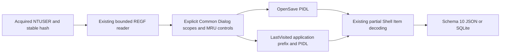

# Common Dialog PIDL MRU Python CLI

**English** | [한국어](DIALOG_MRU_CLI.ko.md)

The current package is 0.13.0 and every output uses schema 13. Earlier introductions/results below describe their release context; see [Explorer history](EXPLORER_HISTORY_CLI.md) for the current schema.

Implemented and self-reviewed on 2026-10-16 on codex/python-dialog-mru from 2c6a4203770834c6e197e86b9a1888ea5c4c5d68. Package 0.10.0/report schema 10 adds OpenSavePidlMRU and LastVisitedPidlMRU. All thirteen EnScript files, archive refs/manifests and 263 reconstructed 2017 commits are preserved. The original RecentDocuments module has no dedicated Common Dialog MRU parser; this extension reuses the independent REGF and partial Shell Item readers.

## Run and Acquired Input

Supply explicit acquired stable NTUSER.DAT REGF files with repeatable --dialog-mru; filenames can be changed. Python 3.10+ is declared; validation used macOS/Python 3.14. No new runtime dependency is introduced; EVTX retains its optional extra. --dialog-mru-codepage defaults to cp1252 for ANSI strings inside PIDLs; choose an ANSI-compatible acquisition encoding such as cp949 when appropriate. Application prefixes and Unicode Shell Items stay UTF-16LE; LNK/ShellBags codepage flags remain separate.

```sh
python3 -m plaintrace --dialog-mru /path/to/NTUSER.DAT --output dialogs.json
python3 -m plaintrace --dialog-mru /case-a/NTUSER.DAT --dialog-mru /case-b/NTUSER.DAT --format sqlite --output dialogs.sqlite
python3 -m plaintrace --dialog-mru /path/to/NTUSER.DAT --dialog-mru-codepage cp949 --strict
python3 -m venv .venv
.venv/bin/python -m pip install .
.venv/bin/plaintrace --dialog-mru /path/to/acquired.bin
```

```powershell
py -m venv .venv
.venv\Scripts\python.exe -m pip install .
.venv\Scripts\plaintrace.exe --dialog-mru C:\acquired\NTUSER.DAT --output dialogs.json
```

JSON defaults to stdout; SQLite requires --output. Strict mode writes the whole report and returns 1 for warnings; fatal errors return 2 without publishing a partial file. Existing output/input/SQLite-sidecar protections remain. Inputs are bounded and hashed before/read/after without modification. No live registry, profile scanning, path/document lookup, network access, executable launch or transaction-log replay occurs. Stable hashes alone do not prove atomic acquisition or authenticity.

Dialog MRU sources follow all earlier source groups, including ShellBags, and preserve supplied order within their group. Repeated hives have separate source IDs. Supplying one hive to multiple adapters creates separate observations without automatic joins, user attribution or PIDL correlation.

## Registry Scope and MRU Ordering

Both supported keys are beneath Software\Microsoft\Windows\CurrentVersion\Explorer\ComDlg32 in the supplied hive.

| List | Scope and numeric value data |
| --- | --- |
| OpenSavePidlMRU | Root and all direct extension/wildcard children: REG_BINARY Shell Item list |
| LastVisitedPidlMRU | Root only: REG_BINARY UTF-16LE application label plus aligned NUL, then Shell Item list |

OpenSave category is the literal direct child name, including wildcard * and Unicode extension labels. The root category is null and parent_key_id links extension keys to their root. Root numeric values are retained when present. An OpenSave root without numeric values/ordering controls is a container, not a missing list: mru_status container has no invented order or warning for the absent control. LastVisited root category and parent are null. Deeper OpenSave descendants and all LastVisited subkeys are diagnosed without traversal. Missing supported branches produce explicit diagnostics; existing empty scopes remain key records. OpenSaveMRU, LastVisitedMRU, LastVisitedPidlMRULegacy, CIDSizeMRU, WOW-specific variants and other dialog caches are outside this adapter.

Canonical numeric value names are decimal 0..4294967294, without leading zeros. Other values remain other_values with raw bytes/offsets and a diagnostic. MRUListEx must be REG_BINARY DWORDs ending in a single 0xffffffff sentinel with no earlier sentinel or duplicate slot. Missing, invalid, legacy MRUList or simultaneous controls retain raw controls with no ranks. Valid references to absent values keep order/rank gaps and warn; unlisted values remain with null rank and a warning. A valid empty order differs from a missing control. mru_status is container, missing, invalid, ambiguous or valid. Enumeration order is preserved rather than sorted by rank.

Rank 0 means the first stored reference in its key's valid MRU order. It is not a timestamp or a global order across extensions/applications. Wildcard/category duplicates remain separate. The stored extension label is not verification of the referenced object's file type, and the adapter cannot distinguish successful opening from saving or dialog interaction that did not complete.

## Application Prefix and PIDL Boundaries

Only numeric REG_BINARY values are interpreted. OpenSave PIDL begins at byte zero. LastVisited uses the first two-byte-aligned UTF-16LE NUL to delimit its application label; pidl_offset is the byte immediately after it. The application name is preserved literally, without requiring an .exe suffix, resolving paths or claiming verified executable identity. application_utf16_hex excludes the terminator; the full value retains it. application_name_valid means only nonempty strict UTF-16, not a validated Windows filename or execution evidence. Invalid Unicode is escaped with a diagnostic and false validity; an independently framed PIDL can still be decoded. Empty labels remain empty with false validity. Without an aligned terminator, no PIDL start is guessed or searched by signature.

The PIDL reader walks declared item sizes and requires a terminal zero item for path composition, unlike the optional terminator accepted by the ShellBags value format. Unterminated PIDLs retain framed components but no path candidate. Bytes after a terminal stay in item_trailing_hex with a warning and also suppress composition. Empty or malformed lists retain raw bytes, application prefix where independently framed, and explicit status. Framing errors discard interpreted items for that value rather than guessing partial offsets. Resource-limit failures remain fatal and are not downgraded to malformed observations.

pidl_status is parsed (framed items, including unsupported classes), empty, malformed, wrong_type, invalid_prefix, unterminated or trailing. When several conditions apply, missing terminal takes precedence over empty, and trailing bytes take precedence over parsed/empty. Unknown Shell Items stay opaque and cannot silently create name components. Decoder diagnostics are adapter-scoped with dialog_mru codes and the numeric value record ID. No longest-printable-string heuristic, signature carving, offset repair or automatic OpenSave-to-LastVisited association occurs.

## Partial Item, Path and Time Semantics

The unchanged [Shell Item contract](SHELLBAGS_CLI.md) supports selected root GUIDs, named volumes, standard file/directory items, network items and BEEF0004 versions 3/7/8/9. Other classes/variants/extensions remain raw with diagnostics. items retains primary/long names, raw metadata/FAT fields, extensions and per-item offsets; parsed status is not exhaustive decoding. Existing ShellBags, LNK and Jump List field meanings are unchanged.

path_candidate is a literal symbolic/relative/filesystem candidate, never a filesystem lookup. path_basis is relative_hierarchy, shell_namespace_hierarchy, stored_volume_hierarchy or stored_unc_hierarchy. Dot/dot-dot, separator/colon/NUL file-name components and device namespaces do not become guessed filesystem paths. Explicit stored drive/UNC anchors can reset unresolved earlier components; namespace GUIDs stay symbolic without localized folder mapping. ancestry_complete applies only to usable components since the latest explicit anchor and does not establish acquisition completeness or existence. Relative candidates are not promoted to absolute paths.

OpenSave references and LastVisited application-associated folder references do not prove actual file access, saving, execution, user ownership or sessions. No application label is inferred for OpenSave; LastVisited does not name an associated OpenSave file. Key last-write stays only in dialog_mru_keys, with exact decimal FILETIME and separate UTC microsecond display; zero is null and overflow is diagnosed. Display truncates 100 ns fractions with integer arithmetic. Shell Item FAT fields retain raw_hex/display/time_basis stored_fat_no_timezone without timezone assignment. No key time is copied onto entries, even rank 0; stored item file times are not dialog event times.

## Schema 10, Lineage and Architecture

Every JSON format_version and SQLite user_version is 10, even without dialog inputs. Version 10 adds dialog_mru_keys/dialog_mru_entries and their counts; earlier field meanings remain unchanged. Old reports are not migrated or rewritten; consumers must recognize version 10. Sources have source_kind dialog_mru, schema_family registry_ntuser, full-file sha256 and null browser/database/WAL fields. Input filenames do not establish format, identity or ownership.

| Collection/table | Fields |
| --- | --- |
| dialog_mru_keys | source_id, record_id, key_path, list_kind, category, parent_key_id, key_last_written, key_last_write_raw, mru_status, mru_order, control_values, other_values |
| dialog_mru_entries | source_id, record_id, key_id, key_path, list_kind, category, value_name, value_type, mru_rank, application_name, application_utf16_hex, application_name_valid, pidl_offset, pidl_hex, pidl_status, items, item_list_terminated, item_trailing_hex, path_candidate, path_basis, ancestry_complete, value_data_hex |

Key/entry record_id is the physical nk/vk cell-header offset in decimal text, scoped by source_id. key_id links entries to their scope. SQLite enforces source foreign keys, unique parent IDs, key-parent links and composite entry-to-key links. Objects/arrays are native JSON and JSON text in SQLite; booleans bind as integers; inserts bind values. Raw control/metadata objects contain value_offset, name, type and data_hex.

pidl_offset and Shell Item offsets are logical positions inside the value, not physical REGF data-cell offsets. Add pidl_offset to an item's offset to locate it within value_data_hex; vk offsets cannot simply be added because registry data can reside in another cell. pidl_hex preserves the entire suffix including terminal/trailing bytes, and value_data_hex preserves every original byte. application_name_valid is null for OpenSave or unavailable prefixes; unknown decoded fields are null. An invalid prefix has null pidl_offset/pidl_hex rather than fabricating a split.



[dialog_mru.py](../plaintrace/dialog_mru.py) uses [registry_hive.py](../plaintrace/registry_hive.py), [shell_items.py](../plaintrace/shell_items.py) and the qualified path composer in [shellbags.py](../plaintrace/shellbags.py); no existing decoder behavior is changed. Source assembly, CLI, model and exporters add integration. Inherited limits: 64 MiB REGF input, 16344 bytes per accessed value, 16 MiB accessed value/name bytes and native allocated-cell/index bounds; 64 Shell Items per PIDL and 32 extensions per item. This adapter adds 1024 keys, 10000 entries, 4096 UTF-16 code units per terminated application prefix, 32768 candidate-path characters and 64 MiB serialized adapter output per hive. Limits apply to direct calls and may reject valid large inputs. Output checks occur after allocation; combined reports stay in memory without a native timeout/memory sandbox.

## Tests and Remaining Validation

[Tests and self-review](DIALOG_MRU_TESTS.md) map 36 new cases. All 314 Python tests pass with the EVTX extra. Independent python-registry 1.3.1 comparison checks synthetic key/value names/types/raw bytes and cell offsets; installed console tests run outside checkout. This is not independent certification of full PIDL semantics or actual acquired hives.

Actual NTUSER dialog MRUs across Windows/application versions, Windows/Linux execution, Python 3.10, independent real-PIDL comparisons, large collections and acquisition races remain unvalidated. Dirty-hive/log replay, REGF 1.6/big data/volatile/link/deleted/slack recovery, unsupported PIDL variants/extensions, deeper scopes and legacy/other dialog keys remain excluded. Existing artifact limitations continue. EnCase compilation/execution remains unverified; portable tests do not validate its host APIs.

## References

Layout interpretation uses [the registry MRU knowledge base](https://winreg-kb.readthedocs.io/en/latest/sources/explorer-keys/Most-recently-used.html), [Common Dialog key handling](https://github.com/mkorman90/regipy/blob/master/regipy/plugins/ntuser/comdlg32.py) for key scope only, and [Shell Item format research](https://github.com/libyal/libfwsi/blob/main/documentation/Windows%20Shell%20Item%20format.asciidoc). Printable-string heuristics from other parsers are not used. No dependency source is vendored. See [archive analysis](ANALYSIS.md).
