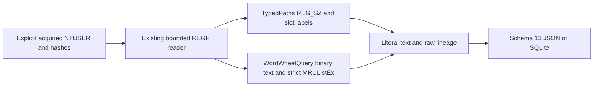

# 탐색기 TypedPaths·WordWheelQuery CLI

[English](EXPLORER_HISTORY_CLI.md) | **한국어**

현재 패키지는 0.14.0이며 모든 출력은 스키마 14입니다. 아래 도입/결과는 당시 기록이며 현재 스키마는 [시스템 정보](SYSTEM_INFO_CLI.ko.md)를 참고하세요.

2026-10-17에 e94cee173fffdcfdd9b960c29c0e9f81a1067236 기반 codex/python-explorer-history에서 구현하고 자체 리뷰했습니다. 패키지 0.13.0/보고서 스키마 13은 독립 탐색기 주소/검색 이력 어댑터를 추가합니다. 원본 EnScript 13개에는 전용 TypedPaths/WordWheelQuery 파서가 없으며 모두 bb476180453c76f7d38e5b6a9f1f025ad2273ce0과 바이트 단위로 같습니다. 아카이브 참조/매니페스트와 사후 재구성한 2017년 커밋 263개를 보존하고 실제 작업 날짜를 사용합니다.

## 실행과 안정된 획득 입력

반복 가능한 --typed-paths·--word-wheel-query에 명시적으로 획득한 안정된 NTUSER.DAT REGF 파일을 지정합니다. 파일 이름은 신원·형식·소유권을 입증하지 않습니다. Python 3.10+를 요구하며 여기서는 macOS/Python 3.14를 검증했습니다. 두 어댑터는 표준 라이브러리를 사용하고 EVTX의 선택 추가 의존성은 별개입니다.

```sh
python3 -m plaintrace --typed-paths /path/to/NTUSER.DAT --output paths.json
python3 -m plaintrace --word-wheel-query /path/to/NTUSER.DAT --strict
python3 -m plaintrace --typed-paths /case-a/NTUSER.DAT --typed-paths /case-b/NTUSER.DAT --word-wheel-query /case-a/NTUSER.DAT --format sqlite --output explorer.sqlite
python3 -m venv .venv
.venv/bin/python -m pip install .
.venv/bin/plaintrace --typed-paths /path/to/acquired.bin
```

```powershell
py -m venv .venv
.venv\Scripts\python.exe -m pip install .
.venv\Scripts\plaintrace.exe --word-wheel-query C:\acquired\NTUSER.DAT --output queries.json
```

JSON 기본 출력은 stdout이며 SQLite는 --output이 필요합니다. 성공은 0, --strict는 보고서를 쓰고 경고가 있으면 1, 치명적 입출력 오류는 부분 보고서 파일을 게시하지 않고 2입니다. 기존 목적지/입력/SQLite 사이드카 보호와 배타적 게시를 유지하며 셸 stdout 리다이렉션에는 해당 파일 보장이 적용되지 않습니다. 입력은 크기를 제한하고 읽기 전/읽은 데이터/읽기 후 해시를 비교하며 수정하지 않습니다. 해시 일치는 원자적 획득·진위·완전한 증거 관리 연속성을 입증하지 않습니다.

두 출처 그룹은 RunMRU 뒤에 추가됩니다. CLI는 플래그 교차 순서와 무관하게 TypedPaths 입력, WordWheelQuery 입력 순이며 각 그룹 내 지정 순서를 유지합니다. Python API는 explorer_hives 쌍 순서를 보존합니다. 반복 입력/어댑터마다 별도 출처 ID이며 자동 키/하이브/사용자 결합을 하지 않습니다. 실시간 레지스트리/프로필 검색·네트워크·대상 조회·실행·셸 평가·로그 재생·복구를 하지 않습니다.

## 범위·슬롯·순서

두 루트는 Software\Microsoft\Windows\CurrentVersion\Explorer 아래에 있습니다. 선택한 루트만 분석하고 다른 어댑터를 묵시적으로 실행하지 않습니다. 하위 키는 진단하고 순회하지 않습니다. 루트 누락은 경고와 빈 결과이며 존재하는 빈 루트는 키로 남깁니다. 빈 TypedPaths는 not_applicable이며 제어 누락 경고가 없고, MRUListEx가 없는 빈 WordWheelQuery는 missing과 경고입니다. 과거 활동 부재를 입증하는 상태가 아닙니다.

| 아티팩트 | 루트 / 지원 항목 형식 | 표준 슬롯 이름과 순서 |
| --- | --- | --- |
| typed_paths | TypedPaths / REG_SZ | 대소문자 무시 url과 십진수 슬롯; slot_number는 저장 레이블이며 mru_rank는 항상 null |
| word_wheel_query | WordWheelQuery / REG_BINARY | 십진수 슬롯; 유효한 MRUListEx만 0부터 시작하는 mru_rank 부여 |

지원 십진수 슬롯은 0..4294967294이며 0 자체 외에는 선행 0이 없습니다. 의도적으로 제한한 계약으로 url0도 포함하지만 Windows가 보통 생성한다는 주장은 아닙니다. 희소/큰 슬롯도 원래 이름과 숫자 레이블을 유지합니다. 미지원/기본/유니코드 숫자/음수/선행 0 이름은 진단과 other_values로 남깁니다. 형식이 잘못된 표준 슬롯도 원시 항목 관측으로 보존합니다.

WordWheelQuery MRUListEx는 REG_BINARY의 비어 있지 않은 정렬 DWORD 배열, 마지막 단일 0xffffffff 센티널, 앞선 센티널 없음, 중복 인덱스 없음이어야 합니다. 유효한 빈 순서는 누락과 다릅니다. MRUList만 있으면 미지원이며 두 제어는 모호함입니다. 잘못됨/누락/미지원/모호한 제어에 순위를 추측하지 않습니다. 없는 항목 참조는 경고와 순위 간격을 유지하고 목록 외 항목은 null 순위와 경고로 남깁니다. 순서와 텍스트 유효성이 독립이므로 잘못된 텍스트에도 순위가 남을 수 있습니다. mru_order는 부호 없는 정수를 보존하며 항목은 순위/슬롯 정렬 대신 열거 순서를 유지하고 같은 텍스트도 별도로 남깁니다.

TypedPaths는 여기서 MRU를 해석하지 않습니다. 슬롯 레이블을 순위나 최신성으로 변환하지 않습니다. 예상 밖 MRUList/MRUListEx도 원시 제어와 경고로 남기고 순서에 영향을 주지 않습니다. mru_status는 TypedPaths에서 not_applicable, WordWheelQuery에서 valid/missing/invalid/unsupported/ambiguous입니다. 다른 이력 키·TypedURLs·ACMru·Search 레지스트리 DB·WOW 변형·실시간 제안·레지스트리 내보내기 텍스트는 미지원입니다.

## 텍스트·출처·시각 의미

지원 항목의 첫 2바이트 정렬 UTF-16LE NUL이 문자열 경계입니다. stored_text는 그 앞의 유니코드·이모지·대소문자·공백·따옴표·환경 토큰·URL·검색 연산자·UNC 경로·접미부를 모두 보존합니다. 분리·트리밍·URL 해독·확장·정규화·파일 대상/검색식 해석을 하지 않습니다. TypedPaths 텍스트는 주소창 관측이며 반드시 파일 경로는 아니고, WordWheelQuery는 저장 검색 레이블 관측이며 검색 완료나 결과 발생의 증거가 아닙니다.

text_utf16_hex는 종결자를 제외하고 trailing_data_hex는 뒤의 0 패딩/홀수 꼬리까지 모든 바이트를 경고와 함께 보존합니다. value_data_hex는 원래 값 전체입니다. 정렬 NUL이 없으면 해독/경계 필드는 null이며 unterminated입니다. 잘못된 UTF-16은 바이트 역슬래시 이스케이프와 invalid_text이며 검증된 원래 문자열 표시는 아닙니다. 빈 텍스트는 경고와 빈 값으로 남기고 다른 레지스트리 형식은 강제 변환 없이 원시 보존합니다. ANSI 대체·오프셋 복구·출력 가능 문자열 카빙을 하지 않습니다.

항목 status는 wrong_type/unterminated/invalid_text/empty/trailing/parsed입니다. 잘못된 텍스트가 꼬리보다 우선하며 그렇지 않으면 빈 텍스트도 꼬리가 있으면 trailing입니다. parsed는 지원 경계/인코딩 해석일 뿐입니다. 이 기록은 대상 존재·접근·명령 실행·성공적 탐색/검색·전체 사용자 이력·소유권·SID·사용자 신원·활성 세션을 입증하지 않습니다. 아티팩트는 수정·노후·삭제·누락될 수 있고 부재나 현재 순서로 모든 과거 활동을 재구성하지 않습니다.

키 마지막 쓰기는 키에만 정확한 십진수 key_last_write_raw FILETIME과 별도 정수 기반 UTC 마이크로초 표시로 남깁니다. 0은 null이고 범위 초과는 경고와 null이며 남은 100 ns 자릿수도 원시 틱에 보존합니다. 키 시각을 항목이나 순위 0에 복사하거나 항목별 방문/검색/열기 시각을 추론하지 않습니다. 브라우저 키워드·RunMRU·UserAssist·RecentDocs·다른 증거와 자동 결합하지 않습니다.

## 스키마 13과 구조

해당 입력이 없어도 모든 JSON format_version/SQLite user_version은 13입니다. 버전 13은 explorer_history_keys/explorer_history_entries와 개수를 추가하며 기존 필드 의미는 유지하고 과거 보고서는 변환하지 않습니다. 소비자는 스키마 13을 인식해야 합니다. artifact와 source_kind는 typed_paths/word_wheel_query이며 출처 schema_family는 registry_ntuser, 전체 파일 sha256과 null 브라우저/DB/WAL 필드입니다.

| Collection/table | Fields |
| --- | --- |
| explorer_history_keys | source_id, record_id, key_path, artifact, key_last_written, key_last_write_raw, mru_status, mru_order, control_values, other_values |
| explorer_history_entries | source_id, record_id, key_id, key_path, artifact, value_name, value_type, slot_number, mru_rank, status, stored_text, text_utf16_hex, trailing_data_hex, value_data_hex |

키/항목 record_id는 source_id 범위 내 물리적 nk/vk 셀 헤더 오프셋의 십진수 텍스트입니다. key_id는 항목을 루트에 연결하며 SQLite는 출처/복합 항목-키 외래 키와 키 ID 고유성을 강제합니다. control_values/other_values 객체는 value_offset, name, type, data_hex를 포함합니다. 이름은 REGF 해독 텍스트이며 원시 이름 바이트가 아니고 전체 출처 바이트는 sha256으로 식별합니다. 객체/배열은 JSON과 SQLite JSON 텍스트이고 삽입은 매개변수를 바인딩합니다. 데이터가 별도 셀에 있을 수 있어 vk 오프셋을 논리 문자열 오프셋에 더해 데이터 위치를 추정할 수 없습니다. 이용 불가 해독 필드는 null입니다.



[explorer_history.py](../plaintrace/explorer_history.py)는 [registry_hive.py](../plaintrace/registry_hive.py)와 [binary.py](../plaintrace/binary.py)를 재사용하고 기존 디코더 의미는 유지합니다. [execution.py](../plaintrace/execution.py), [cli.py](../plaintrace/cli.py), [model.py](../plaintrace/model.py), [exports.py](../plaintrace/exports.py)는 출처/CLI/출력을 연결합니다. 어댑터 호출당 최대 키 1개이며 상속 제한은 입력 64 MiB, 스캔 셀 250000개, 네이티브 키/인덱스/값 항목 100000개, 접근한 키당 값 4096개, 값당 16344바이트, 접근한 값/이름 합계 16 MiB입니다. 추가 제한은 항목 4096개, 지원 형식 항목당 꼬리를 포함한 UTF-16 코드 단위 4096개와 종결자 하나 분량의 바이트, 직렬화 어댑터 출력 16 MiB입니다. 제어/메타데이터는 네이티브 값 제한을 적용합니다. 직접 호출에도 제한을 적용하며 유효한 입력도 거부할 수 있습니다. 출력 크기는 할당 후 검사하고 결합 보고서는 메모리에 유지하며 네이티브 시간/메모리 격리는 없습니다.

## 테스트와 남은 검증

[테스트와 자체 리뷰](EXPLORER_HISTORY_TESTS.ko.md)는 새 합성 사례 31개를 매핑합니다. EVTX 추가 의존성을 포함한 Python 테스트 407개가 생략 없이 통과했습니다. 독립 합성 REGF 비교와 설치 콘솔 검사는 실제 Windows 동작 인증이 아니며 아카이브 무결성 검사는 EnScript를 컴파일/실행하지 않습니다.

Windows 버전별 실제 획득 NTUSER TypedPaths/WordWheelQuery·Windows/Linux 실행·Python 3.10·독립 실제 레코드 해석·대형 입력 성능·획득 경쟁은 미검증입니다. 미지원 범위/형식/제어 구조·비표준 이름·모호하거나 잘못된 순서·네이티브 REGF 1.6/big data/휘발성/링크/삭제/슬랙 구조를 명시합니다. 더티 하이브 재생·복구·카빙·사용자 귀속·활동 성공 추론을 하지 않습니다. EnCase 컴파일/실행은 여전히 미검증이고 기존 아티팩트 제한도 유지합니다.

## 참고 자료

[libyal TypedPaths 자료](https://winreg-kb.readthedocs.io/en/latest/sources/explorer-keys/Typed-paths.html)는 범위와 REG_SZ 슬롯을 설명합니다. [regipy WordWheelQuery 어댑터](https://github.com/mkorman90/regipy/blob/master/regipy/plugins/ntuser/word_wheel_query.py)는 숫자 이진 UTF-16 항목과 MRUListEx 비교 대상입니다. 자료가 모든 버전 호환성을 보장하지 않으며 이 구현은 순서만 신뢰하지 않고 잘못된 값/목록 외 관측을 보존합니다. 구현 소스를 복사해 포함하지 않았습니다. [아카이브 분석](ANALYSIS.ko.md)을 참고하세요.
