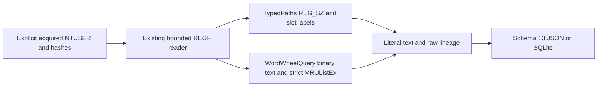

# Explorer TypedPaths and WordWheelQuery CLI

**English** | [한국어](EXPLORER_HISTORY_CLI.ko.md)

The current package is 0.14.0 and every output uses schema 14. Earlier introductions/results below describe their release context; see [system information](SYSTEM_INFO_CLI.md) for the current schema.

Implemented and self-reviewed on 2026-10-17 on codex/python-explorer-history from e94cee173fffdcfdd9b960c29c0e9f81a1067236. Package 0.13.0/report schema 13 adds independent Explorer address/search history adapters. No dedicated TypedPaths/WordWheelQuery parser occurs in the original thirteen EnScript files; all remain byte-identical to bb476180453c76f7d38e5b6a9f1f025ad2273ce0. Archive refs/manifests and 263 retrospectively reconstructed 2017 commits are preserved. This work uses its actual date.

## Run and Stable Acquired Inputs

Supply explicit acquired stable NTUSER.DAT REGF files with repeatable --typed-paths and --word-wheel-query. A filename does not establish identity, format or ownership. Python 3.10+ is declared; macOS/Python 3.14 was exercised. These adapters use the standard library; EVTX keeps its separate optional extra.

```sh
python3 -m plaintrace --typed-paths /path/to/NTUSER.DAT --output paths.json
python3 -m plaintrace --word-wheel-query /path/to/NTUSER.DAT --strict
python3 -m plaintrace --typed-paths /case-a/NTUSER.DAT --typed-paths /case-b/NTUSER.DAT --word-wheel-query /case-a/NTUSER.DAT --format sqlite --output explorer.sqlite
python3 -m venv .venv
.venv/bin/python -m pip install .
.venv/bin/plaintrace --typed-paths /path/to/acquired.bin
```

```powershell
py -m venv .venv
.venv\Scripts\python.exe -m pip install .
.venv\Scripts\plaintrace.exe --word-wheel-query C:\acquired\NTUSER.DAT --output queries.json
```

JSON defaults to stdout; SQLite requires --output. Success returns 0; --strict writes the report and returns 1 for warnings; fatal input/output errors return 2 without publishing partial report files. Existing destination/input/SQLite-sidecar protections and exclusive output publication remain. Shell stdout redirection does not receive those file guarantees. Inputs are size-bounded and hashed before/read/after without modification; matching hashes do not prove atomic acquisition, authenticity or complete chain of custody.

Both source groups follow RunMRU: CLI TypedPaths inputs first, then WordWheelQuery, each in supplied order regardless of flag interleaving. The Python API preserves explorer_hives pair order. Every repeated input/adapter has a distinct source ID; no automatic cross-key/hive/user joins occur. There is no live registry/profile scan, network access, target lookup, execution, shell evaluation, log replay or recovery.

## Scope, Slots and Ordering

Both roots are under Software\Microsoft\Windows\CurrentVersion\Explorer. Only the selected root is analyzed; the other adapter is not implicitly invoked. Descendants are diagnosed without traversal. Missing roots warn and produce no records; existing empty roots remain keys. Empty TypedPaths has not_applicable ordering without an absent-control warning; empty WordWheelQuery without MRUListEx has missing ordering and a warning. These states do not prove absence of past activity.

| Artifact | Root / supported entry type | Canonical slot name and order |
| --- | --- | --- |
| typed_paths | TypedPaths / REG_SZ | Case-insensitive url plus decimal slot; slot_number is a stored label, mru_rank always null |
| word_wheel_query | WordWheelQuery / REG_BINARY | Decimal slot; only a valid MRUListEx assigns zero-based mru_rank |

Supported decimal slots are 0..4294967294 without leading zeros except 0. This intentionally bounded contract includes url0 without claiming it is normally generated by Windows. Sparse/high slots retain their literal names and numeric labels. Unsupported/default/Unicode-digit/negative/leading-zero names remain other_values with diagnostics. Wrong-type canonical slots still become raw entry observations.

WordWheelQuery MRUListEx must be REG_BINARY, a nonempty aligned DWORD array ending in one 0xffffffff sentinel, without earlier sentinels or duplicate indices. Valid empty order differs from missing. MRUList alone is unsupported; both controls are ambiguous. Invalid/missing/unsupported/ambiguous controls never create guessed ranks. References to absent entries retain rank gaps with warnings; unlisted entries retain null rank and warnings. Rank can remain available for a malformed text value because order validity is independent. mru_order retains unsigned integers. Entries keep enumeration order, not sorted rank/slot order, and duplicate text stays separate.

TypedPaths has no MRU interpretation here: slot labels are not converted to ranks or recency. Unexpected MRUList/MRUListEx controls remain raw with warnings and no ordering effect. mru_status is not_applicable for TypedPaths and valid/missing/invalid/unsupported/ambiguous for WordWheelQuery. Other history keys, TypedURLs, ACMru, Search registry databases, WOW variants, live suggestions and registry-export text are unsupported by these adapters.

## Text, Provenance and Time Semantics

The first two-byte-aligned UTF-16LE NUL frames supported entry data. stored_text preserves all text before it, including Unicode, emoji, case, whitespace, quotes, environment tokens, URLs, search operators, UNC paths and suffixes. It is not split, trimmed, URL-decoded, expanded, normalized or interpreted as a filesystem target/search expression. TypedPaths text is an address-bar observation, not necessarily a filesystem path; WordWheelQuery text is a stored search-label observation, not proof a search completed or returned results.

text_utf16_hex excludes the terminator; trailing_data_hex retains every byte after it, including zero padding/odd tails, with a warning. value_data_hex retains every byte of the original value. No aligned NUL gives null decoded/framing fields and unterminated status; invalid UTF-16 displays byte backslash escapes with invalid_text status. Those escaped displays are not validated original strings. Empty text remains empty with a warning. Wrong registry types stay raw without coercion. No ANSI fallback, offset repair or printable-string carving occurs.

Entry status is wrong_type/unterminated/invalid_text/empty/trailing/parsed. Invalid text takes precedence over a trailing tail; otherwise a nonempty tail sets trailing even for empty text. parsed means supported framing/encoding only. These records do not prove target existence, access, command execution, successful navigation/search, exhaustive user history, ownership, SID, user identity or active sessions. Artifacts can be edited, stale, cleared or incomplete; neither absence nor current stored order reconstructs all prior activity.

Key last-write stays in keys only, with exact decimal key_last_write_raw FILETIME and a separate UTC microsecond display using integer arithmetic. Zero displays null; overflow warns and stays null, preserving raw ticks including the remaining 100 ns digit. No key time is copied onto entries or rank 0 and no per-entry visit/search/open time is inferred. There is no automatic correlation with browser keywords, RunMRU, UserAssist, RecentDocs or other evidence.

## Schema 13 and Architecture

Every JSON format_version/SQLite user_version is 13, even without these inputs. Version 13 adds explorer_history_keys/explorer_history_entries and counts while keeping earlier artifact field meanings. Old reports are not migrated. Consumers must recognize schema 13. artifact and source_kind are typed_paths/word_wheel_query; source schema_family is registry_ntuser with full-file sha256 and null browser/database/WAL fields.

| Collection/table | Fields |
| --- | --- |
| explorer_history_keys | source_id, record_id, key_path, artifact, key_last_written, key_last_write_raw, mru_status, mru_order, control_values, other_values |
| explorer_history_entries | source_id, record_id, key_id, key_path, artifact, value_name, value_type, slot_number, mru_rank, status, stored_text, text_utf16_hex, trailing_data_hex, value_data_hex |

Key/entry record_id is the physical nk/vk cell-header offset as decimal text scoped by source_id. key_id links each entry to its root; SQLite enforces source/composite entry-key foreign keys and unique key IDs. control_values/other_values objects contain value_offset, name, type and data_hex. Names are REGF-decoded text rather than raw name bytes; full source bytes remain identified by sha256. Objects/arrays are JSON and SQLite JSON text; inserts bind parameters. Value data may reside in a separate cell, so vk offsets cannot be added to logical text offsets to infer data locations. Unknown decoded fields are null.



[explorer_history.py](../plaintrace/explorer_history.py) reuses [registry_hive.py](../plaintrace/registry_hive.py) and [binary.py](../plaintrace/binary.py); existing decoder semantics remain unchanged. [execution.py](../plaintrace/execution.py), [cli.py](../plaintrace/cli.py), [model.py](../plaintrace/model.py) and [exports.py](../plaintrace/exports.py) add source/CLI/export integration. Each adapter invocation analyzes at most one key; inherited limits are 64 MiB input, 250000 scanned cells, 100000 native key/index/value items, 4096 values per accessed key, 16344 bytes per value and 16 MiB accessed value/name bytes. Additional caps are 4096 entries, 4096 UTF-16 code units plus one terminator worth of bytes per supported-type entry including any tail, and 16 MiB serialized adapter output. Controls/metadata use native value bounds. Limits apply to direct calls and may reject valid inputs. Output size is checked after allocation; combined reports remain in memory without native timeout/memory isolation.

## Tests and Remaining Validation

[Tests and self-review](EXPLORER_HISTORY_TESTS.md) map 31 new synthetic cases. All 407 Python tests pass without skips with the EVTX extra. Independent synthetic REGF comparison and installed-console checks are not real Windows behavior certification. Archive integrity checks do not compile or run EnScript.

Actual acquired NTUSER TypedPaths/WordWheelQuery across Windows versions, Windows/Linux execution, Python 3.10, independent real-record interpretation, large-input performance and acquisition races remain unvalidated. Unsupported scopes/types/control formats, noncanonical names, ambiguous/malformed order and native REGF 1.6/big-data/volatile/link/deleted/slack structures remain documented. No dirty-hive replay, repair, recovery, user attribution or activity-success inference. EnCase compilation/execution remains unverified; all earlier artifact limitations continue.

## References

The [libyal TypedPaths reference](https://winreg-kb.readthedocs.io/en/latest/sources/explorer-keys/Typed-paths.html) describes scope and REG_SZ slots. The [regipy WordWheelQuery adapter](https://github.com/mkorman90/regipy/blob/master/regipy/plugins/ntuser/word_wheel_query.py) provides a comparison for numeric binary UTF-16 entries and MRUListEx. These references are not universal compatibility guarantees; this implementation retains malformed/unlisted observations instead of trusting ordering alone. No implementation source is vendored. See [archive analysis](ANALYSIS.md).
