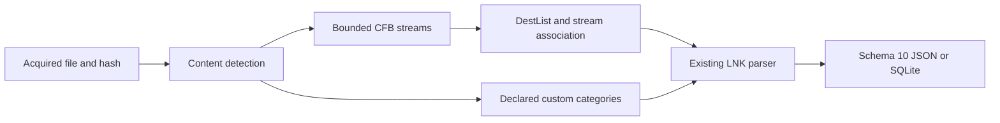

# Windows Jump Lists Python CLI

[English](JUMP_LISTS_CLI.md) | **한국어**

현재 패키지는 0.13.0이며 모든 출력은 스키마 13입니다. 아래 이전 버전 도입/테스트 결과는 당시 기록이며 현재 계약은 [탐색기 이력 확장](EXPLORER_HISTORY_CLI.ko.md)을 따릅니다.

2026-10-15에 285f7f5020213042372e4d791fd001626a04231e 기반 codex/python-jump-lists에서 구현했습니다. 패키지 0.8.0/보고서 스키마 8은 자동/사용자 지정 Jump Lists를 추가합니다. 원본 EnScript, 아카이브 참조/매니페스트와 재구성된 2017년 커밋 263개는 보존합니다. 원본 LNK/RecentDocuments 모듈에는 Jump Lists 전용 파서가 없어 독립 Python LNK 어댑터를 재사용하는 확장입니다.

## 실행과 획득 입력

요구 환경은 Python 3.10+이며 macOS/Python 3.14에서 검증했습니다. Jump Lists는 olefile이나 EnCase 없이 표준 라이브러리만 사용하며 EVTX 선택 의존성은 유지합니다. --jump-list를 반복하여 명시적으로 획득한 안정된 파일을 전달하며 내용으로 파서를 선택하므로 이름을 변경해도 됩니다. --lnk-codepage는 내장 ANSI LNK에도 적용하며 Unicode는 UTF-16LE입니다. JSON 기본 출력은 stdout, SQLite는 --output이 필요합니다. 엄격 모드는 전체 출력을 쓰고 경고가 있으면 1을 반환합니다. 치명적 오류는 부분 보고서를 게시하지 않고 2를 반환합니다. 기존 출력/입력/SQLite 사이드카 보호를 적용합니다.

```sh
python3 -m plaintrace --jump-list /path/to/file.automaticDestinations-ms --output jump.json
python3 -m plaintrace --jump-list /path/to/automatic.bin --jump-list /path/to/file.customDestinations-ms --format sqlite --output jump.sqlite
python3 -m plaintrace --jump-list /path/to/custom.bin --lnk-codepage cp949 --strict
python3 -m venv .venv
.venv/bin/python -m pip install .
.venv/bin/plaintrace --jump-list /path/to/acquired.bin
```

```powershell
py -m venv .venv
.venv\Scripts\python.exe -m pip install .
.venv\Scripts\plaintrace.exe --jump-list C:\acquired\file.automaticDestinations-ms --output jump.json
```

입력 크기를 제한하고 읽기 전/중/후 해시를 비교하며 수정하지 않습니다. 실시간 프로필 검색, 대상 실행, 경로 조회, 문서 열기나 네트워크 접근은 없습니다. Jump List 출처는 모든 기존 출처 그룹 뒤에 오며 그룹 내 전달 순서를 유지합니다. 내장 링크는 중첩 관찰로 남고 독립 links 컬렉션에 중복 추가하지 않으며 같은 파일을 두 번 전달하면 별도 출처 ID를 유지합니다. 자동 아티팩트 조인이나 사용자 귀속은 없습니다. 해시 안정성만으로 원자적 획득이나 진본성을 증명하지 않습니다.

## AutomaticDestinations

CFB 버전 3/512바이트와 버전 4/4096바이트 섹터를 지원하며 일반 스트림, 64바이트 미니 스트림, FAT, miniFAT와 확장 DIFAT를 포함합니다. 과도한 DIFAT 개수는 확장 전에 선언 FAT 용량과 비교해 거부합니다. 활성 루트의 평면 스트림을 탐색하고 범위, 선언 길이, 디렉터리 참조, 순환, 소유권 겹침과 중복 이름을 검사합니다. 중첩 저장소, 도달할 수 없는 활성 디렉터리, 잘못된 이름, 비정규 헤더와 잘리거나 과도한 체인은 거부합니다. 비활성 디렉터리, 빈 섹터와 slack은 카빙하지 않습니다. Jump List 전용 제한 판독기이며 완전한 CFB 검증이 아닙니다. 적흑 트리 순서/색상 의미와 비활성 할당 메타데이터는 인증하지 않습니다.

DestList 버전 1, 3, 4를 해석하며 버전 2와 향후 버전은 명시적으로 거부합니다. DestList가 비었거나 없으면 진단하고 활성 번호 LNK 스트림은 미연결 상태로 보존합니다. 헤더가 있으면 선언 항목/고정 개수를 제공합니다. 선언된 레코드만 해석하고 나머지 바이트는 경고와 함께 trailing_data_hex로 남습니다. 선언 레코드/경로/확장이 잘리면 치명적 오류입니다. 버전 3/4 확장 길이는 스트림 경계로 제한하며 바이트는 진단과 함께 불투명하게 남기고 속성 저장소는 해석하지 않습니다.

각 DestList 항목은 물리 시작, 논리 스트림 오프셋, 원시 레코드, UTF-16 경로 바이트, 원시 호스트 이름, droid GUID 4개, 정확한 FILETIME과 고정 상태를 보존합니다. 호스트 이름은 다른 인코딩을 추정하지 않고 ASCII로 디코딩하며 잘못된 텍스트는 이스케이프하고 진단합니다. 경로는 knownfolder 문자열, GUID 네임스페이스와 내부 NUL을 포함해 그대로 유지하며 드라이브 매핑이나 정규화는 하지 않습니다. metadata_hex는 미상/체크섬/개수 필드를 포함한 고정 메타데이터를 보존하지만 부동소수 개수를 해석하거나 체크섬을 검증하지 않습니다. FILETIME 0은 null 표시, 범위 초과는 경고이며 정수 연산으로 100 ns를 UTC 마이크로초로 절삭합니다.

항목 번호는 오프셋 88의 저장된 부호 없는 DWORD이며 인접 미상 바이트는 원시 보존합니다. 고유 번호를 정규 16진수 루트 스트림 이름에 대소문자 구분 없이 연결하며 이름은 선행 0 없이 최대 8자리입니다. 중복 항목 번호는 모호하며 LNK 연결을 추정하지 않습니다. 누락 스트림은 DestList 전용 행으로 남기고 나머지 번호 스트림은 별도 미연결 행으로 보존합니다. 비정규 스트림은 원시 바이트와 진단을 남깁니다. 크기 내 내장 LNK가 잘못되면 항목을 버리지 않고 바이트와 link_status invalid를 보존합니다. 컨테이너 구조 오류는 치명적 오류입니다.

pin_status는 부호 있는 값으로 -1은 미고정, 0 이상은 고정, 다른 음수는 경고와 함께 미상입니다. 선언/해석한 고정 개수 불일치는 진단합니다. entry_index는 저장된 레코드 순서이며 보편적 시간 순위가 아닙니다. DestList last_modified_at은 목록 항목 시각이며 문서 열람을 증명하지 않습니다. LNK 대상 파일 시각은 link 내부에 남고 DestList 시각을 대체하지 않습니다. Droid GUID로 MAC 주소, 사용자나 생성 사건을 추정하지 않습니다.

## CustomDestinations

12바이트 파일 헤더와 선언 범주를 가진 버전 2만 지원합니다. 타입 0(이름 있는 범주), 1(알려진 범주 식별자), 2(작업)를 인식하며 선언 경계마다 footer 0xbabffbab를 확인합니다. 범주 이름/원시 UTF-16과 식별자는 그대로 유지하며 알 수 없는 알려진 범주 ID도 보존합니다. 타입 0/2는 선언 항목 수를 가지며 타입 1은 항목을 직렬화하지 않습니다. 빈 컨테이너/범주는 유효한 요약입니다. 헤더 미상 필드는 원시 보존합니다.

지원 항목은 전체 Shell Link 또는 CLSID-plus-body COM 저장 객체입니다. 후자는 기존 LNK 파서에 전달할 때만 합성 4바이트 HeaderSize를 붙이며 raw_entry_hex는 원본을, link_representation은 두 형식을 구분합니다. 선언된 IDList, LinkInfo, StringData, ExtraData 길이를 따라 0 TerminalBlock까지 프레임을 정합니다. 내장 LNK/footer 시그니처로 분할하지 않습니다. 알 수 없는 객체 클래스, 범주 타입/버전, 누락 footer, 개수 불일치와 뒤따르는 봉투는 치명적 오류이며 시그니처 카빙/복구는 하지 않습니다. 프레임을 정할 수 있지만 내부 해석이 실패하는 링크는 invalid와 원시 바이트를 보존합니다. 사용자 지정 작업/범주는 애플리케이션 정의 메뉴 상태이며 실행, 고정이나 최근 사용 증거가 아니므로 DestList 시각/고정 상태를 만들어내지 않습니다.

## 스키마 10, 출처와 구조

이전 아티팩트만 입력해도 모든 JSON format_version과 SQLite user_version은 10입니다. 버전 8은 jump_lists/jump_list_entries와 두 개수를 추가합니다. 기존 필드 의미는 유지하고 과거 보고서를 마이그레이션/재작성하지 않으며 소비자는 버전 10을 명시적으로 지원해야 합니다. 출처의 source_kind는 jump_list, schema_family는 jump_automatic 또는 jump_custom, sha256은 전체 파일 해시이며 browser/database/WAL 필드는 null입니다. app_id_hint는 관례적 확장자와 일치할 때 파일 이름의 16자리 16진 접두사 원문일 뿐이며 검증된 앱 정체성이 아닙니다. 앱 조회 데이터베이스는 포함하지 않습니다.

| Collection/table | Fields |
| --- | --- |
| jump_lists | source_id, record_id, container_kind, version, app_id_hint, header_hex, container_header_hex, declared_entries, declared_pinned, streams, categories, trailing_data_hex |
| jump_list_entries | source_id, record_id, container_id, entry_index, stream_name, link_stream_name, stream_offset, file_offset, directory_id, category_index, entry_number, association, stored_path, path_utf16_hex, hostname, hostname_hex, droids, last_modified_at, last_modified_filetime_raw, pin_status, pinned, metadata_hex, extension_hex, raw_entry_hex, link_status, link_representation, link, lnk_hex |

요약 record_id는 container입니다. 항목은 source_id 범위의 dest:논리오프셋, stream:디렉터리ID 또는 custom:파일오프셋을 사용합니다. container_id는 출처 범위 부모를 참조하며 SQLite는 출처, 고유 부모 ID와 복합 부모 외래 키를 적용하고 값을 바인딩합니다. 객체/배열은 JSON에서 그대로, SQLite에서 JSON 텍스트이며 고정 불리언은 SQLite 정수로 저장합니다. 출력은 실행하지 않습니다.

DestList 행의 stream_name, directory_id, stream_offset, file_offset은 DestList 레코드를 식별하고 link_stream_name은 연결된 LNK를 별도로 식별합니다. 미연결 행은 자신의 LNK 스트림 논리 오프셋 0을 식별합니다. 스트림 목록 객체는 name, directory_id, size, mini, block_offsets, sha256, raw_hex(알 수 없는 스트림만)를 가집니다. 논리 블록은 미니 스트림이면 64바이트, 그 외 CFB 섹터 크기이며 block_offsets는 각 블록의 정확한 물리 시작을 매핑합니다. 행의 file_offset은 첫 바이트만 식별하며 단편화 체인 전체가 연속임을 뜻하지 않습니다. 중첩 LNK ExtraData 오프셋은 정규화 링크 기준입니다. 사용자 지정 행은 절대 오프셋과 category_index를 가지며 범주 객체는 category_index, file_offset, kind, name, name_utf16_hex, known_category, declared_entries를 포함합니다.

container_header_hex는 CFB 헤더 섹터 또는 12바이트 사용자 지정 헤더이며 header_hex는 DestList 또는 사용자 지정 헤더입니다. raw_entry_hex는 정확한 DestList/사용자 지정 항목 바이트이며 미연결 항목은 lnk_hex를 사용합니다. lnk_hex는 보통 스트림 원본이지만 CLSID-body 사용자 지정 링크는 위의 합성 HeaderSize를 포함합니다. link는 기존 LNK 필드 계약을 유지하되 항목 범위 ID와 진단을 사용합니다. association은 matched, missing, ambiguous, unassociated, custom이며 link_status는 absent, parsed, invalid입니다. 해석할 수 없는 필드는 null입니다. 원시 바이트/해시는 해석용 보존이며 대체 컨테이너 재구성이 아닙니다.



[compound.py](../plaintrace/compound.py)가 CFB 체인을 검증하고 [jump_lists.py](../plaintrace/jump_lists.py)는 컨테이너를 해석하며 [lnk.py](../plaintrace/lnk.py)를 사용합니다. 출처 결합, CLI, 모델과 출력기가 입력/스키마를 연결합니다. 입력당 제한은 파일 32 MiB, CFB 섹터 65536개, 디렉터리 슬롯 4096개, 스트림 1024개, 출력 항목 10000개, 사용자 지정 범주 1024개, 경로/이름 UTF-16 코드 단위 32768개, 내장 LNK당 1 MiB와 직렬화 어댑터 출력 64 MiB입니다. 기존 LNK 구간 검사도 유지합니다. 직접 호출에도 제한하며 정상 대용량 입력도 거부할 수 있습니다. 출력 검사는 할당 후 수행하며 통합 보고서는 메모리에 남고 자체 프로세스 시간 제한이나 메모리 샌드박스는 없습니다.

## 테스트와 남은 검증

[테스트와 리뷰](JUMP_LISTS_TESTS.ko.md)는 신규 36개 사례를 매핑하며 EVTX extra 포함 236개가 모두 통과합니다. 독립 olefile 0.47 검사로 활성 스트림 바이트를 대조했습니다. 원저자의 공개 Windows 7/10 AutomaticDestinations 샘플 두 개에서 DestList 1/3과 링크 4개/9개를 해석했습니다. 제한된 샘플 범위이며 사용자의 획득 증거 검증은 아닙니다.

사용자 획득 Jump Lists, 공개/실제 CustomDestinations, 다양한 Windows/앱 버전, Windows/Linux 실행, Python 3.10, 대규모 자료와 획득 경합은 미검증입니다. 미지원 CFB 구조, DestList 2/향후 버전, 확장/속성 저장소 해석, LNK 외 객체, 비정규 사용자 지정 개수/봉투, 삭제/slack 복구와 레지스트리 ProgramsCache는 제외합니다. 기존 LNK PIDL/속성 저장소 및 다른 아티팩트 한계도 유지합니다. EnCase 컴파일/실행은 미검증이며 이식판 테스트는 호스트 API를 검증하지 않습니다.

## 참고 자료

프레임/레이아웃은 [libyal Jump Lists 자료](https://github.com/libyal/dtformats/blob/main/documentation/Jump%20lists%20format.asciidoc), [Microsoft CFB 명세](https://learn.microsoft.com/en-us/openspecs/windows_protocols/ms-cfb/53989ce4-7b05-4f8d-829b-d08d6148375b), [원저자 DestList 구현](https://github.com/EricZimmerman/JumpList/blob/master/JumpList/Automatic/DestList.cs)과 [사용자 지정 저장 처리](https://github.com/fox-it/dissect.target/blob/main/dissect/target/plugins/os/windows/jumplist.py)를 참고했습니다. [기존 LNK 해석](EXECUTION_CLI.ko.md)과 [아카이브 분석](ANALYSIS.ko.md)을 확인하세요. 외부 파서 소스는 저장소에 복제하지 않았습니다.
