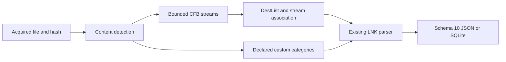

# Windows Jump Lists Python CLI

**English** | [한국어](JUMP_LISTS_CLI.ko.md)

The current package is 0.15.0 and every output uses schema 15. Earlier version introductions/test results below describe their release context; see [the SAM account extension](SAM_ACCOUNTS_CLI.md) for the current contract.

Implemented on 2026-10-15 on codex/python-jump-lists, based on 285f7f5020213042372e4d791fd001626a04231e. Package 0.8.0/report schema 8 adds automatic/custom Jump Lists. Original EnScript files, archive refs/manifests and 263 reconstructed 2017 commits remain preserved. The original LNK/RecentDocuments modules have no Jump Lists-specific parser; this extension reuses the independent Python LNK adapter.

## Run and Acquired Input

Python 3.10+ is declared; validation used macOS/Python 3.14. Jump Lists use only the standard library, without olefile or EnCase. EVTX retains its optional extra. Repeat --jump-list for explicit acquired stable files; filenames may be changed because content selects the parser. --lnk-codepage applies to embedded ANSI LNK strings too; Unicode remains UTF-16LE. JSON defaults to stdout; SQLite requires --output. Strict mode writes complete output and returns 1 for warnings. Fatal errors return 2 without publishing a partial report. Existing output/input/SQLite-sidecar protections apply.

```sh
python3 -m plaintrace --jump-list /path/to/file.automaticDestinations-ms --output jump.json
python3 -m plaintrace --jump-list /path/to/automatic.bin --jump-list /path/to/file.customDestinations-ms --format sqlite --output jump.sqlite
python3 -m plaintrace --jump-list /path/to/custom.bin --lnk-codepage cp949 --strict
python3 -m venv .venv
.venv/bin/python -m pip install .
.venv/bin/plaintrace --jump-list /path/to/acquired.bin
```

```powershell
py -m venv .venv
.venv\Scripts\python.exe -m pip install .
.venv\Scripts\plaintrace.exe --jump-list C:\acquired\file.automaticDestinations-ms --output jump.json
```

Inputs are bounded and hashed before/read/after without modification. No live-profile scan, target execution, path lookup, document opening or network access occurs. Jump List sources follow all previous source groups and keep supplied order within the group. Embedded links remain nested observations, not duplicated into the standalone links collection; supplying the same file twice retains separate source IDs. No automatic artifact joins or user attribution occur. Hash stability alone does not prove atomic acquisition or authenticity.

## AutomaticDestinations

CFB version 3/512-byte and version 4/4096-byte sectors are supported, including regular streams, 64-byte mini streams, FAT, miniFAT and extended DIFAT. Surplus DIFAT counts are rejected against declared FAT capacity before expansion. The reader traverses active flat root streams and checks ranges, declared lengths, directory references, cycles, overlapping ownership and duplicate names. Nested storages, unreachable active directory entries, malformed names, noncanonical headers and truncated/overlong chains are rejected. Inactive directory slots, free sectors and slack are not carved. This is a constrained Jump List container reader, not complete CFB validation: red-black ordering/color semantics and inactive allocation metadata are not certified.

DestList versions 1, 3 and 4 are interpreted; version 2 and future versions are explicitly rejected. Empty/missing DestList is diagnosed, while active numbered LNK streams are still retained as unassociated. A present header supplies declared entry and pinned counts. Only declared records are parsed; remaining bytes stay in trailing_data_hex with a warning. Truncated declared records/paths/extensions are fatal. Version 3/4 extension lengths are bounded by the stream and their bytes remain opaque with a diagnostic; property stores are not decoded.

Each DestList entry retains its physical start, logical stream offset, raw record, UTF-16 path bytes, raw hostname bytes, four droid GUIDs, exact FILETIME and pin state. Hostname is decoded as ASCII without guessing alternate encodings; malformed text is escaped and diagnosed. Paths remain literal, including knownfolder strings, GUID namespaces and embedded NULs. No drive mapping or normalization occurs. metadata_hex preserves fixed metadata, including unknown/checksum/count fields, without interpreting floating counts or validating checksums. Zero FILETIME has null display; overflow warns; integer conversion truncates 100 ns fractions to UTC microseconds.

Entry numbers use the stored unsigned DWORD at offset 88; adjacent unknown bytes remain raw. A unique number matches a canonical hexadecimal root-stream name case-insensitively; names have no leading zero and fit eight hex digits. Duplicate entry numbers are ambiguous and receive no guessed LNK association. Missing streams preserve DestList-only rows; remaining numbered streams become separate unassociated rows. Noncanonical streams retain raw bytes and a diagnostic. A bounded but invalid embedded LNK retains its bytes with link_status invalid rather than discarding the entry. Structural container errors remain fatal.

pin_status is signed; -1 means unpinned, nonnegative means pinned, other negatives are unknown with a warning. Declared/interpreted pinned-count mismatch is diagnosed. entry_index is stored record order, not a claimed universal time rank. DestList last_modified_at is a list-entry timestamp, not proof of document opening. LNK target file timestamps stay inside link and never replace DestList times. Droid GUIDs do not become inferred MAC addresses, users or creation events.

## CustomDestinations

Only version 2 with a 12-byte file header and declared categories is supported. Types 0 (named category), 1 (known-category identifier) and 2 (tasks) are recognized, with footer 0xbabffbab at each declared boundary. Category names/raw UTF-16 and identifiers remain literal; unknown known-category IDs are preserved. Types 0/2 contain declared entry counts; type 1 does not serialize entries. Empty containers/categories remain valid summaries. Header unknown fields remain raw.

Supported entries are full Shell Links or CLSID-plus-body COM persistence objects. The latter gets a synthetic four-byte HeaderSize only for the existing LNK parser; raw_entry_hex preserves original bytes and link_representation distinguishes the forms. Framing walks declared IDList, LinkInfo, StringData and ExtraData lengths through a zero TerminalBlock. It never splits on embedded LNK/footer signatures. Unknown shell object classes, category types/versions, missing footers, inconsistent counts and trailing envelopes are fatal; no signature carving or repair is attempted. A frameable link whose internal details fail parsing retains invalid status and raw bytes. Custom tasks/categories are application-defined menu state, not evidence of execution, pinning or recency; no DestList timestamps/pin states are invented.

## Schema 10, Lineage and Architecture

Every JSON format_version and SQLite user_version is 10, even for older artifact-only inputs. Version 8 adds jump_lists/jump_list_entries and both counts. Existing field meanings remain unchanged; earlier reports are never migrated or rewritten. Consumers must explicitly support version 10. Sources have source_kind jump_list, schema_family jump_automatic or jump_custom, full-file sha256 and null browser/database/WAL fields. app_id_hint is only the literal 16-hex filename prefix when the conventional extension matches; it is not verified application identity and no application lookup database is bundled.

| Collection/table | Fields |
| --- | --- |
| jump_lists | source_id, record_id, container_kind, version, app_id_hint, header_hex, container_header_hex, declared_entries, declared_pinned, streams, categories, trailing_data_hex |
| jump_list_entries | source_id, record_id, container_id, entry_index, stream_name, link_stream_name, stream_offset, file_offset, directory_id, category_index, entry_number, association, stored_path, path_utf16_hex, hostname, hostname_hex, droids, last_modified_at, last_modified_filetime_raw, pin_status, pinned, metadata_hex, extension_hex, raw_entry_hex, link_status, link_representation, link, lnk_hex |

The summary record_id is container. Entries use dest:logical-offset, stream:directory-id or custom:file-offset, scoped by source_id. container_id references the source-scoped parent; SQLite enforces source, unique parent IDs and composite parent foreign keys with bound inserts. Objects/arrays are native JSON and JSON text in SQLite; boolean pin values bind as SQLite integers. No output is executed.

For DestList rows, stream_name, directory_id, stream_offset and file_offset identify the DestList record. link_stream_name separately identifies the associated LNK. Unassociated rows identify their LNK stream at logical offset zero. stream inventory objects contain name, directory_id, size, mini, block_offsets, sha256 and raw_hex (only unknown streams). Logical blocks are 64 bytes for mini streams or the CFB sector width otherwise; block_offsets maps each block to its exact physical start. A row's file_offset identifies only the first byte, not a contiguous extent across fragmented chains. Nested LNK ExtraData offsets remain relative to the normalized link. Custom rows have absolute offsets and category_index; their category objects contain category_index, file_offset, kind, name, name_utf16_hex, known_category and declared_entries.

container_header_hex stores the CFB header sector or 12-byte custom header; header_hex stores the DestList header or custom header. raw_entry_hex contains exact DestList/custom entry bytes; unassociated entries use lnk_hex. lnk_hex normally preserves stream bytes, but CLSID-body custom links include the synthetic HeaderSize described above. link holds the unchanged LNK field contract, with entry-scoped IDs and diagnostics. Association values are matched, missing, ambiguous, unassociated or custom; link_status is absent, parsed or invalid. Unavailable decoded fields are null. Raw bytes/hashes are preserved for interpretation, not a reconstructed replacement container.



[compound.py](../plaintrace/compound.py) validates CFB chains; [jump_lists.py](../plaintrace/jump_lists.py) interprets containers and uses [lnk.py](../plaintrace/lnk.py). Source assembly, CLI, model and exporters add input and schema integration. Limits per input: 32 MiB file, 65536 CFB sectors, 4096 directory slots, 1024 streams, 10000 output entries, 1024 custom categories, 32768 path/name UTF-16 code units, 1 MiB per embedded LNK and 64 MiB serialized adapter output. Inherited LNK section checks remain. Limits also apply to direct calls and can reject valid large inputs. Output checks occur after allocation; combined reports stay in memory without a native process timeout or memory sandbox.

## Tests and Remaining Validation

[Tests and review](JUMP_LISTS_TESTS.md) map 36 new cases; all 236 tests pass with the EVTX extra. Independent olefile 0.47 checks compare active stream bytes. Two public upstream Windows 7/10 AutomaticDestinations samples exercise DestList 1/3, with four/nine parsed links; this is limited sample coverage, not validation of user-acquired evidence.

User-acquired Jump Lists, public/real CustomDestinations, broad Windows/application versions, Windows/Linux execution, Python 3.10, large collections and acquisition races remain unvalidated. Unsupported CFB structures, DestList 2/future versions, extension/property-store interpretation, non-LNK shell objects, nonconforming custom counts/envelopes, deleted/slack recovery and registry ProgramsCache remain excluded. Existing LNK PIDL/property-store and other artifact limitations continue. EnCase compilation/execution remains unverified; portable tests do not validate its APIs.

## References

Framing/layout interpretation uses [libyal Jump Lists notes](https://github.com/libyal/dtformats/blob/main/documentation/Jump%20lists%20format.asciidoc), [Microsoft CFB specification](https://learn.microsoft.com/en-us/openspecs/windows_protocols/ms-cfb/53989ce4-7b05-4f8d-829b-d08d6148375b), [the original DestList implementation](https://github.com/EricZimmerman/JumpList/blob/master/JumpList/Automatic/DestList.cs) and [custom persistence handling](https://github.com/fox-it/dissect.target/blob/main/dissect/target/plugins/os/windows/jumplist.py). See [existing LNK interpretation](EXECUTION_CLI.md) and [archive analysis](ANALYSIS.md). No external parser source is vendored.
