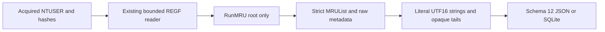

# RunMRU Python CLI

[English](RUN_MRU_CLI.md) | **한국어**

현재 패키지는 0.13.0이며 모든 출력은 스키마 13입니다. 아래 도입/결과는 당시 기록이며 현재 스키마는 [탐색기 이력](EXPLORER_HISTORY_CLI.ko.md)을 참고하세요.

2026-10-16에 53f0d510b2d06f991394cf5858be22f54416a1f4 기반 codex/python-runmru에서 구현하고 자체 리뷰했습니다. 패키지 0.12.0은 보고서 스키마 12와 독립 Windows 실행 대화상자 MRU 관측을 도입합니다. 원본 EnScript 13개에는 전용 RunMRU 파서가 없으며 bb476180453c76f7d38e5b6a9f1f025ad2273ce0과 바이트 단위로 동일합니다. 원본 아카이브 참조/매니페스트와 사후 재구성된 2017년 커밋 263개를 보존하며 실제 작업 날짜를 사용합니다.

## 실행과 입력 보존

명시적으로 획득한 안정된 NTUSER.DAT REGF 파일을 지정합니다. 파일 이름은 형식이나 사용자 신원을 입증하지 않습니다. Python 3.10+를 요구하며 여기서는 macOS/Python 3.14를 검증했습니다. RunMRU는 표준 라이브러리만 사용하며 기존 EVTX 추가 의존성은 별개입니다.

```sh
python3 -m plaintrace --run-mru /path/to/NTUSER.DAT --output run.json
python3 -m plaintrace --run-mru /case-a/NTUSER.DAT --run-mru /case-b/NTUSER.DAT --format sqlite --output run.sqlite
python3 -m plaintrace --run-mru /path/to/NTUSER.DAT --strict
python3 -m venv .venv
.venv/bin/python -m pip install .
.venv/bin/plaintrace --run-mru /path/to/acquired.bin
```

```powershell
py -m venv .venv
.venv\Scripts\python.exe -m pip install .
.venv\Scripts\plaintrace.exe --run-mru C:\acquired\NTUSER.DAT --output run.json
```

JSON 기본 출력은 stdout이며 SQLite는 --output이 필요합니다. 엄격 모드는 전체 보고서를 작성하고 경고가 있으면 1, 일반 성공은 0을 반환하며 치명적 오류는 부분 보고서 파일을 게시하지 않고 2를 반환합니다. 기존 목적지/입력/SQLite 사이드카 보호와 배타적 게시를 유지합니다. 입력은 제한된 크기로 읽고 읽기 전/읽은 데이터/읽기 후 해시를 비교하며 수정하지 않습니다. 안정된 해시는 원자적 획득·진위·완전한 증거 관리 연속성을 입증하지 않습니다.

RunMRU 출처는 UserAssist를 포함한 기존 그룹 뒤에 추가하고 그룹 내 지정 순서를 유지합니다. 반복 하이브는 별도 출처 ID를 갖습니다. 여러 어댑터에 같은 하이브를 주어도 자동 결합이나 사용자 귀속을 허용하지 않습니다. 실시간 레지스트리/프로필 검색·네트워크 접근·명령 실행·저장 대상 파일 조회·트랜잭션 로그 재생을 하지 않습니다. 셸의 stdout 리다이렉션에는 배타적 파일 보장이 적용되지 않습니다.

## 범위와 순서

Software\Microsoft\Windows\CurrentVersion\Explorer\RunMRU만 분석합니다. 하위 키는 진단하고 순회하지 않습니다. 다른 명령 이력 키·지속성 Run/RunOnce 키·WOW 변형·TypedPaths·셸/PowerShell 이력·레지스트리 내보내기 텍스트는 범위 밖입니다. 루트 누락은 경고와 빈 결과입니다. 존재하는 빈 키는 순서 누락 상태의 키로 보존하며 명령 사용 이력이 전혀 없었다는 증거가 아닙니다.

항목 이름은 대소문자 구분 없는 정확히 한 ASCII 문자이며 원래 표기를 유지합니다. 비문자/기본/숫자/유니코드 이름은 경고와 other_values로 남깁니다. MRUList와 MRUListEx는 모두 원시 제어로 보존합니다. MRUList는 REG_SZ의 엄격한 UTF-16LE, 단일 마지막 NUL, 0개 이상의 ASCII 문자, 중간 NUL 없음, 대소문자를 무시한 중복 없음일 때만 지원합니다. 유효한 빈 순서는 제어 누락과 다릅니다. MRUListEx만 있으면 미지원이며 두 제어가 있으면 모호함입니다. 잘못되거나 누락·미지원·모호한 순서에 순위를 추측하지 않습니다.

mru_status는 valid/missing/invalid/unsupported/ambiguous입니다. 순위 0은 저장 MRUList의 첫 참조이며 시각이나 전역 순서가 아닙니다. 없는 값 참조는 경고와 순위 간격을 유지하고 목록에 없는 항목은 null 순위와 경고로 보존합니다. 순서와 텍스트 유효성이 독립적이므로 잘못된 페이로드도 순위를 가질 수 있습니다. 순위로 정렬하지 않고 열거 순서를 보존합니다. 다른 슬롯의 같은 명령도 별도로 남깁니다.

## 리터럴 명령 문자열과 시각 의미

항목은 REG_SZ만 해독합니다. 첫 2바이트 정렬 UTF-16LE NUL이 문자열 경계입니다. stored_command는 그 앞 텍스트 전체를 보존하며 따옴표·공백·인수·URL·환경 토큰·UNC 경로·접미부를 포함합니다. 명령 분리·환경 확장·경로 정규화·접미부 제거·대상 신원 조회를 하지 않습니다. 특히 리터럴 역슬래시와 숫자 1의 조합은 U+0001 제어 문자와 다르며 모두 그대로 남깁니다. 접미부가 Windows 마커인지 사용자 입력인지 판단하지 않습니다.

command_utf16_hex는 종결자를 제외하며 trailing_data_hex는 그 뒤의 0 패딩·홀수 꼬리를 포함한 모든 바이트를 경고와 함께 보존합니다. value_data_hex는 원래 값 전체입니다. 정렬 종결자가 없으면 텍스트/경계 필드는 null이며 미종결 경고를 남깁니다. 잘못된 UTF-16은 바이트 역슬래시 이스케이프로 표시하고 invalid_text 상태이며 정확한 바이트가 기준이고 이스케이프 표시는 검증된 명령 텍스트가 아닙니다. 다른 레지스트리 형식은 문자열 해독 없이 원시 보존합니다. 빈 문자열은 경고와 빈 값으로 남깁니다. ANSI 대체·밀린 구조 복구·출력 가능 문자열 카빙을 하지 않습니다.

항목 status는 wrong_type/unterminated/invalid_text/empty/trailing/parsed입니다. 잘못된 텍스트가 후행 데이터보다 우선하며 그렇지 않으면 빈 텍스트도 꼬리가 있으면 trailing입니다. parsed는 지원하는 경계/인코딩 해독일 뿐 성공적 실행·안전성·검증된 실행 파일 신원이 아닙니다. RunMRU 관측은 프로그램·문서·폴더·URL·임의 레이블일 수 있고 오래되거나 수정·누락될 수 있습니다. 전체 명령/프로세스 이력이나 특정 사람의 활동 증거가 아닙니다.

키에만 key_last_written과 정확한 십진수 key_last_write_raw FILETIME이 있습니다. UTC 표시는 정수 마이크로초이며 나머지 100 ns 자릿수는 원시 틱에 남습니다. 0은 null이고 범위 초과는 경고와 null입니다. 순위 0에도 키 시각을 복사하지 않으며 명령별 실행/열기 시각·성공·소유자·SID·세션·아티팩트 연관을 추론하지 않습니다.

## 스키마 12, 출처와 구조

RunMRU 입력이 없어도 모든 JSON format_version과 SQLite user_version은 이제 12입니다. 버전 12는 run_mru_keys/run_mru_entries와 개수를 추가하며 기존 아티팩트 필드 의미는 유지합니다. 과거 보고서를 변환하거나 재작성하지 않으며 소비자는 스키마를 확인해야 합니다. 출처는 source_kind run_mru, schema_family registry_ntuser, 전체 파일 sha256과 null 브라우저/DB/WAL 필드를 사용합니다.

| Collection/table | Fields |
| --- | --- |
| run_mru_keys | source_id, record_id, key_path, key_last_written, key_last_write_raw, mru_status, mru_order, control_values, other_values |
| run_mru_entries | source_id, record_id, key_id, key_path, value_name, value_type, mru_rank, status, stored_command, command_utf16_hex, trailing_data_hex, value_data_hex |

키/항목 record_id는 source_id 범위 내 물리적 nk/vk 셀 헤더 오프셋의 십진수 텍스트입니다. key_id는 항목을 루트에 연결합니다. SQLite는 출처·복합 항목-키 외래 키와 키 ID 고유성을 강제합니다. control_values/other_values는 value_offset, name, type, data_hex를 포함합니다. 이름은 REGF 해독 텍스트이며 원시 이름 바이트가 아니고 출처 해시는 전체 획득 파일을 식별합니다. 객체/배열은 JSON과 SQLite JSON 텍스트이며 삽입은 매개변수를 바인딩합니다. 값은 별도 데이터 셀을 쓸 수 있으므로 논리 문자열 오프셋을 vk 오프셋에 더해 물리 위치를 구하면 안 됩니다. 이용 불가 해독 필드는 null입니다.



[run_mru.py](../plaintrace/run_mru.py)는 [registry_hive.py](../plaintrace/registry_hive.py)와 [binary.py](../plaintrace/binary.py)를 재사용하고 기존 디코더 의미는 바꾸지 않습니다. [execution.py](../plaintrace/execution.py), [cli.py](../plaintrace/cli.py), [model.py](../plaintrace/model.py), [exports.py](../plaintrace/exports.py)에 출처/CLI/출력 연결을 추가합니다. 하이브별 상속 제한은 입력 64 MiB, 스캔 셀 250000개, 네이티브 키/인덱스/값 항목 100000개, 접근한 키당 값 4096개, 값당 16344바이트, 접근한 값/이름 합계 16 MiB입니다. 어댑터는 문자 항목 26개, REG_SZ 항목당 후행 바이트를 포함해 UTF-16 코드 단위 4096개와 종결자 1개 분량의 바이트, 직렬화 출력 8 MiB로 제한합니다. 제어/메타데이터는 네이티브 값 제한을 따르며 어댑터는 최대 키 1개만 분석합니다. 직접 호출에도 제한을 적용하며 유효한 입력도 거부될 수 있습니다. 출력 크기는 할당 후 검사하며 결합 보고서는 메모리에 유지하고 네이티브 시간/메모리 격리는 없습니다.

## 테스트와 남은 검증

[테스트와 자체 리뷰](RUN_MRU_TESTS.ko.md)는 합성 사례 30개를 매핑하며 EVTX 추가 의존성을 포함한 전체 376개 테스트가 통과했습니다. 독립 합성 REGF 비교와 설치 콘솔 검사는 실제 Windows 명령 의미를 인증하지 않습니다. EnScript/아카이브 무결성 검증은 런타임 테스트와 별개입니다.

Windows 버전별 실제 획득 NTUSER RunMRU·Windows/Linux 실행·Python 3.10·독립 실제 레코드 비교·대형 입력 성능·획득 경쟁은 미검증입니다. 미지원 범위/형식/제어 구조·잘못되거나 모호한 순서·비표준 이름·네이티브 REGF 1.6/big data/휘발성/링크/삭제/슬랙 제한을 명시합니다. 더티 하이브 로그 재생·복구·카빙·실행 성공 귀속·자동 사용자/아티팩트 결합을 하지 않습니다. EnCase 컴파일/실행은 여전히 미검증이며 기존 아티팩트 제한도 유지합니다.

## 참고 자료

[libyal MRU 지식 기반](https://winreg-kb.readthedocs.io/en/latest/sources/explorer-keys/Most-recently-used.html)은 문자열 MRUList 순서와 RunMRU 범위를 설명합니다. [regipy RunMRU 구현](https://github.com/mkorman90/regipy/blob/master/regipy/plugins/ntuser/runmru.py)은 범위 비교 대상이며 이 어댑터는 정규화/누락 대신 리터럴 접미부·목록 외 값·잘못된 순서 관측을 보존합니다. 참고 자료가 모든 Windows 호환성을 보장하지 않으며 구현 소스를 복사해 포함하지 않았습니다. [아카이브 분석](ANALYSIS.ko.md)을 참고하세요.
