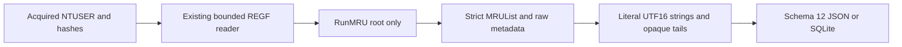

# RunMRU Python CLI

**English** | [한국어](RUN_MRU_CLI.ko.md)

The current package is 0.15.0 and every output uses schema 15. Earlier introductions/results below describe their release context; see [SAM accounts](SAM_ACCOUNTS_CLI.md) for the current schema.

Implemented and self-reviewed on 2026-10-16 on codex/python-runmru from 53f0d510b2d06f991394cf5858be22f54416a1f4. Package 0.12.0 introduces report schema 12 and independent Windows Run dialog MRU observations. The original thirteen EnScript files have no dedicated RunMRU parser and remain byte-identical to bb476180453c76f7d38e5b6a9f1f025ad2273ce0. Original archive refs/manifests and 263 retrospectively reconstructed 2017 commits remain preserved; this extension uses its actual work date.

## Run and Input Preservation

Supply explicit acquired stable NTUSER.DAT REGF files; filenames do not establish format or user identity. Python 3.10+ is declared, with macOS/Python 3.14 exercised here. RunMRU uses only the standard library; the existing EVTX extra remains separate.

```sh
python3 -m plaintrace --run-mru /path/to/NTUSER.DAT --output run.json
python3 -m plaintrace --run-mru /case-a/NTUSER.DAT --run-mru /case-b/NTUSER.DAT --format sqlite --output run.sqlite
python3 -m plaintrace --run-mru /path/to/NTUSER.DAT --strict
python3 -m venv .venv
.venv/bin/python -m pip install .
.venv/bin/plaintrace --run-mru /path/to/acquired.bin
```

```powershell
py -m venv .venv
.venv\Scripts\python.exe -m pip install .
.venv\Scripts\plaintrace.exe --run-mru C:\acquired\NTUSER.DAT --output run.json
```

JSON defaults to stdout; SQLite needs --output. Strict mode writes the complete report and returns 1 for warnings, normal success returns 0, and fatal errors return 2 without publishing a partial report file. Existing destination/input/SQLite-sidecar protections and exclusive publication remain. Inputs are bounded and hashed before/read/after without modification. Stable hashes do not prove atomic acquisition, authenticity or a complete chain of custody.

RunMRU sources follow all earlier groups, including UserAssist, and retain supplied order within their group. Repeated hives have separate source IDs. Supplying a hive to several adapters does not authorize automatic joins or user attribution. No live registry/profile scan, network access, command execution, filesystem lookup of stored targets or transaction-log replay occurs. Shell redirection of stdout does not receive exclusive-file guarantees.

## Scope and Ordering

Only Software\Microsoft\Windows\CurrentVersion\Explorer\RunMRU is analyzed. Descendants are diagnosed without traversal; other command-history keys, Run/RunOnce persistence keys, WOW variants, TypedPaths, shell/PowerShell histories and registry-export text are outside this adapter. Missing root warns and yields no records. An existing empty key remains a key record with missing ordering, not evidence that no commands were ever used.

Entries have exactly one ASCII letter value name, matched case-insensitively; original spelling remains. Non-letter/default/numeric/Unicode names stay other_values with a warning. Both MRUList and MRUListEx stay raw controls. MRUList is supported only as REG_SZ strict UTF-16LE, a single final NUL, zero or more ASCII letters, no embedded NUL and no case-insensitive duplicates. Empty valid order differs from a missing control. MRUListEx alone is unsupported; both controls together are ambiguous. No invalid/missing/unsupported/ambiguous ordering receives guessed ranks.

mru_status is valid/missing/invalid/unsupported/ambiguous. Rank 0 is the first stored MRUList reference, not a timestamp or global order. References to absent values warn and preserve rank gaps; unlisted entries remain with null rank and warning. Malformed entry payloads can still have a rank because ordering and text validity are independent. Enumeration order is preserved rather than sorted by rank. Duplicate command strings in different slots remain separate.

## Literal Command Strings and Time Semantics

Only REG_SZ entry data is decoded. The first two-byte-aligned UTF-16LE NUL frames the string. stored_command keeps the complete text before that terminator, including quotes, whitespace, arguments, URLs, environment tokens, UNC paths and suffixes. No command splitting, environment expansion, path normalization, suffix removal or target identity lookup occurs. In particular a literal backslash followed by digit one and a U+0001 control character are distinct and both remain intact. The adapter does not decide whether any suffix is a Windows marker or user input.

command_utf16_hex excludes the terminator; trailing_data_hex preserves every byte after it, including zero padding and odd tails, with a warning. value_data_hex preserves the entire original value. No aligned terminator means null text/framing fields and an unterminated warning. Invalid UTF-16 is displayed using byte backslash escapes with invalid_text status; exact bytes remain authoritative and escaped display is not validated command text. Wrong registry types stay raw without string decoding. Empty strings remain empty with a warning. No ANSI fallback, shifted-layout repair or printable-string carving occurs.

Entry status is wrong_type/unterminated/invalid_text/empty/trailing/parsed. Invalid text takes precedence over trailing; otherwise any nonempty tail sets trailing, including for empty text. A parsed string only means supported framing/encoding, not successful execution, safety or verified executable identity. Stored RunMRU observations may refer to programs, documents, folders, URLs or arbitrary labels and may be stale, edited or incomplete. They are not an exhaustive command/process history or proof of a particular person's activity.

Only keys carry key_last_written and exact decimal key_last_write_raw FILETIME. UTC display uses integer microseconds, preserving the remaining 100 ns digit in raw ticks. Zero displays null; out-of-range ticks warn and stay null. No key time is copied onto entries, even rank 0; no per-command execution/open time, success, owner, SID, session or cross-artifact association is inferred.

## Schema 12, Lineage and Architecture

Every JSON format_version and SQLite user_version is now 12, even without RunMRU inputs. Version 12 adds run_mru_keys/run_mru_entries and counts; previous artifact field meanings remain unchanged. Old reports are not migrated or rewritten and consumers must inspect the schema. Sources use source_kind run_mru, schema_family registry_ntuser, full-file sha256 and null browser/database/WAL fields.

| Collection/table | Fields |
| --- | --- |
| run_mru_keys | source_id, record_id, key_path, key_last_written, key_last_write_raw, mru_status, mru_order, control_values, other_values |
| run_mru_entries | source_id, record_id, key_id, key_path, value_name, value_type, mru_rank, status, stored_command, command_utf16_hex, trailing_data_hex, value_data_hex |

Key/entry record_id is the physical nk/vk cell-header offset in decimal text scoped by source_id. key_id links entries to the root. SQLite enforces source and composite entry-key foreign keys with unique key identities. control_values/other_values contain value_offset, name, type and data_hex. Names are REGF-decoded text, not raw name bytes; the source hash identifies the complete acquired file. Objects/arrays are JSON and SQLite JSON text; inserts bind parameters. Logical string offsets cannot be added to vk offsets to locate data because values can use separate data cells. Unknown decoded fields are null.



[run_mru.py](../plaintrace/run_mru.py) reuses [registry_hive.py](../plaintrace/registry_hive.py) and [binary.py](../plaintrace/binary.py) without changing existing decoder semantics. [execution.py](../plaintrace/execution.py), [cli.py](../plaintrace/cli.py), [model.py](../plaintrace/model.py) and [exports.py](../plaintrace/exports.py) add source/CLI/export integration. Each hive uses inherited 64 MiB input, 250000 scanned cells, 100000 native key/index/value items, 4096 accessed values per key, 16344 bytes per value and 16 MiB accessed value/name bytes. Adapter caps: 26 letter entries, 4096 UTF-16 code units plus one terminator worth of bytes per REG_SZ entry including trailing bytes, and 8 MiB serialized adapter output. Controls/metadata retain native value bounds; the adapter analyzes at most one key. Limits also apply to direct calls and may reject valid inputs. Output size is checked after allocation; combined reports stay in memory without native timeout/memory isolation.

## Tests and Remaining Validation

[Tests and self-review](RUN_MRU_TESTS.md) map 30 new synthetic cases; the full 376-test suite passes with the EVTX extra. Independent synthetic REGF comparisons and installed-console checks do not certify real Windows command semantics. EnScript/archive integrity validation remains separate from runtime testing.

Actual acquired NTUSER RunMRU across Windows versions, Windows/Linux execution, Python 3.10, independent real-record comparisons, large-input performance and acquisition races remain unvalidated. Unsupported scopes/types/control formats, malformed/ambiguous ordering, noncanonical names and native REGF 1.6/big-data/volatile/link/deleted/slack restrictions remain explicit. No dirty-hive log replay, repair, recovery, execution-success attribution or automatic user/artifact joins. EnCase compilation/execution remains unverified; earlier artifact limitations continue.

## References

The [libyal MRU knowledge base](https://winreg-kb.readthedocs.io/en/latest/sources/explorer-keys/Most-recently-used.html) describes string MRUList ordering and RunMRU scope. The [regipy RunMRU implementation](https://github.com/mkorman90/regipy/blob/master/regipy/plugins/ntuser/runmru.py) is a scope comparison; this adapter deliberately preserves literal suffixes, unlisted values and invalid-order observations rather than normalizing or dropping them. References do not guarantee universal Windows compatibility; no implementation source is vendored. See [archive analysis](ANALYSIS.md).
