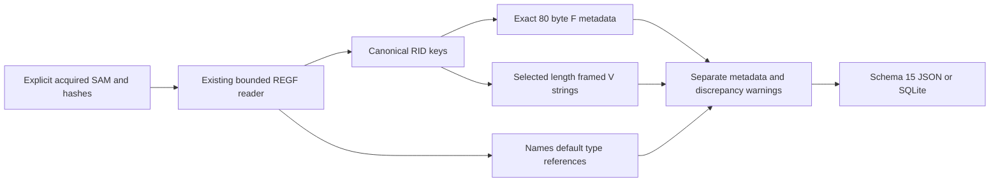

# SAM 사용자 계정 메타데이터 Python CLI

[English](SAM_ACCOUNTS_CLI.md) | **한국어**

2026-10-26에 def0c228b0ef2721470d63e3adbf14719311428c 기반 codex/python-sam-accounts에서 구현하고 자체 리뷰했습니다. 패키지 0.15.0/보고서 스키마 15는 오프라인 로컬 SAM 계정 메타데이터를 추가합니다. EnScript 13개는 bb476180453c76f7d38e5b6a9f1f025ad2273ce0과 바이트 단위로 같으며 원본 아카이브 참조/매니페스트와 사후 재구성된 2017년 커밋 263개를 보존합니다. 현대 작업은 실제 날짜를 사용합니다.

## 실행과 안정된 획득 입력

반복 가능한 --sam에 명시적으로 획득한 안정된 REGF SAM 하이브를 지정합니다. 파일 이름은 신원이나 소유권을 입증하지 않습니다. Python 3.10+를 요구하며 macOS/Python 3.14에서 검증했습니다. 표준 라이브러리만 사용하고 EVTX의 선택 추가 의존성은 별개입니다. SYSTEM 하이브·부트 키·암호화 의존성·복호화 경로를 사용하지 않습니다.

```sh
python3 -m plaintrace --sam /path/to/SAM --output accounts.json
python3 -m plaintrace --sam /case-a/SAM --sam /case-b/SAM --format sqlite --output accounts.sqlite
python3 -m plaintrace --sam /path/to/SAM --strict
python3 -m venv .venv
.venv/bin/python -m pip install .
.venv/bin/plaintrace --sam /path/to/acquired.bin
```

```powershell
py -m venv .venv
.venv\Scripts\python.exe -m pip install .
.venv\Scripts\plaintrace.exe --sam C:\acquired\SAM --output accounts.json
```

JSON 기본 출력은 stdout이며 SQLite는 --output이 필요합니다. 성공은 0, --strict는 전체 보고서를 쓰고 경고가 있으면 1, 치명적 오류는 부분 보고서 파일을 게시하지 않고 2입니다. 입력/목적지/SQLite 사이드카 보호와 배타적 게시를 유지하며 셸 stdout 리다이렉션에는 해당 파일 보장이 없습니다. 크기를 제한하고 읽기 전/읽은 데이터/읽기 후 해시를 비교하며 입력은 수정하지 않습니다. 해시 일치는 원자적 획득·진위·완전한 증거 관리 연속성을 입증하지 않습니다.

SAM 출처는 시스템 정보를 포함한 기존 출처 뒤에 추가하고 지정 순서와 반복 입력별 출처 ID를 유지합니다. 자동 하이브/프로필/장비/사용자 결합·호스트 레지스트리 호출·획득 도구·경로 접근·대상 실행·네트워크·로그 재생은 없습니다.

## 범위와 EnScript 관계

SAM\Domains\Account\Users와 그 바로 아래 8자리 16진 RID 키 및 Names 직접 자식만 검사합니다. 루트 SAM 구성 요소는 하이브 상대 경로의 일부이며 대체 루트는 추측하지 않습니다. 레지스트리 조회와 F/V 이름은 대소문자를 무시합니다. RID 이름은 key_path에 0 패딩을 유지하고 부호 없는 rid_key로 변환하며 미지원 Users 자식은 경고 후 순회하지 않습니다. 계정/Names 하위 키는 진단하고 무시합니다. Users/Names 컨테이너 값은 범위 밖으로 해독하지 않고 진단합니다. Users 누락은 경고와 빈 결과이며 존재하는 빈 루트는 no_accounts 경고입니다.

원본 Win_UserAccount는 F/V·이름·시각/카운터·계정 상태를 읽고 LM/NT 바이트 범위를 노출하며 V 필드로 권한 레이블을 추측하고 고정 암호 만료 기간을 더합니다. Python 어댑터는 계정 메타데이터만 이식합니다. 자격 증명 추출/복호화·권한 추측·고정 암호 만료·SAM 도메인 키·그룹/별칭·전체 SID 구성·캐시/도메인 계정·삭제 복구·EnCase 추출/GUI/CSV·아티팩트 귀속은 재현하지 않습니다.

F/V/Names가 없거나 잘못되어도 RID 키마다 계정을 남깁니다. Names/<label>은 기본 값의 레지스트리 형식을 RID 참조로 사용하며 페이로드가 비어 있어야 합니다. 페이로드를 RID 정수로 읽지 않습니다. 기본 값 누락/비어 있지 않은 데이터는 invalid 매핑입니다. 올바른 참조에 표준 계정 키가 없으면 orphan과 null account_id로 남깁니다. 별칭/중복 매핑도 모두 보존하고 하나의 RID에 여러 레이블이면 경고합니다. 연결은 추측한 사용자 이름이나 F RID가 아니라 RID 키만 사용합니다. F RID 불일치와 Names 대 유효 V 사용자 이름 불일치는 양쪽을 보존하고 경고합니다. 대소문자 무시 텍스트 비교는 진단이며 신원 결합이 아닙니다. 선호 계정 이름을 고르지 않습니다.

## 지원 F 메타데이터

F는 REG_BINARY와 정확히 80바이트가 필요합니다. 다른 크기/형식은 접두부 복구나 구조 추측 없이 요약합니다. 정확한 크기는 좁게 지원하는 후보 구조이며 모든 과거 리비전의 독립 검증은 아닙니다. 지원 F 바이트는 f_record.data_hex에 보존하고 처음 바이트와 미할당 범위는 버전/권한 의미를 조작하지 않고 원시로 남깁니다.

| F 논리 오프셋 | 바이트 | 해석 |
| --- | --- | --- |
| 8 / 24 / 40 | 각 8 | last_logon / password_last_set / last_bad_password FILETIME 관측 |
| 48 / 52 | 각 4 | rid_raw / primary_group_rid_raw, 실제 그룹 구성원이 아님 |
| 56 | 2 | SAM ACB flags_raw; 인접 바이트는 미해석 |
| 60 / 62 | 각 2 | country_code_raw / codepage_raw, 실제 물리 위치를 추론하지 않음 |
| 64 / 66 | 각 2 | bad_password_count_raw / logon_count_raw, 전체 이벤트 개수가 아님 |

flag_labels는 SAM ACB 비트 0x0001 disabled, 0x0004 password_not_required, 0x0010 normal_account, 0x0200 password_never_expires, 0x0400 auto_locked만 노출합니다. 나머지는 unknown_flag_bits에 남깁니다. 저장 비트 레이블이며 Windows UF 마스크·현재 로그인 가능 여부·관리자 상태·잠금 정책 평가·암호 부재의 증명이 아닙니다. 카운터는 초기화/포화될 수 있으며 세션이나 모든 로그온을 재구성하지 않습니다. 미할당 F 바이트에서 만료 필드/정책·42일 기간·계정 생성·마지막 로그오프·권한을 추론하지 않습니다.

times 항목은 field, offset, filetime_raw, time, state입니다. 부호 없는 원시 100 ns 틱은 정확한 십진수 문자열입니다. state는 0이면 unset, 0x7fffffffffffffff/0xffffffffffffffff면 sentinel이며 달력 변환이나 특정 정책 의미를 부여하지 않습니다. 표시 가능한 0 아닌 틱은 value, 범위 초과는 out_of_range입니다. UTC 표시는 정수 마이크로초로 자르며 나머지 자릿수는 원시 틱에 남습니다. 키 마지막 쓰기는 별개이며 내장 계정 이벤트 시각의 대체가 아닙니다. 저장 값은 오래되거나 조작될 수 있고 성공적 활동을 독립 입증하지 않습니다.

## 부분 V 문자열과 콘텐츠 경계

V는 REG_BINARY와 최소 204바이트 헤더가 필요합니다. 선택 문자열 설명자만 해독하며 v_record.status partial_strings는 전체 V 형식이나 모든 리비전 인증이 아닙니다. 오프셋은 값의 204바이트 기준 상대 위치이며 길이는 문자 수가 아닌 바이트입니다. 문자열 설명자는 12 username, 24 full_name, 36 admin_comment, 48 user_comment, 72 home_directory, 84 home_drive, 96 logon_script, 108 profile_path, 120 workstations이고 각각 부호 없는 4바이트 오프셋과 4바이트 길이입니다.

strings 항목은 field, descriptor_offset, relative_offset, byte_length, data_offset, descriptor_hex, status, text, utf16_hex입니다. data_offset은 V 내부 논리 위치이며 REGF 물리 오프셋이 아닙니다. descriptor_hex는 오프셋/길이 쌍을 보존합니다. 범위와 짝수 오프셋/길이를 검사하고 잘못된 범위는 텍스트/데이터 추출을 추측하지 않고 설명자 메타데이터만 남깁니다. 범위 안 길이 0은 빈 값이지 누락이 아닙니다. UTF-16LE는 NUL이 필요 없는 엄격한 길이 경계이며 유니코드/이모지·공백·경로 토큰·중간 NUL을 그대로 보존합니다. 잘못된 유니코드는 바이트 역슬래시 이스케이프로 표시하며 중간 NUL·유효 범위 겹침은 자르거나 복구하지 않고 경고합니다. status는 parsed/empty/invalid_text/embedded_nul/invalid_bounds/invalid_alignment이며 invalid_text가 중간 NUL보다 우선입니다.

V에서는 선택 문자열 바이트만 내보내며 전체 V/헤더/다른 페이로드는 내보내지 않습니다. f_record/v_record는 value_offset, type, byte_length, sha256, status를 가지며 누락 레코드는 null 메타데이터입니다. 미지원 F의 data_hex는 null입니다. 다른 계정/매핑 값은 콘텐츠 없이 value_offset/name/type/byte_length/sha256으로 요약합니다. 이 SHA-256은 출처 블롭 식별용이며 암호 해시가 아닙니다. 출처 파일 해시는 전체 획득 바이트를 식별합니다. 자격 증명 포인터를 해독하지 않고 LM/NT 데이터를 추출/복호화하지 않으며 부트 키/도메인 비밀 파서는 없습니다. 제한된 필드 선택이며 문자열 필드에 임의로 들어간 콘텐츠까지 일반적인 비식별 처리를 보장하지는 않습니다.

프로필/홈/스크립트 경로를 확장·열기·실행하지 않습니다. 사용자 신원·소유권·SID/도메인 접두부·관리자/그룹 소속·실효 정책·활성 세션을 추론하지 않습니다. 이름/문자열은 편집되거나 모순될 수 있고 linked 매핑도 이 하이브 안 RID 키에 대한 저장 참조만 뜻합니다.

## 스키마 15, 출처와 구조

SAM 입력이 없어도 모든 JSON format_version/SQLite user_version은 15입니다. 스키마 15는 sam_accounts/sam_name_mappings와 개수를 추가하고 기존 의미를 유지하며 과거 보고서를 변환하지 않습니다. 출처는 source_kind sam_accounts, schema_family registry_sam, 전체 파일 sha256과 null 브라우저/DB/WAL 필드입니다.

| Collection/table | Fields |
| --- | --- |
| sam_accounts | source_id, record_id, key_path, rid_key, key_last_written, key_last_write_raw, f_record, v_record, fixed_fields, times, strings, other_values |
| sam_name_mappings | source_id, record_id, key_path, account_name, rid_reference, account_id, status, key_last_written, key_last_write_raw, values |

계정/매핑 record_id는 source_id 범위 내 물리적 nk 셀 헤더 오프셋의 십진수 텍스트이며 value_offset은 물리적 vk 셀 헤더 오프셋입니다. 값 데이터가 다른 셀에 있을 수 있으므로 논리 F/V 오프셋을 vk 오프셋에 더해 데이터 위치를 추정할 수 없습니다. SQLite는 출처 외래 키·계정 ID 고유성·복합 매핑-계정 연결을 강제하고 invalid/orphan의 account_id는 null입니다. 배열/객체는 JSON과 SQLite JSON 텍스트이며 매핑 values는 SQLite values_json입니다. 삽입은 매개변수를 바인딩하고 이용 불가 필드는 null 또는 빈 구조이며 신원을 만들어내지 않습니다.



[sam_accounts.py](../plaintrace/sam_accounts.py)는 [registry_hive.py](../plaintrace/registry_hive.py)와 [binary.py](../plaintrace/binary.py)를 재사용하고 기존 디코더 의미는 바꾸지 않습니다. [execution.py](../plaintrace/execution.py), [cli.py](../plaintrace/cli.py), [model.py](../plaintrace/model.py), [exports.py](../plaintrace/exports.py)가 출처/출력을 연결합니다. 상속 하이브별 제한은 입력 64 MiB, 스캔 셀 250000개, 네이티브 키/인덱스/값 항목 100000개, 접근 키당 값 4096개, 값당 16344바이트, 접근 값/이름 합계 16 MiB입니다. 어댑터는 계정 4096개·이름 매핑 4096개·관측 값 16384개·선택 V 필드당 UTF-16 단위 4096개·직렬화 계정/매핑 출력 32 MiB입니다. 과도하게 선언한 문자열 길이를 포함한 자원 오류는 입력을 중단합니다. 크기는 할당 후 검사하며 결합 보고서/진단은 메모리에 유지하고 네이티브 시간/메모리 격리는 없습니다. 유효한 입력도 거부될 수 있습니다.

## 테스트와 남은 검증

[테스트와 자체 리뷰](SAM_ACCOUNTS_TESTS.ko.md)는 새 사례 35개를 매핑하고 EVTX 추가 의존성을 포함한 Python 테스트 475개가 생략 없이 통과했습니다. 합성 원시 값/오프셋 비교와 설치 콘솔 검사는 실제 SAM 의미나 EnCase 동작 인증이 아니며 원본 EnScript/아카이브 검증은 별개입니다.

Windows 버전/리비전별 실제 획득 SAM·Windows/Linux 실행·Python 3.10·독립 실제 레코드 해석·대형 컬렉션·획득 경쟁은 미검증입니다. 미지원 F/V 구조/필드·대체 루트·그룹/별칭/도메인 정책/SID·자격 증명 추출·네이티브 REGF 1.6/big data/휘발성/링크/삭제/슬랙 구조는 제외합니다. 더티 하이브 재생·복구·권한/만료 추측·하이브 간 결합은 없습니다. EnCase 컴파일/실행은 여전히 미검증이고 기존 아티팩트 제한도 유지합니다.

## 참고 자료

[Dissect SAM 메타데이터 구조](https://github.com/fox-it/dissect.target/blob/main/dissect/target/plugins/os/windows/sam.py)를 F 필드·ACB 비트·선택 V 설명자의 독립 비교에 사용하며 해당 구현의 암호화 경로는 사용하지 않습니다. 원본 [EnScript 분석](ANALYSIS.ko.md)은 별도 아카이브 맥락입니다. 모든 버전 호환성을 입증하는 자료가 아니고 구현 소스를 복사해 포함하지 않았습니다.
