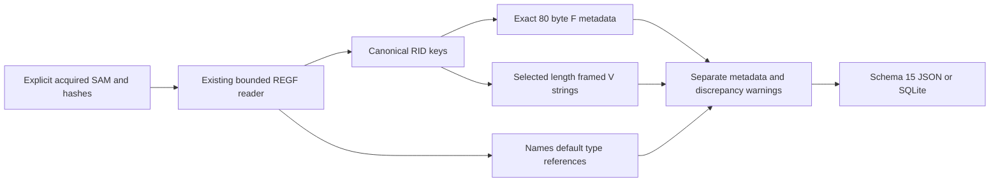

# SAM User Account Metadata Python CLI

**English** | [한국어](SAM_ACCOUNTS_CLI.ko.md)

Implemented and self-reviewed on 2026-10-26 on codex/python-sam-accounts from def0c228b0ef2721470d63e3adbf14719311428c. Package 0.15.0/report schema 15 adds offline local SAM account metadata. All thirteen EnScript files remain byte-identical to bb476180453c76f7d38e5b6a9f1f025ad2273ce0; original archive refs/manifests and 263 retrospectively reconstructed 2017 commits remain preserved. Modern work uses its actual date.

## Run and Stable Acquired Input

Supply explicit acquired stable REGF SAM hives via repeatable --sam. A filename does not establish identity or ownership. Python 3.10+ is declared; testing used macOS/Python 3.14. This adapter uses the standard library; EVTX keeps its separate optional extra. No SYSTEM hive, boot key, cryptographic dependency or decryption path is used.

```sh
python3 -m plaintrace --sam /path/to/SAM --output accounts.json
python3 -m plaintrace --sam /case-a/SAM --sam /case-b/SAM --format sqlite --output accounts.sqlite
python3 -m plaintrace --sam /path/to/SAM --strict
python3 -m venv .venv
.venv/bin/python -m pip install .
.venv/bin/plaintrace --sam /path/to/acquired.bin
```

```powershell
py -m venv .venv
.venv\Scripts\python.exe -m pip install .
.venv\Scripts\plaintrace.exe --sam C:\acquired\SAM --output accounts.json
```

JSON defaults to stdout; SQLite requires --output. Success returns 0, --strict writes the whole report and returns 1 for warnings, fatal errors return 2 without publishing partial report files. Existing input/destination/SQLite-sidecar protections and exclusive publication remain. Shell stdout redirection lacks those file guarantees. Bounded reads compare before/read/after hashes without modifying input; matching hashes do not establish atomic acquisition, authenticity or a complete chain of custody.

SAM sources follow all earlier source groups, including system information, retaining supplied order and distinct source IDs for repeated inputs. There are no automatic cross-hive/profile/machine/user joins, host registry calls, acquisition tools, path access, executable launch, network requests or log replay.

## Scope and Relation to EnScript

Only SAM\Domains\Account\Users and its direct eight-hex-digit RID keys plus direct Names children are examined. The root SAM component is part of the hive-relative path; alternative root layouts are not guessed. Registry lookup and F/V names are case-insensitive. RID names retain leading zero padding in key_path and convert to unsigned rid_key; unsupported Users children warn without traversal. Account/Names descendants are diagnosed and ignored. Users/Names container values are outside scope and diagnosed without decoding. Missing Users warns with no records; existing empty roots warn no_accounts.

The original Win_UserAccount reads F/V, names, timestamps/counters and account-state fields, exposes LM/NT byte ranges, guesses privilege labels from a V field and adds a fixed password-expiry interval. This Python adapter ports account metadata only. It does not reproduce credential extraction/decryption, privilege guesses, fixed password expiry, SAM domain keys, groups/aliases, full SID construction, cached/domain accounts, deleted recovery, EnCase extraction/GUI/CSV or cross-artifact attribution.

Each RID key becomes an account even if F/V/Names information is missing or malformed. Names/<label> uses the default value's registry type as its RID reference, requiring an empty payload; the payload is never read as a RID integer. Missing/nonempty defaults stay invalid mappings. A valid reference with no canonical account key stays orphan with null account_id. All aliases/duplicate mappings remain; several labels referencing one RID warn. Linking uses the RID key only, not a guessed username or F RID. F RID mismatch and Names-versus-valid-V username mismatch warn with both sources retained. Case-insensitive text comparison is diagnostic, not an identity join. No preferred account name is selected.

## Supported F Metadata

F requires REG_BINARY and exactly 80 bytes. Other sizes/types are summarized without prefix recovery or layout guessing. Exact size is a narrowly supported candidate layout, not independent verification of every historical revision. Supported F bytes are preserved in f_record.data_hex. The first bytes and other unassigned ranges stay raw without invented version/privilege semantics.

| Logical F offset | Bytes | Interpretation |
| --- | --- | --- |
| 8 / 24 / 40 | 8 each | last_logon / password_last_set / last_bad_password FILETIME observations |
| 48 / 52 | 4 each | rid_raw / primary_group_rid_raw, not effective group membership |
| 56 | 2 | SAM ACB flags_raw; adjacent bytes remain uninterpreted |
| 60 / 62 | 2 each | country_code_raw / codepage_raw, not inferred physical locale |
| 64 / 66 | 2 each | bad_password_count_raw / logon_count_raw, not complete event counts |

flag_labels exposes only SAM ACB bits 0x0001 disabled, 0x0004 password_not_required, 0x0010 normal_account, 0x0200 password_never_expires and 0x0400 auto_locked. All remaining bits are retained in unknown_flag_bits. These are stored bit labels, not a Windows UF mask, current login ability, administrator status, lockout-policy evaluation or proof that a password is absent. Counters can reset/saturate and do not reconstruct sessions or every logon. No expiration field/policy, 42-day interval, account creation time, last-logoff time or account privilege is inferred from unassigned F bytes.

Each times item has field, offset, filetime_raw, time and state. Raw unsigned 100 ns ticks are exact decimal strings. State is unset for zero, sentinel for 0x7fffffffffffffff/0xffffffffffffffff (no calendar conversion or claim of a specific policy meaning), value for representable nonzero ticks and out_of_range for overflow. UTC display truncates to integer microseconds; raw ticks retain the remaining digit. Key last-write is separate and never substitutes for an embedded account-event time. Stored values may be stale/manipulated and do not independently prove successful activity.

## Partial V Strings and Content Boundaries

V requires REG_BINARY with at least a 204-byte header. Only selected string descriptors are decoded; v_record.status partial_strings is not certification of the full V format or every revision. Offsets are relative to byte 204 of the value and lengths are bytes, not characters. String descriptors occur at 12 username, 24 full_name, 36 admin_comment, 48 user_comment, 72 home_directory, 84 home_drive, 96 logon_script, 108 profile_path and 120 workstations; each supplies a four-byte unsigned offset followed by four-byte length.

Each strings item preserves field, descriptor_offset, relative_offset, byte_length, data_offset, descriptor_hex, status, text and utf16_hex. data_offset is logical within V, not a physical REGF file offset. Descriptor bytes retain the offset/length pair. Bounds and even offset/length are checked; invalid ranges retain descriptor metadata without guessed text or data extraction. Empty in-range fields remain empty, not missing. UTF-16LE is strictly length-framed with no required NUL: preserve literal Unicode/emoji, whitespace, path tokens and embedded NULs. Invalid Unicode is displayed as byte backslash escapes; embedded NUL and overlapping valid ranges warn without trimming or repairing. Status is parsed/empty/invalid_text/embedded_nul/invalid_bounds/invalid_alignment; invalid_text takes precedence over an embedded NUL.

Only selected string bytes are exported from V; the full V/header/other payload is not exported. f_record/v_record include value_offset, type, byte_length, sha256 and status; missing records have null metadata. Unsupported F has null data_hex. Other account and mapping values are summarized as value_offset/name/type/byte_length/sha256 without content. These SHA-256 fields identify source blobs; they are not password hashes. The source-file hash identifies all acquired bytes. No credential pointer is decoded, no LM/NT data is extracted or decrypted, and no boot-key/domain-secret parser exists. This is a bounded field selection, not a general redaction guarantee for arbitrary content placed in text fields.

No profile/home/script path is expanded, opened or executed. No user identity, ownership, SID/domain prefix, administrator/group membership, effective policy or active session is inferred. Names/strings can be edited or inconsistent; even linked mapping means only a stored reference to a RID key in this one supplied hive.

## Schema 15, Lineage and Architecture

Every JSON format_version/SQLite user_version is 15, even without SAM. Schema 15 adds sam_accounts/sam_name_mappings and counts, retaining existing field meanings without migrating old reports. Sources use source_kind sam_accounts, schema_family registry_sam, full-file sha256 and null browser/database/WAL fields.

| Collection/table | Fields |
| --- | --- |
| sam_accounts | source_id, record_id, key_path, rid_key, key_last_written, key_last_write_raw, f_record, v_record, fixed_fields, times, strings, other_values |
| sam_name_mappings | source_id, record_id, key_path, account_name, rid_reference, account_id, status, key_last_written, key_last_write_raw, values |

Account/mapping record_id is the physical nk cell-header offset in decimal text scoped by source_id; nested value_offset is a physical vk cell-header offset. Value data can reside elsewhere, so logical F/V offsets cannot be added to vk offsets to locate data. SQLite enforces source foreign keys, unique account identities and composite mapping-to-account links; invalid/orphan account_id is null. Arrays/objects are JSON and SQLite JSON text; mapping values uses SQLite values_json. Inserts bind parameters. Unavailable fields are null or empty structured collections, not invented identities.



[sam_accounts.py](../plaintrace/sam_accounts.py) reuses [registry_hive.py](../plaintrace/registry_hive.py) and [binary.py](../plaintrace/binary.py), without changing existing decoder semantics. [execution.py](../plaintrace/execution.py), [cli.py](../plaintrace/cli.py), [model.py](../plaintrace/model.py) and [exports.py](../plaintrace/exports.py) integrate sources/output. Inherited per-hive bounds: 64 MiB input, 250000 scanned cells, 100000 native key/index/value items, 4096 values per accessed key, 16344 bytes per value and 16 MiB accessed value/name bytes. Adapter caps: 4096 accounts, 4096 name mappings, 16384 observed values, 4096 UTF-16 units per selected V field and 32 MiB serialized account/mapping output. Resource failures abort the input, including excessive declared string lengths. Size checks occur after allocation; combined reports/diagnostics remain in memory without native timeout/memory isolation. Limits may reject valid inputs.

## Tests and Remaining Validation

[Tests and self-review](SAM_ACCOUNTS_TESTS.md) map 35 new cases; all 475 Python tests pass without skips with the EVTX extra. Synthetic raw-value/offset comparisons and installed-console checks do not certify actual SAM semantics or EnCase behavior. Original EnScript/archive integrity checks remain separate.

Actual acquired SAM across Windows versions/revisions, Windows/Linux execution, Python 3.10, independent real-record interpretation, large collections and acquisition races remain unvalidated. Unsupported F/V layouts/fields, alternative roots, groups/aliases/domain policy/SIDs, credential extraction, and native REGF 1.6/big-data/volatile/link/deleted/slack structures remain excluded. No dirty-hive replay, recovery, privilege/expiry guesses or cross-hive joins. EnCase compilation/execution remains unverified; earlier artifact limitations continue.

## References

[Dissect's SAM metadata structures](https://github.com/fox-it/dissect.target/blob/main/dissect/target/plugins/os/windows/sam.py) provide an independent comparison for F fields, ACB bits and selected V descriptors; its cryptographic paths are not used. The original [EnScript analysis](ANALYSIS.md) provides separate archival context. These references do not establish universal compatibility. No implementation source is vendored.
