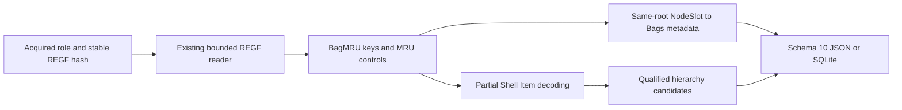

# Windows ShellBags Python CLI

[English](SHELLBAGS_CLI.md) | **한국어**

현재 패키지는 0.11.0이며 모든 출력은 스키마 11입니다. 아래 이전 버전 도입/테스트 결과는 당시 기록이며 현재 계약은 [UserAssist 확장](USERASSIST_CLI.ko.md)을 따릅니다.

2026-10-15에 9bc15c8f765ea2c10d2259049a39222375f5d61c 기반 codex/python-shellbags에서 구현했습니다. 패키지 0.9.0/보고서 스키마 9는 BagMRU 계층과 참조 Bags 메타데이터를 추가합니다. EnScript 13개, 아카이브 참조/매니페스트와 재구성된 2017년 커밋 263개를 보존합니다. 원본 RecentDocuments 모듈에는 ShellBags 파서가 없어 새 독립 Python 확장으로 구현했습니다.

## 실행과 입력 범위

요구 환경은 Python 3.10+이며 macOS/Python 3.14에서 검증했습니다. ShellBags는 기존 표준 라이브러리 REGF 판독기를 사용하며 새로운 런타임 의존성이 없습니다. EVTX 선택 의존성은 유지합니다. --shellbags-ntuser와 --shellbags-usrclass를 반복하여 안정적으로 획득한 바이너리 하이브를 전달하며 파일 이름은 변경해도 됩니다. 역할은 알려진 경로를 선택할 뿐 하이브 정체성/소유권을 검증하지 않습니다. --shellbags-codepage는 ANSI Shell Item 이름에 기본 cp1252를 사용하며 적절한 획득 환경에서는 cp949 같은 ANSI 호환 인코딩을 지정합니다. Unicode는 UTF-16LE이고 LNK 코드페이지와 별도입니다.

```sh
python3 -m plaintrace --shellbags-ntuser /path/to/NTUSER.DAT --output shellbags.json
python3 -m plaintrace --shellbags-usrclass /path/to/UsrClass.dat --format sqlite --output shellbags.sqlite
python3 -m plaintrace --shellbags-ntuser /case-a/NTUSER.DAT --shellbags-usrclass /case-a/UsrClass.dat --shellbags-codepage cp949 --strict
python3 -m venv .venv
.venv/bin/python -m pip install .
.venv/bin/plaintrace --shellbags-ntuser /path/to/acquired.bin
```

```powershell
py -m venv .venv
.venv\Scripts\python.exe -m pip install .
.venv\Scripts\plaintrace.exe --shellbags-usrclass C:\acquired\UsrClass.dat --output shellbags.json
```

JSON 기본 출력은 stdout, SQLite는 --output이 필요합니다. 엄격 모드는 전체 보고서를 쓰고 경고가 있으면 1을 반환합니다. 치명적 오류는 부분 출력을 게시하지 않고 2를 반환합니다. 기존 출력/입력/SQLite 사이드카 보호를 적용합니다. 출처를 수정하지 않고 읽기 전/중/후 해시를 비교합니다. 명시한 파일만 읽으며 실시간 레지스트리, 프로필 탐색, 문서/경로 조회, 대상 실행, 네트워크 조회, 로그 재생이나 하이브 간 조인은 없습니다. 해시 안정성만으로 원자적 획득이나 진본성을 증명하지 않습니다. ShellBags 출처는 기존 모든 그룹 뒤에 오며 CLI는 ntuser를 usrclass보다 먼저 묶고 각 역할 내 전달 순서를 유지합니다. 반복 하이브는 별도 출처 ID입니다.

## 레지스트리 계층, 순서와 보기 설정

| Supplied role | Shell roots; append BagMRU or Bags |
| --- | --- |
| ntuser | Software\Microsoft\Windows\Shell and ShellNoRoam; Software\Classes\Local Settings\Software\Microsoft\Windows\Shell and ShellNoRoam; Software\Classes\Wow6432Node\Local Settings\Software\Microsoft\Windows\Shell and ShellNoRoam |
| usrclass | Local Settings\Software\Microsoft\Windows\Shell and ShellNoRoam; Wow6432Node\Local Settings\Software\Microsoft\Windows\Shell and ShellNoRoam |

Classes 접두 경로는 전달한 ntuser 역할 하이브에 물리적으로 존재할 때 지원하며 마운트된 HKCU 보기를 합성하지 않습니다. 루트가 없으면 명시적 빈 결과 진단을 남기고 기존 빈 BagMRU 키는 레코드로 유지합니다. 정규 10진 슬롯 0..4294967294만 숫자 항목/하위 키로 처리합니다. 비정규 값은 원시 메타데이터로 남고 비정규 하위 키는 진단 후 탐색하지 않습니다. 숫자 자식은 부모 숫자 값이 없어도 반복 탐색합니다. 누락은 진단하고 parent_entry_id를 null로 두며 이후 명시적 지원 절대 앵커가 새 경로 근거를 제공하기 전까지 조상은 미해결입니다. 중복 경로와 루트는 독립 관찰로 보존합니다.

MRUListEx는 마지막 0xffffffff 종결자, 중간 종결자/중복 슬롯이 없는 REG_BINARY DWORD만 지원합니다. 누락, 잘못된 값, 미지원 기존 MRUList나 동시 제어 값은 원시 보존하고 순위를 부여하지 않습니다. 유효 순서가 없는 항목을 가리키면 경고하고 순서와 순위 간격을 보존합니다. 미등재 숫자 값도 null 순위와 경고로 남습니다. 순위 0은 해당 저장 목록 안에서만 최신이며 시각이나 완전한 사용 연대기가 아닙니다. 출력은 순위 정렬이 아닌 키/값 열거 순서입니다. 네이티브 판독기는 대소문자 비구분 중복 이름과 잘못된 REGF 구조를 거부합니다.

NodeSlot은 정확한 4바이트 REG_DWORD여야 합니다. 부모 숫자 값이 경로를 설명하는 현재 BagMRU 키에 속하며 각 자식 값으로 복사하지 않습니다. 원문 슬롯으로 같은 하이브/같은 Shell 루트의 Bags\slot을 선택합니다. 누락/잘못된 참조는 대체를 추정하지 않고 진단합니다. 참조된 Bags 하위 트리만 경계를 두고 재귀적으로 읽으며 재사용 슬롯은 하나의 보기 키 집합을 참조합니다. Mode, FolderType, Address와 불투명 레이아웃을 포함한 모든 값은 원시 보존하며 보기 설정 열거형이나 내장 Address를 해석하지 않습니다. 미참조 Bags 슬롯은 스캔하지 않고 같은 하이브의 NodeSlot 관계로 사용자 정체성이나 보기를 증명하지 않습니다.

## 지원 Shell Item과 부분 결과

숫자 항목은 REG_BINARY여야 합니다. 선언 항목 크기를 따라 단일 Shell Item과 제한된 다중 목록을 받고 마지막 0 항목은 선택적입니다. 종결자 뒤 바이트는 원시 보존하며 경로 조합을 무효화합니다. 빈 목록, 잘못된 타입, 길이/문자열/확장 오프셋 오류와 미지원 클래스는 명시적 관찰입니다. 항목 구조 오류는 전체 레지스트리 원시 값을 보존하고 해석 항목을 남기지 않으며 자원 제한은 손상 행으로 낮추지 않고 치명적 오류로 처리합니다. 시그니처 카빙, 오프셋 복구나 추측 디코딩은 없습니다.

지원 클래스는 원시 네임스페이스 GUID를 가진 루트 0x1f, 이름 있는 볼륨 0x23/0x25/0x29/0x2f, 예약 바이트가 0인 표준 파일/폴더 0x31/0x32/0x35/0x36, 네트워크 0x41/0x42/0x43/0x46/0x47/0x4c/0xc3입니다. 루트 GUID는 현지화 폴더 매핑 대신 원문 네임스페이스 구성 요소로 남습니다. 볼륨은 20바이트 ANSI 필드를 제한해 읽으며 명시적으로 저장된 드라이브 루트 표기만 파일시스템 후보의 앵커가 됩니다. 네트워크 이름/설명/주석은 그대로 유지하며 명시적인 서버/공유 UNC 표기만 네트워크 후보의 앵커입니다. UNC 외 네트워크 표지, 장치 네임스페이스 접두사, 점/점 두 개 서버/공유 구성 요소와 미지원 변형은 미해결로 남습니다.

파일 항목은 기본 ANSI/Unicode 이름, 크기, 속성과 원시 FAT 수정 필드를 보존합니다. 정렬된 선언 확장 오프셋으로 기본 이름 경계를 정합니다. BEEF0004 확장 버전 3/7/8/9는 버전별 긴 이름, 생성/접근 FAT 필드와 존재하는 원시 파일 참조를 제공합니다. 오프셋, 블록 크기, 정렬 NUL 종결과 지원 확장 역참조를 검사합니다. 버전별 이름 위치 20/38/42/46을 사용하며 다른 헤더 워드/현지화 이름은 보편적으로 신뢰할 오프셋으로 해석하지 않고 원시 보존합니다. 미상 확장 시그니처/버전은 경고와 함께 불투명하게 남고 명시적인 유효 기본 이름을 사용할 수 있습니다. 단일 유효 비어 있지 않은 긴 이름을 우선하며 유효 긴 이름이 여럿이면 모호성 경고와 함께 기본 이름을 유지합니다. 잘못된 Unicode는 표시용 이스케이프 후 조합에서 제외하고 독립적으로 유효한 기본 이름으로 대체할 수 있습니다. 확장이 없는 파일 항목은 0 후행부가 필요하며 구형/변형 보조 이름 레이아웃은 미지원입니다. 루트/볼륨 후행부는 원시 보존하고 진단합니다.

항목 객체는 offset, size, class_type, kind, status, primary_name, long_name, display_name, path_component, component_kind, folder_id, metadata, extensions, raw_hex를 포함합니다. decoded 상태는 선택한 구성 요소를 설명하며 후행부/확장 전체 해석을 뜻하지 않습니다. 확장 객체는 offset, size, version, signature, raw_hex, long_name, created_fat, accessed_fat, file_reference_hex를 포함합니다. 메타데이터는 해당하는 file_size, file_attributes, modified_fat, 루트 sort_index나 네트워크 flags/description/comments입니다. MFT 조인, MAC 추정, 현지화 네임스페이스 조회, ZIP/MTP/URI/제어판/delegate/속성 저장소 해석이나 삭제/slack 복구는 없습니다. 기존 LNK/Jump List PIDL 해석은 유지하며 이 부분 ShellBags 디코더를 자동 재사용하지 않습니다.

## 경로와 시각의 의미

path_candidate는 원문 계층 후보이며 파일시스템 조회/존재 확인이 아닙니다. 지원 이름은 정규화 없이 덧붙이며 빈 이름, 점/점 두 개와 구분자/콜론/NUL이 포함된 파일 이름은 조합하지 않습니다. 명시적으로 저장된 드라이브 루트/UNC 공유는 미해결 접두사를 재설정할 수 있으며 GUID 네임스페이스는 기호로 유지합니다. path_basis는 stored_volume_hierarchy, stored_unc_hierarchy, shell_namespace_hierarchy, relative_hierarchy입니다. 상대 후보를 절대 경로로 승격하지 않습니다. ancestry_complete는 최근 명시적 앵커 이후 조합에 기여한 모든 조상이 사용 가능하다는 뜻이며 획득 완전성을 입증하지 않습니다. 루트에 Desktop 접두사나 경로를 만들지 않으며 빈 조상은 공집합 기준으로 완전합니다.

키 마지막 쓰기는 키/보기 레코드에만 정확한 10진 FILETIME과 별도 UTC 마이크로초 표시로 남깁니다. 0은 null, 범위 초과는 진단하며 정수 연산으로 100 ns 단위를 절삭합니다. Shell Item FAT 사전은 raw_hex, display, time_basis stored_fat_no_timezone를 유지하며 날짜 워드 다음 시각 워드를 2초 해상도의 달력으로 디코딩하되 시간대를 부여하거나 UTC로 변환하지 않습니다. 0은 null이며 잘못된 달력 필드는 경고하고 원시 바이트를 유지합니다. 저장된 항목 메타데이터이며 폴더 보기나 사용자 접근 사건을 증명하지 않습니다. MRU 순위와 NodeSlot 관계로 항목별 레지스트리 시각, 실행, 소유권, 삭제나 세션을 추정하지 않습니다.

## 스키마 10, 출처와 구조

ShellBags 없이도 모든 JSON format_version과 SQLite user_version은 10입니다. 버전 9는 shellbag_views/shellbag_keys/shellbag_entries와 개수를 추가하고 기존 필드 의미는 유지합니다. 과거 보고서를 마이그레이션/재작성하지 않으며 소비자는 버전 10을 인식해야 합니다. 출처의 source_kind는 shellbags, schema_family는 registry_ntuser 또는 registry_usrclass, sha256은 전체 파일 해시이며 browser/database/WAL 필드는 null입니다.

| Collection/table | Fields |
| --- | --- |
| shellbag_views | source_id, record_id, hive_role, shell_root, key_path, parent_key_id, slot_name, key_last_written, key_last_write_raw, raw_values |
| shellbag_keys | source_id, record_id, hive_role, shell_root, key_path, parent_key_id, parent_entry_id, depth, hierarchy_slots, path_candidate, path_basis, ancestry_complete, key_last_written, key_last_write_raw, mru_status, mru_order, control_values, node_slot, bag_key_id, other_values |
| shellbag_entries | source_id, record_id, key_id, hive_role, shell_root, key_path, value_name, value_type, mru_rank, child_key_id, item_status, items, item_list_terminated, item_trailing_hex, path_candidate, path_basis, ancestry_complete, value_data_hex |

record_id는 물리 nk/vk 셀 헤더 오프셋의 10진 텍스트이며 source_id 범위로 식별합니다. Shell Item 오프셋은 value_data_hex 내 논리 바이트 위치이며 물리 파일 오프셋이 아닙니다. 원시 값 객체는 value_offset, name, type, data_hex를 포함합니다. hierarchy_slots는 원문 숫자 키 조상을 유지합니다. 보기 slot_name은 NodeSlot 표지이며 MRU 순위가 아닙니다. BagMRU 경로 후보는 부모 값을 설명하며 항목 후보는 자신의 항목을 덧붙입니다. item_status parsed는 미지원 객체를 포함한 프레임 존재를 뜻하며 대안은 malformed/wrong_type/empty입니다. 해석할 수 없는 필드는 null이고 원시 바이트는 남습니다.

SQLite는 출처, 고유 출처/레코드 ID, 키/보기 부모 관계, 항목 부모/자식 키와 같은 출처 Bags 참조를 적용합니다. 계층과 항목이 상호 참조하므로 키-부모 항목 제약은 커밋까지 지연하며 모든 테이블을 삽입 전에 만듭니다. 잘못된 참조는 게시를 중단합니다. 객체/배열은 JSON에서 그대로, SQLite에서 JSON 텍스트이며 불리언은 정수로 바인딩하고 모든 삽입은 값을 바인딩합니다. 저장 구조의 관계이며 하이브/사용자 간 상관분석이 아닙니다.



[shellbags.py](../plaintrace/shellbags.py)가 기존 [REGF 판독기](../plaintrace/registry_hive.py)를 탐색하고 [shell_items.py](../plaintrace/shell_items.py)가 일부 Shell Item을 디코딩합니다. CLI/출처/모델/출력기가 보고서를 연결합니다. 상속한 REGF 제한은 입력 64 MiB, 접근 값당 16344바이트, 접근 값/이름 합계 16 MiB, 할당 셀만 지원 및 기본 인덱스/레코드 검사입니다. 추가 하이브당 제한은 BagMRU 키 5000개, 참조 보기 키 5000개, 숫자 항목 10000개, 각 트리 깊이 128, 경로 후보 32768문자, 값당 항목 64개, 항목당 확장 32개와 직렬화 어댑터 출력 64 MiB입니다. 직접 호출에도 제한하며 정상 대용량도 거부할 수 있습니다. 출력 검사는 할당 후 수행하고 통합 보고서는 메모리에 남으며 자체 시간 제한/메모리 샌드박스는 없습니다. [REGF 제한](USB_REGISTRY_CLI.ko.md)을 확인하세요.

## 테스트와 남은 검증

[테스트와 자체 리뷰](SHELLBAGS_TESTS.ko.md)는 신규 42개를 매핑합니다. EVTX extra 포함 278개가 모두 통과하며 독립 python-registry 1.3.1로 합성 키/값 오프셋, 이름, 타입과 바이트를 대조했습니다. 독립적인 전체 Shell Item 의미 해석이나 실제 획득 하이브 검증은 아닙니다.

실제 Windows/앱 버전별 NTUSER/UsrClass ShellBags, Windows/Linux 실행, Python 3.10, 독립 실제 아티팩트 의미 대조, 대규모 자료와 획득 경합은 미검증입니다. Dirty 하이브/로그 재생, REGF 1.6, big data, volatile/link/삭제/slack 구조, 미지원 Shell Item 변형/확장과 미참조 Bags 탐색은 제외합니다. 자동 아티팩트/사용자 조인은 없습니다. EnCase 컴파일/실행은 미검증이며 이식판 테스트는 호스트 API를 검증하지 않습니다. 기존 아티팩트 한계도 유지합니다.

## 참고 자료

[레지스트리 지식 기반](https://winreg-kb.readthedocs.io/en/latest/sources/explorer-keys/Most-recently-used.html), [libfwsi Shell Item 연구](https://github.com/libyal/libfwsi/blob/main/documentation/Windows%20Shell%20Item%20format.asciidoc), [원저자 ShellBags 구현](https://github.com/williballenthin/shellbags/blob/master/shellbags.py), [Shell Item 디코더](https://github.com/williballenthin/shellbags/blob/master/ShellItems.py)와 [FAT 달력 처리](https://github.com/williballenthin/shellbags/blob/master/BinaryParser.py)를 참고했습니다. 경계 있는 해석의 근거이며 획득 사건 인증이 아닙니다. 외부 파서 소스는 저장소에 복제하지 않았습니다. [아카이브 분석](ANALYSIS.ko.md)을 확인하세요.
