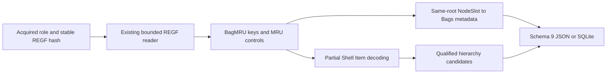

# Windows ShellBags Python CLI

**English** | [한국어](SHELLBAGS_CLI.ko.md)

Implemented on 2026-10-15 on codex/python-shellbags, based on 9bc15c8f765ea2c10d2259049a39222375f5d61c. Package 0.9.0/report schema 9 adds BagMRU hierarchy and referenced Bags metadata. All thirteen EnScript files, archive refs/manifests and 263 reconstructed 2017 commits remain preserved. The original RecentDocuments module has no ShellBags parser; this is a new independent Python extension.

## Run and Input Scope

Python 3.10+ is declared; validation used macOS/Python 3.14. ShellBags uses the existing standard-library REGF reader without new runtime dependencies. EVTX keeps its optional extra. Supply stable acquired binary hives with repeatable --shellbags-ntuser and --shellbags-usrclass; filenames may be changed. Roles select known paths, not verified hive identity or ownership. --shellbags-codepage defaults to cp1252 for ANSI Shell Item names; choose an ANSI-compatible encoding such as cp949 for appropriate acquisitions. Unicode stays UTF-16LE, and LNK codepage settings are separate.

```sh
python3 -m plaintrace --shellbags-ntuser /path/to/NTUSER.DAT --output shellbags.json
python3 -m plaintrace --shellbags-usrclass /path/to/UsrClass.dat --format sqlite --output shellbags.sqlite
python3 -m plaintrace --shellbags-ntuser /case-a/NTUSER.DAT --shellbags-usrclass /case-a/UsrClass.dat --shellbags-codepage cp949 --strict
python3 -m venv .venv
.venv/bin/python -m pip install .
.venv/bin/plaintrace --shellbags-ntuser /path/to/acquired.bin
```

```powershell
py -m venv .venv
.venv\Scripts\python.exe -m pip install .
.venv\Scripts\plaintrace.exe --shellbags-usrclass C:\acquired\UsrClass.dat --output shellbags.json
```

JSON defaults to stdout; SQLite requires --output. Strict mode writes the complete report and returns 1 for warnings. Fatal errors return 2 without publishing partial output. Existing output/input/SQLite-sidecar protections apply. Sources are hashed before/read/after without modification. Only explicit files are opened: no live registry, profile traversal, document/path lookup, target execution, network retrieval, log replay or cross-hive joining. Stable hashes do not prove atomic acquisition or authenticity. ShellBags sources follow all earlier groups; CLI groups ntuser before usrclass and preserves supplied order within each role. Repeated hives have separate source IDs.

## Registry Hierarchy, Ordering and Views

| Supplied role | Shell roots; append BagMRU or Bags |
| --- | --- |
| ntuser | Software\Microsoft\Windows\Shell and ShellNoRoam; Software\Classes\Local Settings\Software\Microsoft\Windows\Shell and ShellNoRoam; Software\Classes\Wow6432Node\Local Settings\Software\Microsoft\Windows\Shell and ShellNoRoam |
| usrclass | Local Settings\Software\Microsoft\Windows\Shell and ShellNoRoam; Wow6432Node\Local Settings\Software\Microsoft\Windows\Shell and ShellNoRoam |

Classes-prefixed paths are supported when physically present in the supplied ntuser-role hive; mounted HKCU views are not synthesized. Missing roots yield an explicit empty-result diagnostic; empty existing BagMRU keys remain records. Only canonical decimal slots 0..4294967294 are treated as numeric entries or child keys. Noncanonical values stay in raw metadata; noncanonical child keys are diagnosed without traversal. Numeric descendants are traversed iteratively, including children whose parent numeric value is absent. That absence is diagnosed, parent_entry_id remains null and ancestry stays unresolved unless a later explicit supported absolute anchor supplies a new path basis. Duplicate paths and roots remain independent observations.

MRUListEx is supported only as REG_BINARY DWORDs with a final 0xffffffff sentinel, no earlier sentinel or duplicate slot. Missing, invalid, unsupported legacy MRUList or simultaneous controls retain raw values without ranks. Valid orders can refer to absent entries: warn, preserve the order and keep rank gaps. Unlisted numeric values remain with null ranks and warnings. Rank 0 is most recent only within that stored list, not a timestamp or complete usage chronology. Output follows key/value enumeration, not rank sorting. The native reader rejects duplicate case-insensitive names and malformed REGF structure.

NodeSlot must be an exact four-byte REG_DWORD. It belongs to the current BagMRU key, whose path is described by its parent's numeric value; it is not copied onto each child value. The literal slot selects Bags\slot under the same Shell root in the same supplied hive. Missing/malformed references are diagnosed without guessed substitutions. Only referenced Bags subtrees are read, recursively and with bounds. Reused slots reference one shared set of view-key records. All values, including Mode, FolderType, Address and opaque layout data, remain raw: no view-setting enums or embedded Address decoding. Unreferenced Bags slots are not scanned, and same-hive NodeSlot references do not establish a user's identity or prove viewing.

## Supported Shell Items and Partial Results

Numeric entries require REG_BINARY. Declared item sizes are walked; single Shell Items and bounded multi-item lists are accepted, with an optional final zero item. Bytes after a terminal remain raw and invalidate path composition. Empty lists, wrong types, malformed lengths/strings/extension offsets and unsupported classes are explicit observations. Structural item errors retain the whole raw registry value with no interpreted items; resource limits are fatal rather than downgraded to malformed rows. No signature carving, offset repair or speculative decoding occurs.

Supported classes: root 0x1f with a raw namespace GUID; named volume 0x23/0x25/0x29/0x2f; standard zero-reserved-byte file/directory 0x31/0x32/0x35/0x36; network 0x41/0x42/0x43/0x46/0x47/0x4c/0xc3. Root GUIDs remain literal namespace components rather than localized folder mappings. Named volumes read the bounded 20-byte ANSI field; only an explicit stored drive-root spelling can anchor a filesystem candidate. Network names/descriptions/comments remain literal; only explicit server/share UNC spellings anchor a network candidate. Non-UNC network labels, device namespace prefixes and dot/dot-dot server/share components remain unresolved, as do unsupported variants.

File entries retain primary ANSI/Unicode names, size, attributes and raw FAT modification fields. Aligned declared extension offsets bound the primary name. BEEF0004 extension versions 3/7/8/9 expose version-specific long names, creation/access FAT fields and raw file-reference bytes where present. Offsets, block sizes, aligned NUL termination and known-extension backlinks are checked. Version layouts use fixed name positions 20/38/42/46; other header words/localized-name material remain raw rather than interpreted as universally reliable offsets. Unknown extension signatures/versions stay opaque with a warning, using an explicit valid primary name if available. A single valid nonempty long name is preferred; multiple valid long names produce an ambiguity warning and retain the primary. Invalid Unicode is escaped for display, excluded from composition, and can fall back to an independently valid primary name. Unextended file entries require a zero trailer; older/variant secondary-name layouts remain unsupported. Root/volume tails stay raw and diagnostic.

Item objects include offset, size, class_type, kind, status, primary_name, long_name, display_name, path_component, component_kind, folder_id, metadata, extensions and raw_hex. Decoded status describes the selected component, not exhaustive interpretation of tails/extensions. Extension objects contain offset, size, version, signature, raw_hex, long_name, created_fat, accessed_fat and file_reference_hex. Metadata includes file_size, file_attributes, modified_fat, root sort_index or network flags/description/comments as applicable. No MFT joins, MAC inference, localized namespace lookup, ZIP/MTP/URI/control-panel/delegate/property-store parsing or deleted/slack recovery is performed. Existing LNK/Jump List PIDL decoding is unchanged and does not automatically reuse this partial ShellBags decoder.

## Path and Time Semantics

path_candidate is a literal hierarchy candidate, never a filesystem lookup or existence claim. Supported names are appended without normalization; empty names, dot/dot-dot and embedded separators/colon/NUL are excluded from file-name composition. Explicit stored drive roots/UNC shares can reset an unresolved prefix; GUID namespaces remain symbolic. path_basis is stored_volume_hierarchy, stored_unc_hierarchy, shell_namespace_hierarchy or relative_hierarchy. A relative candidate is not promoted to an absolute path. ancestry_complete means all contributing ancestry since the most recent explicit anchor is usable; it does not establish acquisition completeness. The root has no invented Desktop prefix or path, and has vacuously complete empty ancestry.

Key last-write times exist only on key/view records, with exact decimal FILETIME plus UTC microsecond display. Zero is null; overflow is diagnosed; integer arithmetic truncates 100 ns fractions. Shell Item FAT dictionaries retain raw_hex, display and time_basis stored_fat_no_timezone: date-word then time-word fields are calendar-decoded at two-second resolution without assigning a timezone or converting to UTC. Zero is null; invalid calendar fields warn while preserving raw bytes. These are stored item metadata, not proven folder-view or user-access events. MRU ranks and NodeSlot relations do not create per-entry registry timestamps, execution, ownership, deletion or session claims.

## Schema 9, Lineage and Architecture

Every JSON format_version and SQLite user_version is 9, including reports without ShellBags. Version 9 adds shellbag_views/shellbag_keys/shellbag_entries and their counts; previous field meanings remain unchanged. Old reports are never migrated or rewritten; consumers must recognize version 9. Sources have source_kind shellbags, schema_family registry_ntuser or registry_usrclass, full-file sha256 and null browser/database/WAL fields.

| Collection/table | Fields |
| --- | --- |
| shellbag_views | source_id, record_id, hive_role, shell_root, key_path, parent_key_id, slot_name, key_last_written, key_last_write_raw, raw_values |
| shellbag_keys | source_id, record_id, hive_role, shell_root, key_path, parent_key_id, parent_entry_id, depth, hierarchy_slots, path_candidate, path_basis, ancestry_complete, key_last_written, key_last_write_raw, mru_status, mru_order, control_values, node_slot, bag_key_id, other_values |
| shellbag_entries | source_id, record_id, key_id, hive_role, shell_root, key_path, value_name, value_type, mru_rank, child_key_id, item_status, items, item_list_terminated, item_trailing_hex, path_candidate, path_basis, ancestry_complete, value_data_hex |

record_id is the physical nk/vk cell-header offset as decimal text, scoped by source_id. Registry Shell Item offsets are logical byte offsets within value_data_hex; they are not physical file offsets. Raw value objects have value_offset, name, type and data_hex. hierarchy_slots preserves the literal numeric key ancestry. View slot_name is the NodeSlot label, not an MRU rank. BagMRU path candidates describe their parent value; entry candidates add their own items. item_status parsed means framed objects exist (including unsupported ones), with malformed/wrong_type/empty alternatives. Unknown decoded fields are null and raw bytes remain available.

SQLite enforces source, unique source/record IDs, key/view parent relations, entry parent/child-key links and same-source Bags references. The key-to-parent-entry constraint is deferred until commit because hierarchy and item records reference each other; all tables are created before inserts. Invalid references abort publication. Objects/arrays are native JSON and JSON text in SQLite, booleans bind as integers, and inserts bind values. These relationships express stored structure, not cross-hive/user correlation.



[shellbags.py](../plaintrace/shellbags.py) walks the existing [REGF reader](../plaintrace/registry_hive.py) and [shell_items.py](../plaintrace/shell_items.py) decodes selected Shell Items. CLI/source/model/export modules integrate the report. Inherited REGF limits include 64 MiB input, 16344 bytes per accessed value, 16 MiB accessed value/name bytes, allocated cells only and native index/record checks. Additional per-hive limits: 5000 BagMRU keys, 5000 referenced view keys, 10000 numeric entries, depth 128 for either tree, 32768 candidate-path characters, 64 items per value, 32 extensions per item and 64 MiB serialized adapter output. Bounds apply to direct calls and may reject valid large collections. Output checks occur after allocation; combined reports remain in memory without a native timeout/memory sandbox. See [REGF restrictions](USB_REGISTRY_CLI.md).

## Tests and Remaining Validation

[Tests and self-review](SHELLBAGS_TESTS.md) map 42 new cases. All 278 tests pass with the EVTX extra; independent python-registry 1.3.1 comparison checks synthetic key/value offsets, names, types and bytes. This is not an independent full Shell Item interpretation or actual acquired-hive validation.

Actual NTUSER/UsrClass ShellBags across Windows/application versions, Windows/Linux execution, Python 3.10, independent real-artifact semantic comparisons, large collections and acquisition races remain unvalidated. Dirty-hive/log replay, REGF 1.6, big data, volatile/link/deleted/slack structures, unsupported Shell Item variants/extensions and unreferenced Bags scanning remain excluded. No automatic cross-artifact/user joins occur. EnCase compilation/execution remains unverified; portable tests do not validate its APIs. Existing artifact limitations remain documented.

## References

Interpretation uses [the registry knowledge base](https://winreg-kb.readthedocs.io/en/latest/sources/explorer-keys/Most-recently-used.html), [libfwsi Shell Item research](https://github.com/libyal/libfwsi/blob/main/documentation/Windows%20Shell%20Item%20format.asciidoc), [the original ShellBags implementation](https://github.com/williballenthin/shellbags/blob/master/shellbags.py), [its Shell Item decoder](https://github.com/williballenthin/shellbags/blob/master/ShellItems.py) and [its FAT calendar handling](https://github.com/williballenthin/shellbags/blob/master/BinaryParser.py). These guide bounded interpretation, not acquired-case certification. No external parser source is vendored. See [archive analysis](ANALYSIS.md).
