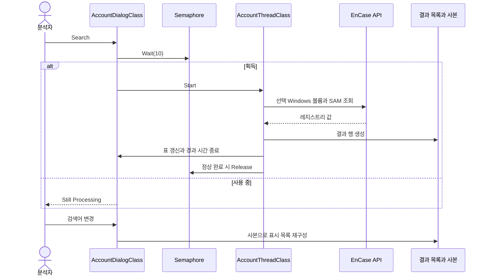
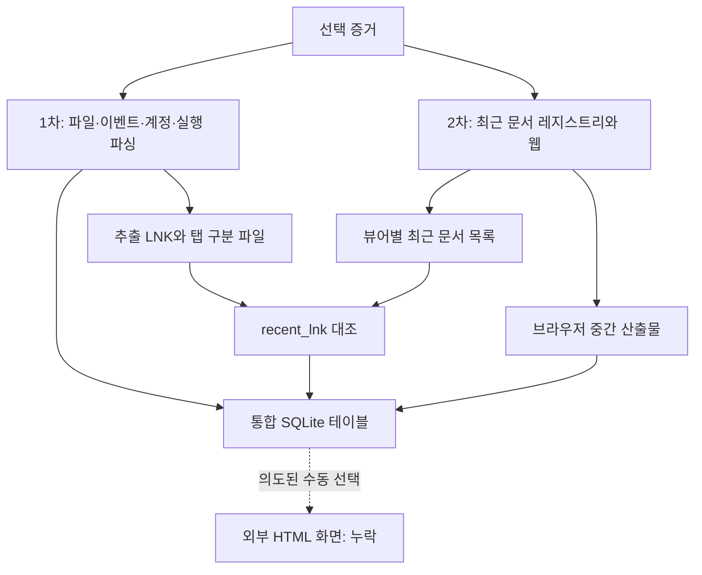

# 시스템 상세 설계

[English](SYSTEM_DESIGN.md) | **한국어**

이 문서의 보존 구현 설명과 검토 결과는 개선 전 태그 `archive/pre-improvements-2026-10-13` 기준입니다. 현재 개선 브랜치의 변경 사항과 남은 검증 항목은 [개선 기록](IMPROVEMENTS.ko.md)을 확인하세요.

2026-10-13 보존된 소스를 기준으로 작성한 사후 문서입니다. 2017년 당시의 원본 산출물이 아닙니다.

## 진입과 선택 범위

`MainClass.Main`은 `CURRENTVIEW`를 순회하며 `IsVolume`과 `WinDir()`의 `Windows` 포함 여부를 확인합니다. 시각이 붙은 북마크 폴더를 만들고 메인 Dialog를 연 뒤 첫 일치 항목에서 종료합니다(진입 파일 64–82행). 다수 작업 스레드는 `CURRENTVIEW_SELECTED`를 순회하므로 진입 볼륨과 모든 작업의 수집 범위가 같다고 보장할 수 없습니다. 현재 뷰와 선택 증거를 모두 기록해야 합니다.

## 일반 수집 수명주기

계정 모듈의 대표 흐름이며 개별 모듈에는 차이가 있습니다.

소스 호출을 설명하며 호스트 스케줄링 모델을 입증하지 않습니다. 예외 정리와 세마포어 대기 단위는 호스트에서 확인해야 합니다. `CanClose()`가 false를 반환하는 경우가 많아 이름만으로 완성된 취소 흐름을 추론하면 안 됩니다.

## 내부 인터페이스 계약

| 인터페이스 | 입력 | 효과·출력 | 검토 사항 |
| --- | --- | --- | --- |
| MainClass.Main(CaseClass) | 열린 케이스 | Windows 메인 화면·북마크 폴더 | 첫 일치 볼륨만 사용 |
| ThreadClass.Run | 케이스·Dialog·폴더 | 파싱 행·내보내기·DB 기록 | 선택·수명·정리 동작 차이 |
| HandlerClass.MenuEvent | 메뉴·노드 이벤트 | CSV/SQLite·파일 추출 | 경로와 출력 포맷 |
| DialogClass.ChildEvent | 호스트 UI 이벤트 | 검색·필터·차트·브라우저 | 재진입과 행 복사 정확성 |
| BuildSqlite 보조 메서드 | 메모리 결과 목록 | 고정 경로 SQLite | 스키마 충돌과 반환 검사 |
| TimeLineThreadClass 보조 메서드 | Entry/Item·SQLite 명령 | 아티팩트별 삽입 | 모듈과 중복된 로직 |

공개 REST가 아닌 내부 EnScript 인터페이스입니다. 생성자가 호스트 객체를 보관하며 독립 DI 컨테이너나 공통 파서 레지스트리는 없습니다.

## 타임라인 처리 흐름

`TimeLineThreadClass.Run`(2006–2120행)은 `C:\TimeLineArtifacts_Total.sqlite`를 쓰기 모드로 열고 반환값 검사 없이 9개 테이블 생성 명령을 실행합니다. 케이스 내보내기 폴더에 `link_files`와 `lnk_parse.csv`를 만듭니다. 첫 순회는 FileDeleted, USBEventLog, LogOn, PowerOn, UserAccount, PrefetchEXE, ExportLink를 호출합니다. 초기 핸들을 닫고 두 번째 순회에서 볼륨별 최근 문서 레지스트리를 읽고 비볼륨 항목에 WebArtifact를 호출합니다. 이후 통합 DB를 다시 열어 recent_lnk로 추출 LNK와 최근 문서를 대조합니다.

초기 스키마는 PC_PowerOnOff, PC_LogOnOff, App_EXEFile, App_Documents, USB_EventLog, PC_UserAccount, Web_Download, Web_Keyword, File_Deleted입니다. 브라우저 보조 함수가 INSERT하는 Web_Visit·Web_Host는 없습니다. 방문→검색어 전달에서도 읽은 reader를 재사용합니다. 아래 화살표는 시도하는 흐름이며 정상 기록을 입증하지 않습니다.

브라우저 보조 메서드는 별도 파일·DB 핸들을 사용하며 전체가 하나의 원자적 트랜잭션이 아닙니다. 완료 문구는 완전성·행 수 검증이 아닙니다. 출력별 차이는 [데이터 모델](DATA_MODEL.ko.md)에 정리했습니다.

## 필터·차트·오류

필터는 대체로 표시 목록을 지우고 사본에서 다시 만듭니다. 필터 해제 시 복원하지만 일부 모듈 생성자 인자 불일치로 값이 달라질 수 있습니다. 시스템 정보 차트는 선택한 케이스 항목을 직접 집계합니다(Win_SystemInfo 459–542행). Prefetch·웹 차트는 파생 SQLite를 집계합니다. 내보내기·차트 반복 생성 시 기존 테이블과 충돌할 수 있습니다. 콘솔·Dialog·bool·프로세스 종료가 혼용되며 중앙 오류·결과 계약은 없습니다.

## 누락된 표현 계약

도움말은 브라우저에서 SQLite 파일과 시간 범위를 선택하는 흐름을 설명합니다(Win_TimeLine 2182–2186행). HTML/JS가 없어 입력 테이블, 브라우저 SQL 엔진, 이벤트 렌더링, 구간 의미, 시간대 처리를 실제 구현 계약으로 명시할 수 없습니다. 이 UI 흐름은 과거 의도에 대한 설명입니다.
