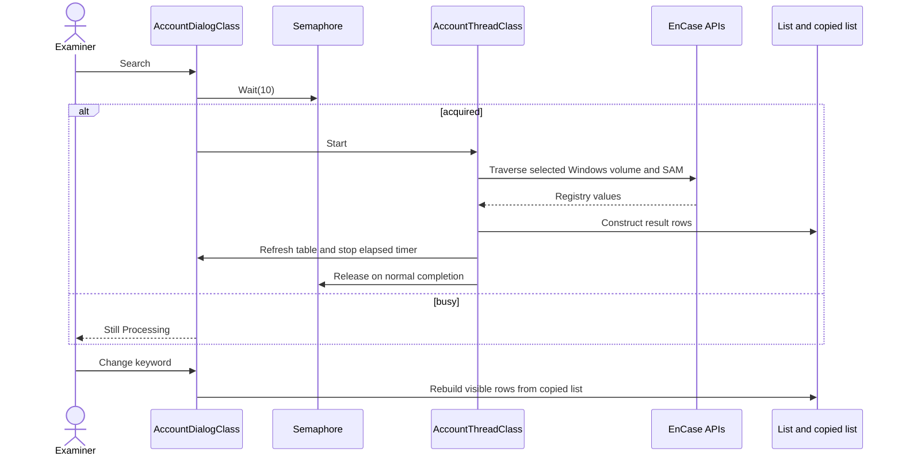
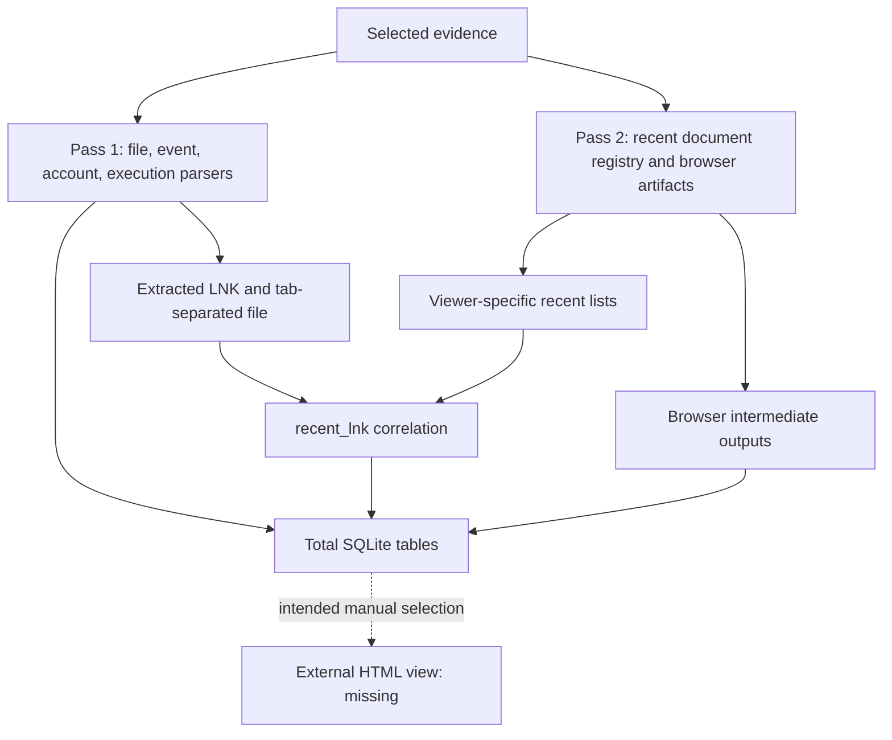

# Detailed System Design

**English** | [한국어](SYSTEM_DESIGN.ko.md)

Archived implementation descriptions and review findings in this document refer to tag `archive/pre-improvements-2026-10-13`. See [the improvement record](IMPROVEMENTS.md) for changes and remaining validation on the current improvement branch.

Prepared on 2026-10-13 from the archived source. This is retrospective documentation, not an original 2017 deliverable.

## Entry and Selection

`MainClass.Main` iterates `CURRENTVIEW`, tests `IsVolume`, obtains its volume, and checks whether `WinDir()` contains `Windows`. It creates a timestamped bookmark folder, opens the main dialog, and breaks after the first match (entry file lines 64–82). Many workers instead iterate `CURRENTVIEW_SELECTED`; the visible volume used at entry does not guarantee that every worker scans the same scope. Record both the visible view and the selected evidence.

## Typical Collection Lifecycle

The account module demonstrates the common pattern; individual modules differ.

This describes calls in source, not a proven host scheduling model. Exception cleanup and the meaning of semaphore timeout units require host validation. `CanClose()` often returns false; do not infer a fully implemented cancellation flow from this method name.

## Internal Interface Contracts

| Interface | Input | Effect/output | Review point |
| --- | --- | --- | --- |
| MainClass.Main(CaseClass) | Open case | Windows main dialog/bookmark folder | First matching volume only |
| ThreadClass.Run | Captured case/dialog/folder | Parsed rows, exports or database writes | Selection, lifetime and cleanup vary |
| HandlerClass.MenuEvent | Menu and node event | CSV/SQLite or extraction action | Output path and formatting |
| DialogClass.ChildEvent | Host UI event | Search, filtering, chart or browser action | Reentrancy and row-copy correctness |
| BuildSqlite helpers | In-memory result lists | Fixed-path SQLite output | Schema conflicts and return checks |
| TimeLineThreadClass helpers | Entry/item and SQLite command | Artifact-specific insertions | Logic duplicated from modules |

These are internal EnScript interfaces, not public REST endpoints. Constructors capture host objects; no standalone dependency injection container or shared parser registry is present.

## Timeline Pipeline

`TimeLineThreadClass.Run` (lines 2006–2120) opens `C:\TimeLineArtifacts_Total.sqlite` for writing and issues nine table-creation statements without checking their results. It creates `link_files` and `lnk_parse.csv` under the case export directory. Pass one invokes FileDeleted, USBEventLog, LogOn, PowerOn, UserAccount, PrefetchEXE and ExportLink. After closing the initial handles, pass two reads per-volume recent-document registry lists and invokes WebArtifact for non-volume entries. It then reopens the total database and correlates exported LNK data using recent_lnk.

The initial schema includes PC_PowerOnOff, PC_LogOnOff, App_EXEFile, App_Documents, USB_EventLog, PC_UserAccount, Web_Download, Web_Keyword and File_Deleted. Web_Visit and Web_Host are absent even though browser helpers attempt inserts into them. The visit-to-keyword helper handoff also reuses a consumed reader. The arrows below describe attempted data flow, not verified successful writes.

Browser helpers use their own file/database handles; the flow is not one atomic transaction. GUI completion text is not a completeness or row-count check. The [data model](DATA_MODEL.md) describes separate outputs and variants.

## Filtering, Charts and Errors

Filtering generally clears displayed rows and rebuilds them from a copied list. Clearing a filter can restore the list, but constructor argument mismatches can alter values in some modules. The system information chart directly counts selected case items (Win_SystemInfo lines 459–542); Prefetch and web charts aggregate derived SQLite data. Exports and repeated chart builds can conflict with pre-existing tables. Console messages, dialogs, boolean results, and some process exits are used inconsistently; there is no central error/result contract.

## Missing Presentation Contract

Help text describes selecting an SQLite file and a time interval in a browser (Win_TimeLine lines 2182–2186). Without the HTML/JS, accepted tables, browser-side SQL engine, event rendering, interval semantics and timezone handling cannot be specified as implemented behavior. The documented UI flow is historical intent only.
