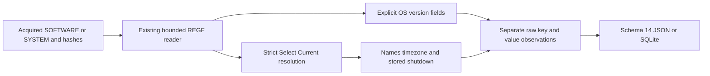

# Windows 시스템 정보 Python CLI

[English](SYSTEM_INFO_CLI.md) | **한국어**

현재 패키지는 0.15.0이며 모든 출력은 스키마 15입니다. 아래 도입/결과는 당시 기록이며 현재 스키마는 [SAM 계정](SAM_ACCOUNTS_CLI.ko.md)을 참고하세요.

2026-10-26에 4638b5101ef3c5ec389d7d77418fe62acd8557c4 기반 codex/python-system-info에서 구현하고 자체 리뷰했습니다. 패키지 0.14.0/보고서 스키마 14는 획득 SOFTWARE/SYSTEM 레지스트리 관측을 도입합니다. EnScript 13개는 bb476180453c76f7d38e5b6a9f1f025ad2273ce0과 바이트 단위로 같으며 원본 아카이브 참조/매니페스트와 사후 재구성된 2017년 커밋 263개를 보존합니다. 현대 작업은 실제 날짜를 사용합니다.

## 실행과 획득 입력

반복 가능한 --system-info-software·--system-info-system에 명시적으로 획득한 안정된 REGF SOFTWARE/SYSTEM 하이브를 지정합니다. 역할은 직접 지정하며 파일 이름으로 탐지하거나 하이브를 결합하지 않습니다. Python 3.10+를 요구하고 macOS/Python 3.14에서 검증했습니다. 이 어댑터는 표준 라이브러리만 사용하며 EVTX의 선택 추가 의존성은 유지합니다.

```sh
python3 -m plaintrace --system-info-software /path/to/SOFTWARE --output os.json
python3 -m plaintrace --system-info-system /path/to/SYSTEM --strict
python3 -m plaintrace --system-info-software /case-a/SOFTWARE --system-info-software /case-b/SOFTWARE --system-info-system /case-a/SYSTEM --format sqlite --output system.sqlite
python3 -m venv .venv
.venv/bin/python -m pip install .
.venv/bin/plaintrace --system-info-software /path/to/acquired.bin
```

```powershell
py -m venv .venv
.venv\Scripts\python.exe -m pip install .
.venv\Scripts\plaintrace.exe --system-info-system C:\acquired\SYSTEM --output system.json
```

JSON 기본 출력은 stdout이며 SQLite는 --output이 필요합니다. 일반 성공은 0이고 --strict는 전체 보고서를 쓰고 경고가 있으면 1입니다. 치명적 인수/입력/출력 오류는 부분 보고서 파일을 게시하지 않고 2입니다. 목적지/입력/SQLite 사이드카 보호와 배타적 게시를 유지하며 셸 stdout 리다이렉션에는 해당 보장이 없습니다. 크기를 제한해 읽고 읽기 전/읽은 데이터/읽기 후 해시를 비교하며 입력은 수정하지 않습니다. 해시 일치는 원자적 획득·진위·완전한 증거 관리 연속성을 입증하지 않습니다.

시스템 정보 그룹은 기존 입력 뒤에 추가됩니다. CLI는 플래그 교차 순서와 무관하게 SOFTWARE, SYSTEM 순이며 그룹 안에서는 지정 순서를 유지하고 API는 system_info_hives 쌍 순서를 유지합니다. 반복 입력은 별도 출처 ID입니다. 자동 하이브/장비/사용자 결합·호스트 레지스트리 접근·프로필 검색·네트워크·대상 실행·경로 조회·로그 재생을 하지 않습니다.

## 원본 모듈과의 관계 및 범위

원본 Win_SystemInfo는 EnCase 사건/파일/볼륨 보고서·분포 차트·SOFTWARE OS 필드/제품 키 처리·SYSTEM 이름/종료 처리·SAM 열거를 포함합니다. Python 어댑터는 오프라인 OS/설정 부분을 이식합니다. EnCase 파일/볼륨 API·차트/북마크/GUI·디스크 이미지 추출·SAM 계정 분석·제품 키 도출은 이번 범위 밖입니다. 출력은 별도 관측 스키마이며 EnScript와 바이트 단위로 같은 결과가 아닙니다. 원본 종료 시각 보조 함수와 고정 ControlSet001/이름 조회 가정은 재현하지 않습니다.

| 역할 / observation_kind | 정확한 루트 또는 접미 경로 | 선택한 해독 필드 |
| --- | --- | --- |
| software / os_version | Microsoft\Windows NT\CurrentVersion | 아래 문자열·DWORD 버전 필드·InstallDate/InstallTime |
| system / control_set_selection | Select | Current, Default, Failed, LastKnownGood DWORD |
| system / computer_name | Control\ComputerName\ComputerName | ComputerName |
| system / active_computer_name | Control\ComputerName\ActiveComputerName | ComputerName |
| system / tcpip_parameters | Services\Tcpip\Parameters | Hostname, NV Hostname, Domain, NV Domain |
| system / time_zone | Control\TimeZoneInformation | TimeZoneKeyName, StandardName, DaylightName, Bias, ActiveTimeBias, StandardBias, DaylightBias, DynamicDaylightTimeDisabled, DisableAutoDaylightTimeSet |
| system / shutdown | Control\Windows | ShutdownTime |

SYSTEM 접미 경로는 Select/Current가 참조한 제어 집합만 사용합니다. 정확히 4바이트 REG_DWORD 1..999와 해당 ControlSetNNN 루트가 필요하며 없으면 입력을 실패 처리합니다. ControlSet001·Default·LastKnownGood·CurrentControlSet 대체는 없습니다. Select도 선택한 control_set과 함께 관측이 됩니다. 설정/활성/TCPIP 이름은 충돌해도 별도로 남기고 유효 호스트 이름을 만들어내지 않습니다. 선택적 ActiveComputerName은 획득 하이브에 없을 수 있습니다.

SOFTWARE 문자열 필드는 ProductName, EditionID, CompositionEditionID, InstallationType, CurrentVersion, CurrentBuild, CurrentBuildNumber, CurrentType, BuildLab, BuildLabEx, BuildBranch, DisplayVersion, ReleaseId, CSDVersion, RegisteredOwner, RegisteredOrganization, ProductId, SystemRoot, PathName, SourcePath, SoftwareType입니다. CurrentMajorVersionNumber·CurrentMinorVersionNumber·UBR은 부호 없는 DWORD입니다. 이를 추측한 OS 마케팅 이름·아키텍처·릴리스로 합치거나 모순을 묵시적으로 해소하지 않습니다. RegisteredOwner/조직과 ProductId는 저장 레이블이며 검증된 사용자 신원·소유권·라이선스 권리가 아닙니다.

정확한 루트만 관측하며 레지스트리 이름의 대소문자를 무시합니다. 하위 키·다른 과거 제어 집합·하드웨어 목록·인터페이스·시간대 규칙 DB·네트워크 프로필·과거 Windows 9x 하이브·WOW 변형은 찾지 않습니다. 선택적 루트 누락은 경고만 남기고 관측을 조작하지 않으며 존재하는 빈 루트는 행으로 유지합니다. 선택 필드가 없으면 정상적인 버전별 차이여도 묶인 fields_absent 경고를 남기며 이는 가용성 안내이고 손상 증거가 아닙니다. DigitalProductId/DigitalProductId4/라이선스 데이터 등 미상 값은 전체 원시 바이트와 불투명 상태로 남기고 제품 키를 도출하지 않습니다. 설계상 불투명 값 자체는 경고하지 않습니다.

## 값 해독과 원시 보존

선택 문자열은 REG_SZ/REG_EXPAND_SZ를 허용하고 첫 정렬 UTF-16LE NUL이 경계입니다. 유니코드·공백·따옴표·환경 토큰·경로를 리터럴로 유지하고 확장/정규화하지 않습니다. text_utf16_hex는 종결자를 제외하고 trailing_data_hex는 패딩 등 뒤의 모든 바이트를 경고와 보존합니다. 종결자가 없으면 decoded/경계 필드는 null이며 잘못된 UTF-16은 바이트 역슬래시 이스케이프와 경고로 표시하고 정확한 바이트를 유지합니다. 빈 문자열도 경고하며 다른 형식은 강제 변환하지 않습니다. 모든 원시 값 데이터와 REGF 해독 이름을 보존하고 이름 자체의 원시 바이트는 아닙니다.

DWORD는 형식 4와 정확히 4바이트가 필요하며 보통 부호 없는 값입니다. Bias/ActiveTimeBias/StandardBias/DaylightBias는 2의 보수 부호 있는 DWORD입니다. 설정된 분 단위 편차만 노출하며 내장 시각 보정·과거 시간대 추론·DST 규칙 재생·물리 위치 식별·현재 활동 가정을 하지 않습니다. 다른 시간대 이진 구조는 불투명하게 남기며 플래그도 부호 없는 값이고 임의의 불리언 유효성을 부여하지 않습니다.

InstallDate는 정확히 4바이트 REG_DWORD의 부호 없는 Unix 초이며 InstallTime은 8바이트 REG_QWORD FILETIME, ShutdownTime은 8바이트 REG_BINARY FILETIME입니다. 길이만으로 형식을 추론하거나 접두부 복구/후행 숫자 바이트를 허용하지 않습니다. time_raw는 정확한 십진수 텍스트이고 time_unit은 unix_seconds/filetime_100ns입니다. time은 정수 기반 UTC 마이크로초이며 0은 미지정/null, FILETIME 범위 초과는 경고와 null이고 마지막 100 ns 자릿수까지 원시 틱을 보존합니다. decoded도 원시 부호 없는 시간 정수를 보존하므로 64비트 JSON 정수를 정확히 표현하지 못하는 소비자는 time_raw를 사용해야 합니다.

설치 값은 최초 설치보다 설정/업그레이드 변경을 반영할 수 있습니다. ShutdownTime은 저장 종료 시각 필드이며 전체 전원 이력·정상 종료 증명·부팅 시각·가동 시간·원인이 아닙니다. 키 마지막 쓰기는 key_last_written/key_last_write_raw에 별도로 남기며 값 시각의 대체로 쓰지 않습니다. 설정은 수정·노후·누락될 수 있고 출처 역할/해시만으로 두 하이브가 같은 장비에서 왔다고 증명하지 않습니다. OS 신원·사용자/세션·네트워크 연결·활동을 독립 입증하지 않습니다.

값 status는 opaque/wrong_type/wrong_size/unterminated/invalid_text/empty/trailing/parsed입니다. 형식 검사가 크기 검사보다 앞섭니다. 잘못된 텍스트가 후행 데이터보다 우선이며 그렇지 않으면 빈 텍스트라도 꼬리가 있으면 trailing입니다. parsed는 지원하는 이진 경계일 뿐 의미의 진실성 검증이 아니며 범위 밖 FILETIME도 parsed와 null time·진단이 될 수 있습니다. 이용 불가 해독 필드는 null이며 추측한 기본값이 아닙니다.

## 스키마 14, 출처와 구조

시스템 입력이 없어도 모든 JSON format_version/SQLite user_version은 14입니다. 버전 14는 system_info와 개수를 추가하고 기존 필드 의미를 유지하며 과거 보고서를 변환하지 않습니다. 출처는 source_kind system_info, schema_family registry_software/registry_system, 전체 파일 sha256과 null 브라우저/DB/WAL 필드입니다. hive_role은 software/system이며 software의 control_set은 null입니다.

| Collection/table | Fields |
| --- | --- |
| system_info | source_id, record_id, hive_role, observation_kind, key_path, control_set, key_last_written, key_last_write_raw, values |
| Nested values object | value_offset, name, type, status, decoded, text_utf16_hex, trailing_data_hex, time, time_raw, time_unit, value_data_hex |

record_id는 source_id 범위 내 물리적 nk 셀 헤더 오프셋의 십진수 텍스트이며 중첩 value_offset은 물리적 vk 셀 헤더 오프셋입니다. 값 데이터가 별도 셀에 있을 수 있으므로 데이터 오프셋은 아닙니다. SQLite는 중첩 values 배열에 values_json을 사용하고 출처 외래 키를 강제하며 가공한 출처 간 관계는 없습니다. 객체/배열은 JSON 값 또는 SQLite JSON 텍스트이며 SQL 삽입은 매개변수를 바인딩합니다.



[system_info.py](../plaintrace/system_info.py)는 [registry_hive.py](../plaintrace/registry_hive.py)와 [binary.py](../plaintrace/binary.py)를 재사용하고 기존 디코더 의미는 바꾸지 않습니다. [execution.py](../plaintrace/execution.py), [cli.py](../plaintrace/cli.py), [model.py](../plaintrace/model.py), [exports.py](../plaintrace/exports.py)가 연결을 추가합니다. 입력별 상속 제한은 하이브 64 MiB, 스캔 셀 250000개, 네이티브 키/인덱스/값 항목 100000개, 접근한 키당 값 4096개, 값당 16344바이트, 접근한 값/이름 합계 16 MiB입니다. 어댑터는 관측 8개·관측 값 총 4096개·꼬리를 포함한 선택 문자열당 UTF-16 코드 단위 4096개와 종결자 하나 분량의 바이트·직렬화 어댑터 출력 32 MiB입니다. 불투명 값은 네이티브 제한을 유지하며 직접 호출에도 제한을 적용하고 유효한 입력도 거부할 수 있습니다. 크기 검사는 할당 후 수행하며 결합 보고서는 메모리에 유지하고 네이티브 시간/메모리 격리는 없습니다.

## 테스트와 남은 검증

[테스트와 자체 리뷰](SYSTEM_INFO_TESTS.ko.md)는 새 합성 사례 33개를 매핑하며 EVTX 추가 의존성을 포함한 Python 테스트 440개가 생략 없이 통과했습니다. 독립 합성 REGF/원시 값 검사와 설치 콘솔 검증은 실제 Windows/EnCase 동작 인증이 아니고 아카이브 검증은 별도 무결성 검사입니다.

Windows 버전별 실제 획득 SOFTWARE/SYSTEM·Windows/Linux 실행·Python 3.10·독립 실제 레코드 의미·대형 입력 성능·획득 경쟁은 미검증입니다. 누락/버전별 키·미지원 형식/구조·네이티브 REGF 1.6/big data/휘발성/링크/삭제/슬랙 제한을 명시합니다. 더티 하이브 재생·복구·제품 키 도출·SAM/볼륨 목록·자동 신원 결합을 하지 않습니다. EnCase 컴파일/실행은 여전히 미검증이며 기존 아티팩트 제한도 유지합니다.

## 참고 자료

[Windows 제품 정보](https://winreg-kb.readthedocs.io/en/latest/sources/system-keys/Windows-product-information.html), [현재 제어 집합](https://winreg-kb.readthedocs.io/en/latest/sources/system-keys/Current-control-set.html), [시간대 설정](https://support.microsoft.com/en-gb/servicing/os/windows-server/2020/08/kb914387-how-to-configure-daylight-saving-time-for-microsoft-windows-operating-systems), [Plaso 종료 구현](https://github.com/log2timeline/plaso/blob/main/plaso/parsers/winreg_plugins/shutdown.py)을 좁게 선언한 해석의 참고로 사용합니다. 모든 Windows 호환성을 확립하지 않으며 구현 소스를 복사해 포함하지 않았습니다. [아카이브 분석](ANALYSIS.ko.md)과 [개선 기록](IMPROVEMENTS.ko.md)을 참고하세요.
