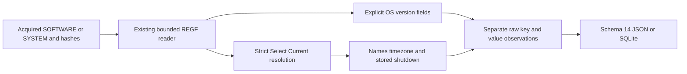

# Windows System Information Python CLI

**English** | [한국어](SYSTEM_INFO_CLI.ko.md)

The current package is 0.15.0 and every output uses schema 15. Earlier introductions/results below describe their release context; see [SAM accounts](SAM_ACCOUNTS_CLI.md) for the current schema.

Implemented and self-reviewed on 2026-10-26 on codex/python-system-info from 4638b5101ef3c5ec389d7d77418fe62acd8557c4. Package 0.14.0/report schema 14 introduces acquired SOFTWARE/SYSTEM registry observations. All thirteen EnScript files remain byte-identical to bb476180453c76f7d38e5b6a9f1f025ad2273ce0; original archive refs/manifests and 263 retrospectively reconstructed 2017 commits remain preserved. Modern work uses its actual date.

## Run and Acquired Input

Supply explicit acquired stable REGF SOFTWARE/SYSTEM hives with repeatable --system-info-software and --system-info-system. Roles are supplied, not detected from filenames or joined across hives. Python 3.10+ is declared; testing used macOS/Python 3.14. This adapter uses only the standard library; EVTX still has its optional extra.

```sh
python3 -m plaintrace --system-info-software /path/to/SOFTWARE --output os.json
python3 -m plaintrace --system-info-system /path/to/SYSTEM --strict
python3 -m plaintrace --system-info-software /case-a/SOFTWARE --system-info-software /case-b/SOFTWARE --system-info-system /case-a/SYSTEM --format sqlite --output system.sqlite
python3 -m venv .venv
.venv/bin/python -m pip install .
.venv/bin/plaintrace --system-info-software /path/to/acquired.bin
```

```powershell
py -m venv .venv
.venv\Scripts\python.exe -m pip install .
.venv\Scripts\plaintrace.exe --system-info-system C:\acquired\SYSTEM --output system.json
```

JSON defaults to stdout; SQLite needs --output. Normal success returns 0; --strict writes the whole report and returns 1 for warnings. Fatal argument/input/output errors return 2 without publishing partial report files. Existing destination/input/SQLite-sidecar protections and exclusive publication remain; shell stdout redirection lacks those file guarantees. Bounded reads compare before/read/after hashes without modifying input. Matching hashes do not prove atomic acquisition, authenticity or a complete chain of custody.

System information groups follow all existing inputs: CLI SOFTWARE first then SYSTEM, each in supplied order regardless of flag interleaving; the API preserves system_info_hives pair order. Each repeated input has its own source ID. No automatic cross-hive/machine/user joins, host registry access, profile scanning, network requests, executable launch, path lookup or log replay occurs.

## Relation to Original Module and Scope

The original Win_SystemInfo module includes EnCase case/file/volume reports, distribution charts, SOFTWARE OS fields/product-key processing, SYSTEM names/shutdown handling and SAM enumeration. This Python adapter ports the offline OS/settings portion. EnCase file/volume APIs, charts/bookmarks/GUI, disk-image extraction, SAM account analysis and product-key derivation are outside this release. Its output is a separate observation schema, not byte-for-byte EnScript output. The original shutdown helper and fixed ControlSet001/name lookup assumptions are not reproduced.

| Role / observation_kind | Exact root or suffix | Selected decoded fields |
| --- | --- | --- |
| software / os_version | Microsoft\Windows NT\CurrentVersion | Strings listed below; DWORD version fields; InstallDate/InstallTime |
| system / control_set_selection | Select | Current, Default, Failed, LastKnownGood DWORDs |
| system / computer_name | Control\ComputerName\ComputerName | ComputerName |
| system / active_computer_name | Control\ComputerName\ActiveComputerName | ComputerName |
| system / tcpip_parameters | Services\Tcpip\Parameters | Hostname, NV Hostname, Domain, NV Domain |
| system / time_zone | Control\TimeZoneInformation | TimeZoneKeyName, StandardName, DaylightName, Bias, ActiveTimeBias, StandardBias, DaylightBias, DynamicDaylightTimeDisabled, DisableAutoDaylightTimeSet |
| system / shutdown | Control\Windows | ShutdownTime |

SYSTEM suffixes use the control set referenced by Select/Current only. Require an exact four-byte REG_DWORD in 1..999 and an existing selected ControlSetNNN root; otherwise fail the input. No ControlSet001, Default, LastKnownGood or CurrentControlSet fallback occurs. Select itself becomes an observation with the selected control_set. Configured/active/TCPIP names remain separate even when they conflict; no effective hostname is invented. The optional ActiveComputerName key may be absent from acquired hives.

SOFTWARE string fields: ProductName, EditionID, CompositionEditionID, InstallationType, CurrentVersion, CurrentBuild, CurrentBuildNumber, CurrentType, BuildLab, BuildLabEx, BuildBranch, DisplayVersion, ReleaseId, CSDVersion, RegisteredOwner, RegisteredOrganization, ProductId, SystemRoot, PathName, SourcePath and SoftwareType. CurrentMajorVersionNumber, CurrentMinorVersionNumber and UBR are unsigned DWORDs. Values are not combined into a guessed OS marketing name, architecture or release, and contradictions are not silently resolved. RegisteredOwner/organization and ProductId are stored labels, not verified user identity, ownership or licensing entitlement.

Only these exact roots are observed, with case-insensitive registry names. No descendants, historical alternate control sets, hardware inventory, interfaces, timezone rule databases, network profiles, legacy Windows 9x hives or WOW variants are searched. Missing optional roots warn without fabricated observations; present empty roots stay rows. Missing selected fields yield a grouped fields_absent warning, even for normal version-specific omissions. Such warnings are availability notices, not evidence of corruption. Unknown values, including DigitalProductId/DigitalProductId4/license data, stay opaque with full raw bytes and no product-key derivation; opaque-by-design values do not themselves warn.

## Value Decoding and Raw Preservation

Selected strings accept REG_SZ/REG_EXPAND_SZ, framed by the first aligned UTF-16LE NUL. Preserve literal Unicode, whitespace, quotes, environment tokens and paths; never expand or normalize. text_utf16_hex excludes the terminator and trailing_data_hex retains every following byte, including padding, with a warning. Missing terminators leave decoded/framing fields null; invalid UTF-16 displays byte backslash escapes with a warning and exact bytes retained. Empty strings warn. Wrong types are not coerced. All raw value data and original REGF-decoded names remain; names are not raw name bytes.

DWORD fields require type 4 and exactly four bytes; ordinary fields are unsigned. Bias/ActiveTimeBias/StandardBias/DaylightBias are signed two's-complement DWORDs. These expose configured minute biases only: do not apply them to embedded times, infer a historical timezone, replay DST rules, identify physical location or assume current activity. Other timezone binary structures remain opaque. Flags remain unsigned values without a fabricated boolean validity interpretation.

InstallDate requires a four-byte REG_DWORD interpreted as unsigned Unix seconds. InstallTime requires an eight-byte REG_QWORD FILETIME, and ShutdownTime an eight-byte REG_BINARY FILETIME. No length-only type inference, prefix recovery or trailing numeric bytes are accepted. time_raw is exact decimal text and time_unit is unix_seconds/filetime_100ns. time is a UTC microsecond display using integer arithmetic; zero means unspecified/null, FILETIME overflow warns and stays null while raw ticks remain exact, including the final 100 ns digit. decoded also retains the raw unsigned time integer; use time_raw for consumers unable to represent full 64-bit JSON integers.

Install values may reflect setup/upgrade changes rather than the first installation ever. ShutdownTime is a stored shutdown-time field, not a complete power history, clean-shutdown proof, boot time, uptime or cause. Key last-write remains separately in key_last_written/key_last_write_raw and is not substituted for missing value times. These settings may be edited, stale or incomplete; source-role labels/hashes do not establish that two hives came from one machine. No OS identity, user/session, network connectivity or activity is independently proven.

Value status is opaque/wrong_type/wrong_size/unterminated/invalid_text/empty/trailing/parsed. Wrong type precedes size checks. Invalid text takes precedence over trailing data; otherwise any tail sets trailing, including for empty text. parsed means supported binary framing, not verified semantic truth; an out-of-range FILETIME can be parsed with null time and a diagnostic. Unavailable decoded fields are null, not guessed defaults.

## Schema 14, Lineage and Architecture

Every JSON format_version/SQLite user_version is 14, even without system inputs. Version 14 adds system_info and its count, preserving earlier field meanings. Old reports are not migrated. Sources use source_kind system_info, schema_family registry_software/registry_system, full-file sha256 and null browser/database/WAL fields. hive_role is software/system; software control_set is null.

| Collection/table | Fields |
| --- | --- |
| system_info | source_id, record_id, hive_role, observation_kind, key_path, control_set, key_last_written, key_last_write_raw, values |
| Nested values object | value_offset, name, type, status, decoded, text_utf16_hex, trailing_data_hex, time, time_raw, time_unit, value_data_hex |

record_id is the physical nk cell-header offset as decimal text scoped by source_id; nested value_offset is the physical vk cell-header offset. It is not the data offset because value data can reside in another cell. SQLite uses values_json for the nested values array and enforces source foreign keys; there are no fabricated cross-source relationships. Objects/arrays are JSON values or SQLite JSON text; SQL inserts bind parameters.



[system_info.py](../plaintrace/system_info.py) reuses [registry_hive.py](../plaintrace/registry_hive.py) and [binary.py](../plaintrace/binary.py) without changing existing decoder semantics. [execution.py](../plaintrace/execution.py), [cli.py](../plaintrace/cli.py), [model.py](../plaintrace/model.py) and [exports.py](../plaintrace/exports.py) add integration. Inherited limits per input: 64 MiB hive, 250000 scanned cells, 100000 native key/index/value items, 4096 values per accessed key, 16344 bytes per value and 16 MiB accessed value/name bytes. Adapter caps: eight observations, 4096 total observed values, 4096 UTF-16 code units plus one terminator worth of bytes per selected string including any tail, and 32 MiB serialized adapter output. Opaque values retain native bounds. Limits apply to direct calls and may reject valid inputs. Size checks occur after allocation; combined reports stay in memory without a native timeout/memory sandbox.

## Tests and Remaining Validation

[Tests and self-review](SYSTEM_INFO_TESTS.md) map 33 new synthetic cases; all 440 Python tests pass with the EVTX extra without skips. Independent synthetic REGF/raw-value checks and installed-console validation are not certification of actual Windows/EnCase behavior. Archive validation is separate integrity verification.

Actual acquired SOFTWARE/SYSTEM across Windows versions, Windows/Linux execution, Python 3.10, independent real-record semantics, large-input performance and acquisition races remain unvalidated. Missing/version-specific keys, unsupported types/structures and native REGF 1.6/big-data/volatile/link/deleted/slack restrictions remain explicit. No dirty-hive replay, recovery, product-key derivation, SAM/volume inventory or automatic identity joins. EnCase compilation/execution remains unverified; previous artifact limitations remain.

## References

[Windows product information](https://winreg-kb.readthedocs.io/en/latest/sources/system-keys/Windows-product-information.html), [current control sets](https://winreg-kb.readthedocs.io/en/latest/sources/system-keys/Current-control-set.html), [time-zone configuration](https://support.microsoft.com/en-gb/servicing/os/windows-server/2020/08/kb914387-how-to-configure-daylight-saving-time-for-microsoft-windows-operating-systems), and [Plaso's shutdown implementation](https://github.com/log2timeline/plaso/blob/main/plaso/parsers/winreg_plugins/shutdown.py) inform the narrowly declared interpretation. They do not establish universal Windows compatibility. No implementation source is vendored. See [archive analysis](ANALYSIS.md) and [improvements](IMPROVEMENTS.md).
