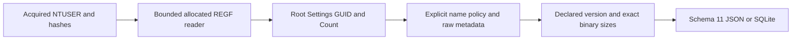

# UserAssist Python CLI

[English](USERASSIST_CLI.md) | **한국어**

현재 패키지는 0.14.0이며 모든 출력은 스키마 14입니다. 아래 도입/결과는 당시 기록이며 현재 스키마는 [시스템 정보](SYSTEM_INFO_CLI.ko.md)를 참고하세요.

2026-10-16에 caa66102c4c46ebc7ab0e81153c36801bdfc8d67 기반 codex/python-userassist에서 구현하고 자체 리뷰했습니다. 패키지 0.11.0은 보고서 스키마 11과 독립 UserAssist 어댑터를 도입합니다. 원본 EnScript 13개에는 전용 UserAssist 파서가 없으며 bb476180453c76f7d38e5b6a9f1f025ad2273ce0과 바이트 단위로 동일합니다. 아카이브 참조/매니페스트와 사후 재구성한 2017년 커밋 263개를 보존하고 실제 작업 날짜를 사용합니다.

## 실행과 입력 보존

파일 이름에 관계없이 명시적으로 획득한 안정된 NTUSER.DAT REGF 파일을 입력합니다. 요구 버전은 Python 3.10+이며 macOS/Python 3.14에서 검증했습니다. UserAssist는 표준 라이브러리만 사용하며 기존 EVTX 어댑터는 선택 추가 의존성이 필요합니다.

```sh
python3 -m plaintrace --userassist /path/to/NTUSER.DAT --output userassist.json
python3 -m plaintrace --userassist /case-a/NTUSER.DAT --userassist /case-b/NTUSER.DAT --format sqlite --output userassist.sqlite
python3 -m plaintrace --userassist /path/to/NTUSER.DAT --strict
python3 -m venv .venv
.venv/bin/python -m pip install .
.venv/bin/plaintrace --userassist /path/to/acquired.bin
```

```powershell
py -m venv .venv
.venv\Scripts\python.exe -m pip install .
.venv\Scripts\plaintrace.exe --userassist C:\acquired\NTUSER.DAT --output userassist.json
```

JSON 기본 출력은 stdout입니다. SQLite는 --output이 필요하며 기존 출력·입력 경로·예약된 SQLite 사이드카를 덮어쓰지 않습니다. 엄격 모드는 경고가 있으면 보고서를 작성하고 1을 반환하며 일반 성공은 0입니다. 치명적 입력/출력 오류는 부분 보고서 파일을 게시하지 않고 2를 반환합니다. 경고는 진단이며 손상이나 악성 증거의 확정이 아닙니다. 정상 세션 제어 값도 페이로드를 불투명하게 보존하므로 경고가 발생합니다.

제한된 판독기는 읽기 전/읽은 데이터/읽기 후 해시를 비교하고 입력을 수정하지 않습니다. 지정된 파일만 접근하며 프로필 검색, 실시간 레지스트리 조회, 대상 실행이나 네트워크 접근을 하지 않습니다. 안정된 해시는 원자적 획득·진위·완전성·증거 관리 연속성을 입증하지 않습니다. UserAssist 출처는 기존 출처 그룹 뒤에 추가되며 반복 입력은 별도 출처 ID와 지정 순서를 유지합니다. 여러 어댑터에 같은 하이브를 주어도 자동 결합하거나 사용자에게 귀속하지 않습니다.

## 레지스트리 범위와 이름 해독

루트는 Software\Microsoft\Windows\CurrentVersion\Explorer\UserAssist입니다. 루트, 선택적 Settings, 바로 아래 중괄호 GUID 그룹과 그 직접 Count 자식을 키로 기록합니다. 문법적으로 올바른 모든 GUID 그룹을 고려하되 GUID를 앱/OS에 대응하지 않습니다. 루트/그룹/Settings/Count 값은 원시 메타데이터로 보존합니다. GUID가 아닌 자식, Count가 아닌 그룹 자식과 Settings/Count 하위 키는 진단하고 순회하지 않습니다. Count가 없는 그룹은 경고와 함께 보존하고, 루트가 없으면 경고와 빈 결과를 반환합니다. 존재하는 빈 루트는 정상 컨테이너입니다.

Version은 각 GUID 그룹의 정확히 4바이트 REG_DWORD에서만 읽습니다. 버전 3·5만 해석하며 누락·잘못된 형식/길이·미지원 버전이면 Count 값을 보존하고 해석 지표는 null입니다. 페이로드 길이만으로 구조를 고르지 않습니다. 빈/기본 이름과 잘못된 값을 포함한 모든 Count 값은 순위·정렬·중복 제거 없이 관측으로 보존합니다.

Settings/NoEncrypt가 없거나 정확한 REG_DWORD 0이면 ASCII ROT13을 사용합니다. 정확한 REG_DWORD 1이면 평문 이름을 유지합니다. 그 외 형식/길이/값은 name_encoding unknown으로 처리하며 제어 값과 항목을 혼동하지 않도록 해독 이름과 지표를 null로 둡니다. 이는 문서화된 기본 정책이며 모든 과거 암호를 탐지하지 않습니다. ROT13은 ASCII 문자만 바꾸며 유니코드·문장부호·GUID 텍스트·환경 토큰은 그대로 둡니다. NoEncrypt와 NoLog는 원시 메타데이터로 남으며 현재 설정이 과거 항목 작성 당시 인코딩이나 기록 상태를 입증하지 않습니다. NoEncrypt는 분석 정책이며 개별 저장 이름의 검증이 아닙니다.

해독한 UEME_CTLSESSION 이름은 대소문자 구분 없이 비교하며 정상 항목 크기와 같아도 session_control로 기록하고 페이로드는 불투명하게 보존하며 실행 지표를 부여하지 않습니다. 다른 이름은 리터럴 레이블이며 해석된 경로나 검증된 앱 신원이 아닙니다. 환경/Known Folder/CLSID 확장, 바로가기 해석, 앱 조회나 사용자/세션 귀속을 하지 않습니다. Windows 7 베타 Vigenère와 과거 인코딩 상태 혼합은 지원하지 않습니다.

## 이진 필드와 해석

지원하는 명시적 버전·알려진 이름 정책·정확한 크기의 REG_BINARY 값만 parsed입니다. 잘못된 형식/크기와 미지원 버전은 전체 페이로드를 불투명하게 보존하며 접두부 복구·후행 바이트 허용·시그니처 카빙을 하지 않습니다.

| 버전 | 정확한 바이트 수 | 논리 오프셋의 보존 필드 |
| --- | --- | --- |
| 3 | 16 | 첫 DWORD 0, 실행 카운터 4, FILETIME 8 |
| 5 | 72 | 첫 DWORD 0, 실행 카운터 4, 포커스 관련 DWORD 8/12, FILETIME 60; 불투명 범위 16..59와 68..71 |

모든 DWORD는 부호 없는 원시 값입니다. 과거 버전의 5회 차감·센티널 보정·포커스 시간 변환·순서·빈도 추정을 적용하지 않습니다. first_dword_raw는 구조마다 의미가 달라 중립적으로 명명했습니다. focus_count_raw와 focus_time_raw는 흔히 포커스와 관련된 오프셋을 노출하지만 모든 GUID/Windows 변형에서 보편적 의미·시간 단위·신뢰할 수 있는 활성 사용 시간을 단정하지 않습니다. 버전 5의 불투명 범위는 순서대로 이어 붙이고 value_data_hex는 원래 위치와 모든 바이트를 보존합니다. 부동소수점 필드는 해석하지 않습니다.

last_run_filetime_raw는 부호 없는 정확한 100 ns 틱을 십진수로 보존합니다. last_run_at은 정수 나눗셈으로 표시한 UTC 마이크로초이며 0은 null, 범위 초과는 경고와 null입니다. 나머지 100 ns 자릿수는 원시 틱에만 남습니다. 이는 구조에 저장된 마지막 실행 필드이며 실제 성공적인 실행을 독립적으로 입증하지 않습니다. 키 마지막 쓰기는 키에만 남기며 항목에 복사하거나 실행 시각의 대체 값으로 쓰지 않습니다. 카운터와 시각은 오래되거나 초기화·조작될 수 있으며 전체 프로세스 이력이나 특정 사람이 앱을 실행했다는 증명이 아닙니다. 소유권·실행 성공·활성 세션·아티팩트 간 연관을 추론하지 않습니다.

## 스키마 11과 구조

UserAssist 입력이 없어도 모든 JSON format_version과 SQLite user_version은 이제 11입니다. 버전 11은 userassist_keys/userassist_entries와 개수를 추가하며 기존 아티팩트 필드 의미는 유지합니다. 과거 보고서는 변환하지 않으며 소비자는 스키마를 확인해야 합니다. 출처는 source_kind userassist, schema_family registry_ntuser, 전체 파일 sha256과 null인 브라우저/DB/WAL 필드를 사용합니다.

| Collection/table | Fields |
| --- | --- |
| userassist_keys | source_id, record_id, key_path, key_role, parent_key_id, group_guid, format_version, key_last_written, key_last_write_raw, raw_values |
| userassist_entries | source_id, record_id, key_id, key_path, group_guid, format_version, value_name, name_encoding, decoded_name, value_type, status, first_dword_raw, run_count_raw, focus_count_raw, focus_time_raw, last_run_at, last_run_filetime_raw, opaque_data_hex, value_data_hex |

키 역할은 root/settings/group/count입니다. 키의 format_version은 저장된 UserAssist Version으로 보고서 스키마 11과 별개이며 루트/Settings는 null입니다. group_guid는 원래 표기를 유지합니다. name_encoding은 rot13/plain/unknown입니다. 항목 status는 parsed/session_control/unsupported_version/wrong_type/wrong_size/unknown_name_encoding이며 세션 인식이 버전/형식 검사보다 우선하고 이후 미지원 버전·잘못된 형식/크기·미상 인코딩 순입니다. parsed는 좁은 이진 구조를 해석했다는 뜻뿐입니다. null은 이용 불가이며 카운트 0이 아닙니다. 키 raw_values 객체는 value_offset, name, type, data_hex를 포함합니다. value_name은 REGF에서 해독한 저장 이름 텍스트이며 이름의 원시 바이트가 아닙니다. 입력 해시는 전체 원본 파일을 식별합니다.

키/항목 record_id는 source_id 범위 내 물리적 nk/vk 셀 헤더 오프셋의 십진수 텍스트입니다. parent_key_id는 루트/그룹/Count를 연결하고 key_id는 항목을 Count에 연결합니다. SQLite는 출처·부모 키·복합 항목-키 외래 키와 키 ID 고유성을 강제합니다. 객체/배열은 JSON 값 및 SQLite JSON 텍스트이며 삽입은 매개변수를 바인딩합니다. 지원하지 않는 관측에서도 원시 버전/제어/데이터 값을 보존합니다. 데이터가 별도 셀에 있을 수 있으므로 논리 페이로드 오프셋을 vk 오프셋에 더해 물리 위치를 추정하면 안 됩니다.



[userassist.py](../plaintrace/userassist.py)는 [registry_hive.py](../plaintrace/registry_hive.py)와 [binary.py](../plaintrace/binary.py)의 FILETIME 변환기를 재사용하고 기존 디코더 의미는 바꾸지 않습니다. [execution.py](../plaintrace/execution.py), [cli.py](../plaintrace/cli.py), [model.py](../plaintrace/model.py), [exports.py](../plaintrace/exports.py)가 출처와 출력을 결합합니다. 하이브별 제한은 입력 64 MiB, 스캔 셀 250000개, 네이티브 키/인덱스/값 항목 100000개, 접근한 키당 값 4096개, 값당 16344바이트, 접근한 값/이름 합계 16 MiB입니다. 어댑터는 키 1024개·항목 10000개·직렬화 출력 32 MiB로 제한합니다. 보수적인 범위 검사는 미지원 이름도 포함해 Settings가 아닌 직접 자식마다 키 2개를 예약합니다. 출력은 키와 항목 양쪽에 Count 원시 데이터를 포함하며 직렬화 제한은 할당 후 검사합니다. 결합 보고서는 메모리에 유지하고 네이티브 시간/메모리 격리는 없으므로 유효한 대형 입력도 거부될 수 있습니다.

## 테스트·리뷰와 남은 검증

[테스트와 자체 리뷰](USERASSIST_TESTS.ko.md)는 합성 사례 32개를 다루며 EVTX 추가 의존성을 포함한 Python 테스트 346개가 통과했습니다. 이식 가능한 테스트는 EnCase를 검증하지 않습니다. 원본 EnScript 바이트·아카이브 태그/매니페스트·재구성 이력을 보존합니다.

Windows/GUID/버전/설정 조합별 실제 획득 NTUSER UserAssist, Windows/Linux 실행, Python 3.10, 독립적인 실제 레코드 의미 비교, 대형 입력 성능과 획득 경쟁은 미검증입니다. 미상 버전·베타 암호·인코딩 상태 혼합·깊은 범위·REGF 1.6/분할 big data/휘발성/링크/삭제/슬랙 구조는 미지원입니다. 더티 하이브 로그 재생·복구·카빙·프로세스 실행·사용자/아티팩트 결합을 하지 않습니다. EnCase 컴파일/실행은 여전히 미검증이며 기존 아티팩트 제한도 유지합니다.

## 참고 자료

[libyal UserAssist 연구](https://github.com/libyal/winreg-kb/blob/main/docs/sources/explorer-keys/User-assist.md)는 버전·설정·제어·불확실한 필드를 설명합니다. [Plaso UserAssist 구현](https://github.com/log2timeline/plaso/blob/main/plaso/parsers/winreg_plugins/userassist.py)은 엄격한 버전/형식/크기 비교 대상이며 이 어댑터는 그 구현의 카운트 보정이나 경로 확장 없이 원시 카운터와 기호 이름을 보존합니다. 어느 쪽도 모든 Windows 호환성을 보장하지 않습니다. 구현 소스를 복사해 포함하지 않았습니다. [아카이브 분석](ANALYSIS.ko.md)을 참고하세요.
