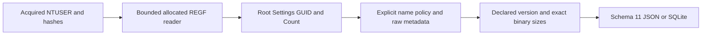

# UserAssist Python CLI

**English** | [한국어](USERASSIST_CLI.ko.md)

The current package is 0.14.0 and every output uses schema 14. Earlier introductions/results below describe their release context; see [system information](SYSTEM_INFO_CLI.md) for the current schema.

Implemented and self-reviewed on 2026-10-16 on codex/python-userassist from caa66102c4c46ebc7ab0e81153c36801bdfc8d67. Package 0.11.0 introduces report schema 11 and an independent UserAssist adapter. The thirteen original EnScript files contain no dedicated UserAssist parser and remain byte-identical to bb476180453c76f7d38e5b6a9f1f025ad2273ce0. Archive refs/manifests and 263 retrospectively reconstructed 2017 commits remain preserved; this work uses its actual date.

## Run and Input Preservation

Supply explicit acquired stable NTUSER.DAT REGF files, independent of filename. Python 3.10+ is declared; macOS/Python 3.14 was exercised. UserAssist uses only the standard library; the existing EVTX adapter still needs its optional extra.

```sh
python3 -m plaintrace --userassist /path/to/NTUSER.DAT --output userassist.json
python3 -m plaintrace --userassist /case-a/NTUSER.DAT --userassist /case-b/NTUSER.DAT --format sqlite --output userassist.sqlite
python3 -m plaintrace --userassist /path/to/NTUSER.DAT --strict
python3 -m venv .venv
.venv/bin/python -m pip install .
.venv/bin/plaintrace --userassist /path/to/acquired.bin
```

```powershell
py -m venv .venv
.venv\Scripts\python.exe -m pip install .
.venv\Scripts\plaintrace.exe --userassist C:\acquired\NTUSER.DAT --output userassist.json
```

JSON defaults to stdout. SQLite needs --output; existing outputs, input paths and reserved SQLite sidecars cannot be overwritten. Strict mode writes the report and returns 1 for any warning; normal success returns 0. Fatal input/output errors return 2 without publishing partial report files. A warning is diagnostic, not proof of corrupt or malicious evidence. Even a normal session-control value produces a warning because its payload remains opaque.

The bounded reader hashes before/read/after and never modifies input. It accesses only supplied files and does not scan profiles, query a live registry, execute targets or access a network. Stable hashes do not prove atomic acquisition, authenticity, completeness or chain of custody. UserAssist sources follow all previous source groups; repeated inputs retain separate source IDs and supplied order. A hive supplied to multiple adapters is not automatically joined or attributed to a user.

## Registry Scope and Name Decoding

The root is Software\Microsoft\Windows\CurrentVersion\Explorer\UserAssist. Root, optional Settings, direct brace-delimited GUID groups and their direct Count children become key records. All syntactically valid GUID groups are considered without a GUID-to-application/OS mapping. Root/group/Settings/Count values retain raw metadata. Non-GUID children, non-Count group children and Settings/Count descendants are diagnosed without traversal. A group without Count is retained with a warning; a missing root yields a warning and no records. An existing empty root is a valid container.

Version is read only from each GUID group as an exact four-byte REG_DWORD. Only versions 3 and 5 are decoded; absent, wrong-type/size or unsupported versions retain Count values with null interpreted metrics. Layout is never selected from payload length alone. All Count values remain observations, including empty/default names and malformed values, without ranks, sorting or deduplication.

Settings/NoEncrypt absent or exact REG_DWORD zero selects ASCII ROT13 name decoding. Exact REG_DWORD one preserves plain names. Any other type/length/value makes name_encoding unknown: decoded names and metrics stay null to avoid confusing controls with entries. This is the documented default, not detection of every historical cipher. ROT13 changes ASCII letters only; Unicode, punctuation, GUID text and environment tokens stay literal. NoEncrypt and NoLog values remain raw metadata; current settings do not prove the encoding or logging state when older entries were written. NoEncrypt describes the analysis policy, not validation of each stored name.

The decoded UEME_CTLSESSION name, compared case-insensitively, is retained as session_control with an opaque payload and no run metrics, even when its size matches a normal entry. Other names are literal labels, not resolved paths or verified application identities. No environment/Known Folder/CLSID expansion, shortcut resolution, app lookup or user/session attribution occurs. Windows 7 beta Vigenère and mixed historical encoding states are unsupported.

## Binary Fields and Interpretation

Only exact-size REG_BINARY values with a supported declared version and known name policy receive parsed status. Wrong types/sizes and unsupported versions retain the whole payload as opaque data; no prefix recovery, trailing-byte acceptance or signature carving occurs.

| Version | Exact bytes | Preserved fields at logical offsets |
| --- | --- | --- |
| 3 | 16 | first DWORD at 0, run counter at 4, FILETIME at 8 |
| 5 | 72 | first DWORD at 0, run counter at 4, focus-related DWORDs at 8/12, FILETIME at 60; opaque ranges 16..59 and 68..71 |

All DWORDs are unsigned raw values. No five-count legacy subtraction, sentinel correction, focus-duration conversion, ordering or frequency estimate is applied. first_dword_raw is deliberately neutral because its meaning differs between layouts. focus_count_raw and focus_time_raw expose common focus-related offsets without asserting universal semantics, time units or reliable active-use duration across GUID/Windows variants. Opaque version-5 ranges are concatenated in order; value_data_hex preserves their original locations and every byte. No floating-point fields are interpreted.

last_run_filetime_raw preserves exact unsigned decimal 100 ns ticks. last_run_at is a UTC microsecond display using integer division; zero is null, overflow warns and stays null, and the remaining 100 ns digit is retained only in raw ticks. This is the stored layout's last-run field, not independent proof of successful execution. Key last-write is separate in keys and is never copied to entries or substituted for missing run time. Counters and timestamps can be stale, reset or manipulated; these records are not an exhaustive process history or proof that a person launched an application. No ownership, execution success, active session or cross-artifact correlation is inferred.

## Schema 11 and Architecture

Every JSON format_version and SQLite user_version is now 11, including reports without UserAssist. Version 11 adds userassist_keys/userassist_entries and counts while preserving existing artifact field meanings. Old reports are not migrated; consumers must inspect the schema. Sources use source_kind userassist, schema_family registry_ntuser, full-file sha256 and null browser/database/WAL fields.

| Collection/table | Fields |
| --- | --- |
| userassist_keys | source_id, record_id, key_path, key_role, parent_key_id, group_guid, format_version, key_last_written, key_last_write_raw, raw_values |
| userassist_entries | source_id, record_id, key_id, key_path, group_guid, format_version, value_name, name_encoding, decoded_name, value_type, status, first_dword_raw, run_count_raw, focus_count_raw, focus_time_raw, last_run_at, last_run_filetime_raw, opaque_data_hex, value_data_hex |

Key roles are root/settings/group/count. Key-local format_version is the stored UserAssist Version, separate from report schema 11; root/settings use null. group_guid retains literal group spelling. name_encoding is rot13/plain/unknown. Entry status is parsed/session_control/unsupported_version/wrong_type/wrong_size/unknown_name_encoding; session recognition precedes version/type checks, then unsupported version, wrong type/size and unknown encoding. parsed only means this narrow binary layout was decoded. Null fields are unavailable, not zero counts. Keys preserve raw_values objects with value_offset, name, type and data_hex. value_name is the original stored name as REGF-decoded text, not raw name bytes; the input hash identifies the full original file.

Key/entry record_id is the physical nk/vk cell-header offset as decimal text scoped by source_id. parent_key_id links root/group/count; key_id connects each entry to Count. SQLite enforces source, key-parent and composite entry-key foreign keys with unique key identities. Objects/arrays are JSON values and SQLite JSON text; inserts bind parameters. Raw version/control/data values remain available even on unsupported observations. Logical payload offsets cannot be added to vk offsets to infer physical data locations because data can live in a separate cell.



[userassist.py](../plaintrace/userassist.py) reuses [registry_hive.py](../plaintrace/registry_hive.py) and the FILETIME converter in [binary.py](../plaintrace/binary.py); existing decoder semantics are unchanged. [execution.py](../plaintrace/execution.py), [cli.py](../plaintrace/cli.py), [model.py](../plaintrace/model.py) and [exports.py](../plaintrace/exports.py) assemble sources and outputs. Limits per hive: 64 MiB input, 250000 scanned cells, 100000 native key/index/value items, 4096 values per accessed key, 16344 bytes per value and 16 MiB accessed value/name bytes. Adapter limits are 1024 keys, 10000 entries and 32 MiB serialized adapter output. The conservative scope check reserves two keys per direct non-Settings child, including unsupported names. Output includes raw Count data in keys and entries; the serialized limit is checked after allocation. Combined reports remain in memory without a native timeout/memory sandbox; valid large inputs may be rejected.

## Tests, Review and Remaining Validation

[Tests and self-review](USERASSIST_TESTS.md) cover 32 new synthetic cases; all 346 Python tests pass with the EVTX extra. Portable testing does not validate EnCase. Original EnScript bytes, archive tag/manifests and reconstructed history are preserved.

Actual acquired NTUSER UserAssist across Windows/GUID/version/settings combinations, Windows/Linux execution, Python 3.10, independent real-record semantics, large-input performance and acquisition races remain unvalidated. Unknown versions, beta ciphers, mixed encoding states, deeper scopes and native REGF 1.6/segmented big data/volatile/link/deleted/slack structures are unsupported. No dirty-hive log replay, repair, recovery, process execution or user/artifact joins occur. EnCase compilation/execution remains unverified; existing artifact limitations remain.

## References

The [libyal UserAssist research](https://github.com/libyal/winreg-kb/blob/main/docs/sources/explorer-keys/User-assist.md) documents versions, settings, controls and uncertain fields. The [Plaso UserAssist implementation](https://github.com/log2timeline/plaso/blob/main/plaso/parsers/winreg_plugins/userassist.py) provides a comparison for strict versions/types/sizes; this adapter deliberately retains raw counters and symbolic names without its count adjustment or path expansion. Neither is a universal Windows compatibility guarantee. No implementation source is vendored. See [archive analysis](ANALYSIS.md).
